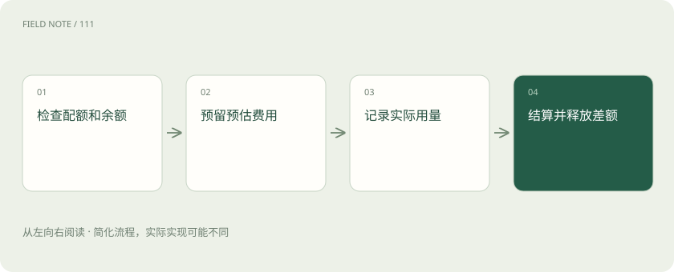

# 配额、预算与计量：三个不同的控制面

> 配额限制某段时间的请求或词元使用，预算约束金额，计量记录实际消耗。

专题：接入平台 · 整理于 2026-11-04

## 前置阅读

- [推理网关：为什么企业不直接调用模型？](gateway.md)

## 先用一个类比理解

像餐厅订位、消费上限和结账单：分别管容量、钱与实付。

类比只帮助建立直觉，不等同于完整机制。

## 一图看懂

## 概念边界

配额限制某段时间的请求或词元使用，预算约束金额，计量记录实际消耗。它们彼此关联却不等价：请求数相同，输入长度、输出长度和模型价格不同，费用可能完全不同。

## 内部怎样运作

平台可以在请求前预估占用并预留预算，结束后按实际用量结算和释放差额。流式断连、供应商延迟上报与失败计费需要独立处理。租户、应用和人员维度应避免重复计算。

## 把机制放进具体场景

假设剩余预算100元，一次请求预计最多消耗8元，就先预留8元，可用余额变成92元。实际结算5元后释放3元，余额为95元。若请求数配额尚有余量但预算不足，平台仍应按金额约束拒绝或降级。

## 取舍与容易忽略的限制

预算控制涉及并发竞态。多个请求若同时读取余额并各自判断够用，却没有原子预留，可能共同花掉超出限额的金额。预估上限也应考虑最大输出、工具链后续调用和供应商计费规则。对账时需保留模型、价格版本与用量来源，才能区分估算差额、延迟上报和真正的计量错误。

## 放在一起对比

| 方式或概念 | 主要作用 | 关键边界 |
| --- | --- | --- |
| 配额 | 请求或词元用量 | 不能直接代表金额 |
| 预算 | 金额上限 | 需要预留和结算 |
| 计量 | 记录实际用量 | 需与账单对账 |

## 真实场景

应用把一次用户请求拆成检索、生成和复核三次模型调用时，应累计整条任务费用；只计最后展示答案的调用，会系统性低估成本。

## 常见误区

页面显示的估算费用不能当财务账单，限流也不能保证绝不超支。

## 想一想

请求次数没有超限，为何仍可能被拒绝？

查看解释

次数配额、词元配额、并发限制与金额预算是不同约束。

## 关联阅读

- [推理网关：为什么企业不直接调用模型？](gateway.md)
- [TTFT、吞吐、P95 和成本：一张性能报告怎么看？](latency-cost.md)
- [重试与熔断：故障时怎样避免越救越忙](retry-circuit.md)

## 原始资料

- [users](https://docs.litellm.ai/docs/proxy/users)

原创讲解；图示和类比经过简化，数字示例不代表实测。工具功能以对应版本官方资料为准。
