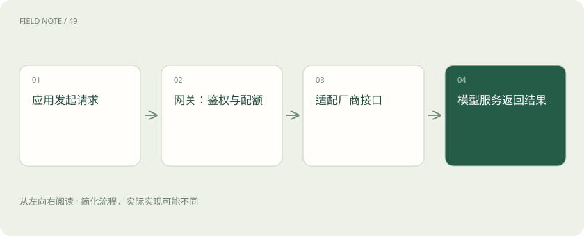

# 推理网关：为什么企业不直接调用模型？

> 网关把多种模型服务接入统一入口，集中管理访问、可靠性和用量。

专题：接入平台 · 整理于 2026-11-04

## 先用一个类比理解

公司前台检查访客身份、记录来访、联系部门。前台本身不完成部门的专业工作；网关通常也不负责运行模型的主要计算。

## 一图看懂

## 统一入口不等于统一全部能力

不同厂商的参数、工具调用与多模态格式可能不同。适配层可以统一常用接口，但不能保证每项特性都完全一致。切换模型后仍应验证应用行为。

## 治理能力解决多人共用问题

身份认证回答“你是谁”，授权回答“你能用什么”，限流控制请求速率，配额或预算控制累计用量。密钥应在服务端保护，日志中的提示词也可能含敏感信息。

## 可靠性有代价

网关可以处理超时、重试和故障降级，但重试可能增加费用和延迟。已经开始流式输出后再换模型更复杂；工具动作重试还需要防止重复执行。

## 真实场景

研发和客服共用模型平台时，各自使用应用密钥与预算。财务看聚合成本，应用只看到自己有权访问的模型。

## 常见误区

网关不是 GPU 推理引擎；限流、预算和账单统计也不是同一个计数器。

## 想一想

统一 API 后能保证所有模型行为一致吗？

查看解释

不能。上下文、参数和能力边界仍可能不同，需评测验证。

## 原始资料

- [LiteLLM · 网关文档](https://docs.litellm.ai/docs/)

原创入门讲解；类比和示意图经过简化。工具功能以对应版本官方文档为准。
