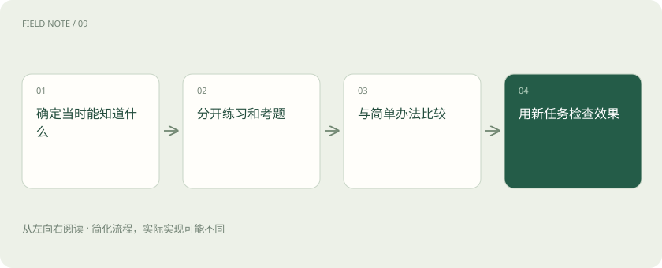
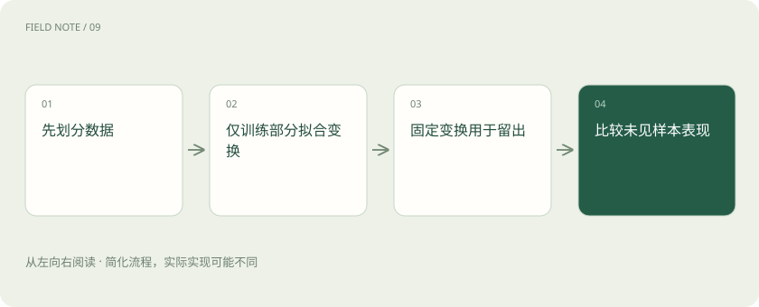
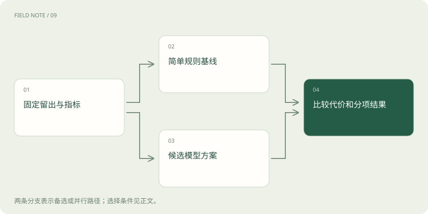

# 泛化与数据泄漏：高分为什么可能没有用

> 沿生鲜店备货案例理解训练、验证、测试的分工，识别未来信息、重复实体和反复调参造成的虚假好成绩。

专题：AI 基础 · 整理于 2026-11-05

## 前置阅读

- [机器学习任务地图：先确定要预测什么](ml-task-map.md)

## 先用一个类比理解

像准备一场真正的考试：练习题可以讲解，模拟题帮助调整方法，最终考卷不能提前参与备课。

类比只帮助建立直觉，不等同于完整机制。

## 一图看懂

## 先说清楚要泛化到哪里

泛化是模型把从已有材料学到的规律用于未见样本的能力。“未见”不能只解释为行号不同：新的一天、新的顾客、新的门店，分别提出不同要求。一个熟悉老店客流的模型，未必能处理完全不同商圈的新店。先写清未来使用对象，才能决定什么数据应该被保留作考题。

本站用生鲜店次日备货作教学例子，不报告真实实验成绩。预测发生在前一天闭店后，届时能知道历史销量、当前库存和已经发布的天气预报，却不知道次日实际销量。这条时间边界决定了哪些字段可以进入模型；若需求改为当天中午动态补货，允许的信息也会随之改变。

## 训练、验证和测试各自负责什么

训练集用于拟合参数，验证集帮助比较模型和选择设置，测试集用于最后估计已选方案的表现。三者的区别是参与决策的用途，不是文件夹名称。团队看了测试结果又修改特征、阈值或提示后，这份数据已经参与开发，不能继续当作完全独立的最终证明。

对次日备货，可以用较早时期开发，再用较近时期比较方案，最后留一段更晚时期验收。窗口长短取决于季节性和样本量，不存在通用比例。样本很少时可用适合任务结构的交叉验证，但每折中的预处理和调参仍需守住隔离边界。

## 随机切分为何可能回答错问题

随机切分适合某些近似独立同分布的样本，却可能把同一顾客、同一事件的不同记录放到两边。模型因此见过与考试极相似的信息，测得的更像熟悉对象的重复表现。若真实目标是服务新顾客，应按顾客分组；若目标是未来日期，应按时间切分并检查特征是否跨越预测时点。

生鲜店的连续日期共享节假日和促销背景。把某次促销前后记录随机打散，可能高估对未来新促销的适应能力。按时间回放时，还要留意销量标签的形成时间与统计窗口，避免某个“过去七日”特征意外包含预测日甚至未来日的数据。

## 数据泄漏不只是把答案放进输入

最显眼的泄漏是用次日实际销量预测次日销量。更隐蔽的泄漏来自事后才形成的退款原因、人工复核结论或库存调整结果。这些字段在历史表中与目标高度相关，却无法在真实决策时获得。模型没有学到提前判断，只是读到了事后线索。

还有一类泄漏发生在预处理：先用全量数据计算均值、选择最相关特征，再切训练测试，会把测试分布带入开发。应只在每次训练部分拟合这些步骤，再把已固定的变换用于验证或测试。流水线有助于保持顺序，但不能替你发现一个业务字段实际产生得太晚。

## 欠拟合与过拟合怎样区分

欠拟合意味着当前模型或特征不足以捕捉任务规律，训练和未见样本都表现不佳；过拟合常表现为训练成绩很好而未见样本明显变差。扩大模型、增加训练轮次可能缓解前者，也可能加剧后者，因此“多训练一点”不是通用修复。先检查数据、任务口径和评估方式，再判断容量问题。

学习曲线可以帮助定位：随着训练样本增加，训练误差和验证误差如何变化。如果两者仍有大差距，更多有代表性数据、限制复杂度或正则化可能值得尝试。若两者都差，还要检查标签噪声和业务不可预测部分，不能把所有误差都归咎于模型不够大。

## 基线与指标要匹配错误代价

基线是一个简单、可解释的参考方案，例如沿用上周同一天销量。复杂模型若不能稳定超过它，就需要解释额外成本换来了什么。指标同样要服务决策：平均绝对误差把偏差转成易理解的数量，但生鲜备货中缺货与报损的代价不同，单一平均误差可能隐藏业务损失。

可以同时报告总偏差、缺货方向的错误、报损方向的错误，以及节假日和普通日的分项结果。预测需求与观察销量也不总相同：卖完后没有记录到的需求属于不可见部分。若直接把销量当作真实需求，模型可能不断低估热销商品，形成错误反馈。

## 交叉验证不是反复看同一考卷的许可

交叉验证通过多次划分估计表现波动，有助于减少某一次划分的偶然性。它不会自动消除分组相关、时间泄漏或错误指标。调参越多、试验路线越多，开发者越容易适应当前验证集合，所以最终仍需要与实际用途匹配的独立检查。

报告应说明比较过多少方案、是否按实体分组、预处理是否在每折独立拟合。若某方法只在一次切分胜出，其他时期并不稳定，结论应保持有限。需要对整个调参过程估计泛化时，可以考虑嵌套交叉验证；小白读者先理解内层选方案、外层评选方案过程即可。

## 上线后仍要检查分布变化

测试集只能描述被覆盖的条件。开新门店、换商品组合、改变促销政策，都可能让未来输入和目标关系发生变化。应持续观察输入分布、业务结果与各类错误，并保留简单基线作对照。分布变化并不总意味着必须重训，可能先需要修复数据字段或调整业务流程。

这家店可以定期回放最近已经完成的日期，把旧模型、候选模型与简单规则放到相同历史条件下比较。新模型若只在促销季有收益，应限定适用范围，而不是全面替换。部署建议属于本站案例设计；它说明如何组织证据，不承诺某个具体算法一定优于现有备货方法。

## 图解：预处理也需要隔离

均值、特征选择与其他学习式预处理都应在训练边界内拟合；图中是一次划分的示意。

## 图解：同一条件下比较方案

基线与候选从相同条件出发，各自预测后汇总比较；不是先执行基线再训练候选。

## 放在一起对比

| 评估问题 | 合适的隔离思路 | 需要排查的泄漏 |
| --- | --- | --- |
| 未来日期预测 | 按时间向前回放 | 未来字段、事后标签与窗口越界 |
| 新顾客或新门店 | 按对象分组留出 | 同一对象的近似重复记录 |
| 选择模型和参数 | 训练内部拟合与验证 | 用测试集反复改方案 |
| 最终上线判断 | 独立样本及业务代价 | 只展示最好一次实验 |

## 真实场景

教学反例：历史表包含“次日闭店剩余库存”。离线模型预测销量十分准确，但这个字段在前一天无法取得。删去它并按时间回放后，才是在检验真实备货能力。

## 常见误区

把数据文件命名为 test，或把样本随机打散，都不能保证它与开发过程独立。

## 想一想

同一顾客的多次记录随机落入训练和测试，评估的可能是什么能力？

查看解释

更接近对熟悉顾客的新记录进行预测；若目标是新顾客，应另按顾客分组检查，不能直接把现有成绩外推。

## 关联阅读

- [训练数据生产：从原始材料到可追溯版本](data-production.md)
- [评测集怎么分：避免把背过的题当能力](eval-splits.md)
- [训练数据质量：先修教材再加课时](data-quality.md)

## 原始资料

- [scikit-learn：常见陷阱与数据泄漏](https://scikit-learn.org/stable/common_pitfalls.html)
- [scikit-learn：交叉验证](https://scikit-learn.org/stable/modules/cross_validation.html)

原创讲解；图示和类比经过简化，数字示例不代表实测。工具功能以对应版本官方资料为准。
