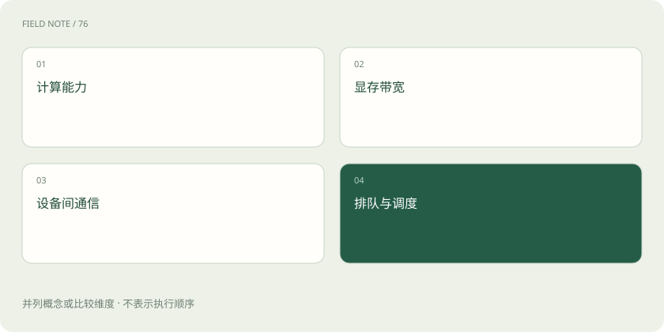

# 算力、带宽与通信：GPU 利用率高，为什么还是慢？

> 模型慢，可能慢在计算、读取数据、设备通信，也可能只是排队太久。

专题：推理设施 · 整理于 2026-11-04

## 先说这篇在讲什么

餐厅出菜慢，可能是厨师忙不过来，也可能是食材运得慢、两间厨房交接慢，或订单已经排了很长队。GPU 服务也有类似的不同瓶颈。只看“GPU 利用率很高”，还不足以知道该怎样加速。

## 先看一个具体例子

服务换成更多 GPU 后平均吞吐增加，但某个交互用户的 Token 间隔变大。可能是并行通信成本或排队策略变化，不能只看卡数下结论。

## 遇到陌生概念，可以先读

展开前置阅读建议

- [GPU、显存和量化：模型为什么装不下？](gpu-memory.md)

## 先用一个类比理解

工厂机器再快，原料运输太慢也会停等；多开机器还需要更多协调。观察一个“忙碌率”不足以定位整条生产线。

类比只帮助建立直觉，不等同于完整机制。

## 一图看懂

## 计算慢：运算本身需要时间

模型要做大量数值运算。输入长度、模型结构和一次同时处理多少请求，都会影响运算量。如果主要时间花在这里，更合适的计算实现或硬件可能有帮助。

## 读取慢：数据跟不上计算

模型计算还要不断读取权重和中间结果。带宽可以先理解为每秒能搬多少数据。如果运算单元经常等数据，单纯增加计算能力未必有效。生成回答时反复访问前文缓存，也可能增加读取压力。

## 通信慢：多张卡要彼此交接

模型分在多张 GPU 上时，设备常要交换计算结果。卡之间连接慢、分工不合适，可能让大家互相等待。所以两张卡不一定刚好比一张卡快一倍，有时只是解决单卡放不下的问题。

## 别把排队时间误认成模型计算时间

用户等待包含请求排队、模型处理、网络传输和页面显示。应分别看这些阶段。如果大部分时间在队列里，改一点运算代码可能帮助不大；如果网络慢，服务器计算快也不代表用户很快看到内容。

## 读完先记住这一句

先找最慢的环节，再决定增加算力、带宽、设备或调整调度。

## 常见误区

显存占用高只代表分配了空间，不等于有效计算多；不同监控工具的利用率定义也可能不同。

## 想一想

GPU 算力翻倍，回答速度一定翻倍吗？

查看解释

不一定。如果主要等待显存读取、设备通信或队列，提升峰值算力未必解决瓶颈。

## 关联阅读

- [TP、PP、DP、EP：多张卡究竟分了什么](parallelism-types.md)
- [连续批处理与分块预填充：让不同请求一起走](batching-prefill.md)
- [PD 分离的下一层：KV 传输和容量配比](pd-kv-capacity.md)

## 原始资料

- [NVIDIA · GPU 性能基础](https://docs.nvidia.com/deeplearning/performance/dl-performance-gpu-background/index.html)
- [vLLM · 性能调优](https://docs.vllm.ai/en/latest/configuration/optimization/)

原创讲解；图示和类比经过简化，数字示例不代表实测。工具功能以对应版本官方资料为准。
