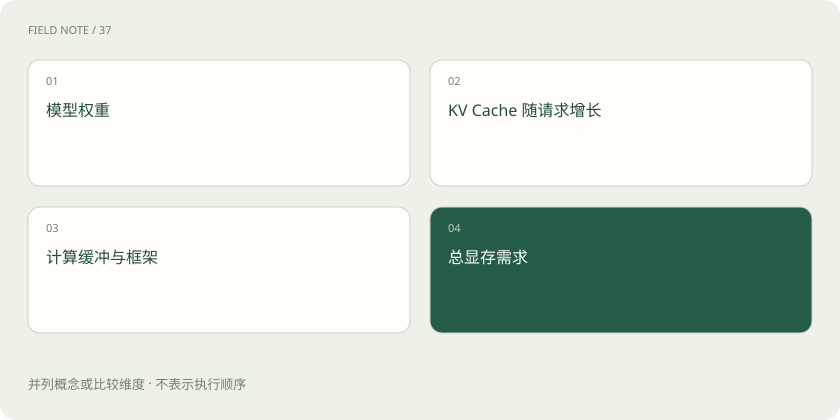

# GPU、显存和量化：模型为什么装不下？

> 运行模型既要放得下参数，也要为当前请求和计算过程留出空间。

专题：推理设施 · 整理于 2026-11-04

## 先说这篇在讲什么

下载一个模型文件有多大，不等于运行时只需要同样多的显存。显存是 GPU 旁边用来暂存计算数据的空间。模型参数要占一部分，正在处理的对话和临时结果还要继续占空间。

## 先看一个具体例子

同一模型，短问答能运行，长文档加多人并发却显存不足，原因可能是 KV Cache 随序列长度和并发增大。

## 遇到陌生概念，可以先读

展开前置阅读建议

- [训练、微调与推理：学习和使用是两回事](training-inference.md)
- [Token、上下文和幻觉：为什么它会忘，也会编？](tokens-context.md)

## 先用一个类比理解

显存像厨房台面：食材箱是权重，正在制作的订单是 KV Cache，锅具和操作空间也是必需的。只量食材箱大小，无法保证厨房运转。

类比只帮助建立直觉，不等同于完整机制。

## 一图看懂

## GPU 和显存各负责什么

GPU 擅长同时执行很多类似的数值运算，模型计算因此经常使用它。显存用于快速存放 GPU 正在使用的数据，可以类比工作台旁的材料区。计算能力与存放空间是不同指标：桌面很大，不保证加工速度快；机器很快，也可能因为放不下材料而无法开工。

## 参数量怎样影响基本存储

参数是模型内部的数值。假设有 70 亿个参数，每个数使用 2 字节，仅这些数就约占 140 亿字节。这是粗略说明，还没算计算过程中的其他内容。模型文件的实际组织方式也会影响大小，不能只凭“7B”就承诺一定能在某张卡上运行。

## 为什么对话变长，还会继续占显存

生成回答时，模型会保存部分前文计算结果，方便后面接着算，常见的就是 KV 缓存。输入越长、同时处理的请求越多，需要的空间往往越大。另外还有临时计算区、预留空间和服务进程开销，不能把显存全部按参数大小分完。

## 量化：用更省空间的数表示模型

量化会使用较低精度的数值表示部分权重或其他数据，通常能减少存储，有时也能改善运行效率。可以类比减少每个测量值保留的小数位数，但真实方法更复杂。省下多少、速度是否改善、答案有没有受影响，要结合硬件和具体任务判断。

## 读完先记住这一句

能装下权重文件，是运行模型的起点，不是全部容量要求。

## 常见误区

不要把模型下载文件大小、运行显存、显卡标称容量混为一谈；量化也不保证一定更快。

## 想一想

权重只有 14 GB，16 GB 显卡就一定够吗？

查看解释

不一定，还必须计算运行时缓存、缓冲和工作负载。

## 关联阅读

- [LoRA 与 QLoRA：少改参数也能学习](lora-qlora.md)
- [TP、PP、DP、EP：多张卡究竟分了什么](parallelism-types.md)
- [连续批处理与分块预填充：让不同请求一起走](batching-prefill.md)

## 原始资料

- [Transformers · 量化概览](https://huggingface.co/docs/transformers/quantization/overview)
- [vLLM · Paged Attention](https://docs.vllm.ai/en/latest/design/paged_attention/)

原创讲解；图示和类比经过简化，数字示例不代表实测。工具功能以对应版本官方资料为准。
