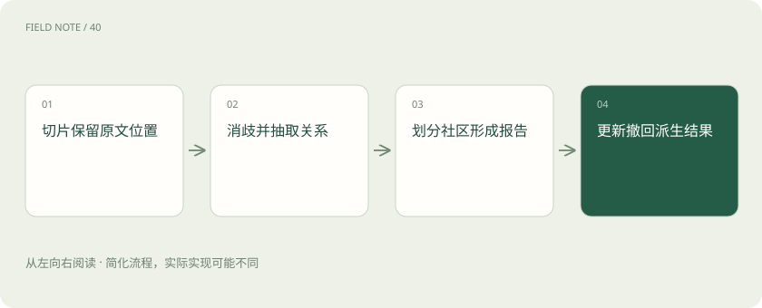
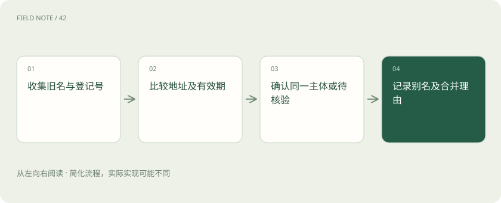
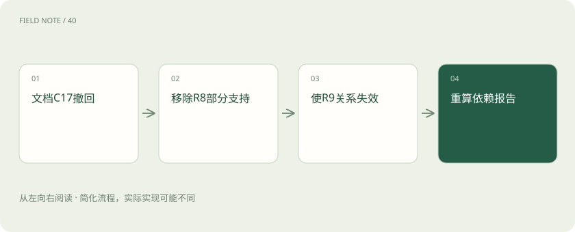

# GraphRAG 索引：从片段到可追溯关系

> 图索引把文本整理成对象、联系和概述，每个重要结论都必须保留可核对的出处。

专题：AI 应用 · 整理于 2026-11-05

## 先说这篇在讲什么

面对许多合同和事故记录，图可以帮我们看见同一企业与不同事件之间的联系。建图并非把名词连起来就结束，还要辨认同名对象、保留时间和出处，并处理权限与撤回。这样图才是可核对的查找工具。

## 先看一个具体例子

沿供应商找到多家工厂后，逐一检查交付单，确认是否在同一时期发生延期。

## 遇到陌生概念，可以先读

展开前置阅读建议

- [RAG：让模型先查资料，再组织答案](rag.md)
- [Recall、MRR 与 nDCG：检索到底好在哪](retrieval-metrics.md)
- [让每个结论都有边界：RAG 的证据责任](deep-rag-evidence.md)

## 先用一个类比理解

像调查员把人物和事件连在白板上，每根线旁仍要标明是哪份材料提供的线索。

类比只帮助建立直觉，不等同于完整机制。

## 一图看懂

## 先确定图要回答什么

图把对象画成节点，把对象之间的联系画成边。图增强检索是利用这些联系寻找材料的一类办法；Microsoft GraphRAG 则是其中一个具体项目。供应链审计可能要找同一供应商联系了哪些工厂，图就能帮助沿线索查找；若只查一个合同编号，普通搜索可能已经足够。建图前先写几个要回答的问题，再决定收集哪些对象和联系。图上的连线表示材料里存在关联，不能单凭连线断言供应商导致了工厂事故。

## 每个片段都要能找到原文

切片是把文件拆成便于处理的小段。合同第七页使用旧公司名，第八页说明更名，拆开后若丢了页码和相邻关系，就很难判断两个名字是否属于同一公司。每段应保存文件编号、版本、页码或文字位置，并有稳定编号。节点是查找线索，原始片段才是核对依据。重新切片时保存新旧对应关系，防止历史答案的引用被指向另一段文字。即使图看起来整齐，也要能从每条关键结论回到具体原句。

## 同名不一定是同一家企业

实体是需要单独识别的对象，例如公司、工厂或设备。实体消歧就是判断两个称呼到底指同一对象还是不同对象。“华南物流”和“华南物流设备”名称接近，却可能是两家公司。先比登记编号、地址、业务范围和时间，再决定合并。旧名与新名若有一致登记编号及更名文件，合并理由比较充分；只有电话号码相同则可能是共用代理服务。证据不足时保留两个对象并标记待核实，比凭名字合并更容易避免假链路。

## 连线必须保留时间和语气

“甲计划给乙供货”“甲正在供货”和“甲不再供货”不是同一事实。抽取关系时应保存双方对象、关系类型、适用时间和原文位置，并区分计划、否定和已发生。模型可能漏掉“不再”，因此不能把自动生成的边直接当成事实。两张交付单支持同一关系时，应分别记录出处，形成一条关系对应多份证据的结构。以后撤掉其中一份，系统才能知道还有没有其他依据，而不是把整条关系无条件删掉或保留。

## 社区只是联系较多的一组对象

社区是按图中连接情况组织出的对象群，不一定对应真实部门，也不代表共同原因。Microsoft GraphRAG 会利用社区形成报告，把多处材料压缩成便于检索的概述。报告可能漏掉少数例外，例如“三家工厂多数交付延期”不能变成“所有交付都延期”。抽查时应列出涉及哪些工厂、哪些月份、哪些交付单。一个供应商位于图中央，也可能只是文件提到它的次数多，不能直接解释为它最有责任或影响最大。

## 撤回文件要追到报告和缓存

合同被撤回后，删除文件本身并不能消除已经生成的描述。需要先找到它的片段，再找到依赖这些片段的关系、实体说明、社区报告和答案缓存。如果某条关系仍有其他有效证据，可以保留关系并移除失效出处。资料变化也可能改变社区，所以要明确哪些部分需要重算。紧急撤回可先让查询排除相关结果，再重建受影响内容。这是需要应用设计和验证的治理流程，不能假设所用项目会自动完成全部工作。

## 看不到原文也可能泄密

权限规定谁能看到什么资料。内部事故报告与公开供应商介绍一起生成摘要后，摘要可能含事故内容，即使不显示原文引用也已经泄露。因此权限检查必须发生在材料进入模型之前，并覆盖节点、关系、片段和报告。可以按可见资料分别构建派生结果，或制定能核验的报告访问规则。公开资料和机密资料混合出的报告不能直接沿用公开标签。按权限分开建图后，各组看到的社区可能不同，这是资料范围不同带来的正常结果。

## 用容易出错的样本验收

准备同名公司、旧名新名、否定供货、过期合同和撤回文件，检查是否误合并、是否漏合并、关系能否回到原句，以及撤回后旧报告是否消失。误合并会造出不存在的供应链，漏合并则会切断真实线索，两类错误应分别记录。存储方式也应按项目实际输出选择：Microsoft GraphRAG 的输出包含 Parquet 表及配置的向量存储；Parquet 是一种表格数据文件格式。采用图增强检索并不必然要求额外部署独立图数据库。

## 图解：实体消歧的判定链

登记标识与时间共同支持身份判断，名称相似只产生候选。

## 图解：撤回一份证据

边的剩余支持决定保留或失效，不能按关联一刀切删除。

## 放在一起对比

| 对象或路线 | 处理依据 | 适用边界或检查点 |
| --- | --- | --- |
| 实体别名 | 登记标识与有效期 | 名称相似不足以合并 |
| 关系事实 | 原句与时间条件 | 边的存在不证明当前有效 |
| 社区报告 | 组成关系及文本单元 | 摘要不能替代原文 |
| 撤回操作 | 派生依赖及残余支持 | 删文件不等于删影响 |

## 读完先记住这一句

图负责组织关联，出处负责让判断能够被核验。

## 常见误区

把连接密集或报告中的概述当成因果证明，跳过原始记录核验。

## 想一想

图上供应商连着多家延期工厂，能证明它导致延期吗？

查看解释

不能。连线只提供关联线索，判断原因还需要原始记录及其他证据。

## 关联阅读

- [把政策文件变成可追责的知识库](deep-rag-corpus.md)
- [从候选召回到证据上下文：检索是一场逐级筛选](deep-rag-retrieval.md)

## 原始资料

- [Microsoft GraphRAG 索引概览](https://microsoft.github.io/graphrag/index/overview/)
- [GraphRAG 输出与出处字段](https://microsoft.github.io/graphrag/index/outputs/)
- [Microsoft GraphRAG 项目](https://github.com/microsoft/graphrag)

原创讲解；图示和类比经过简化，数字示例不代表实测。工具功能以对应版本官方资料为准。
