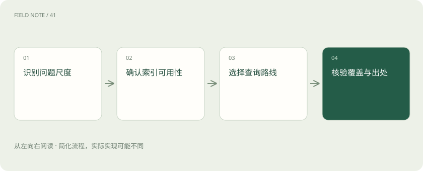
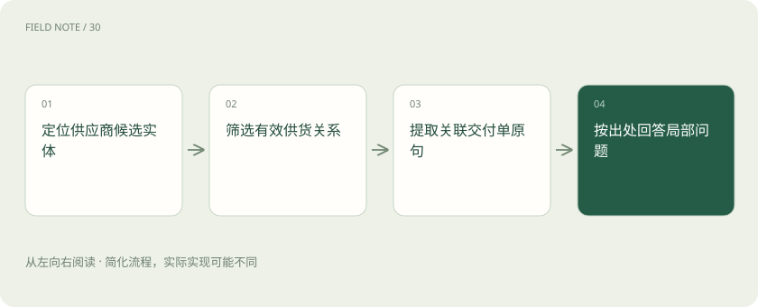
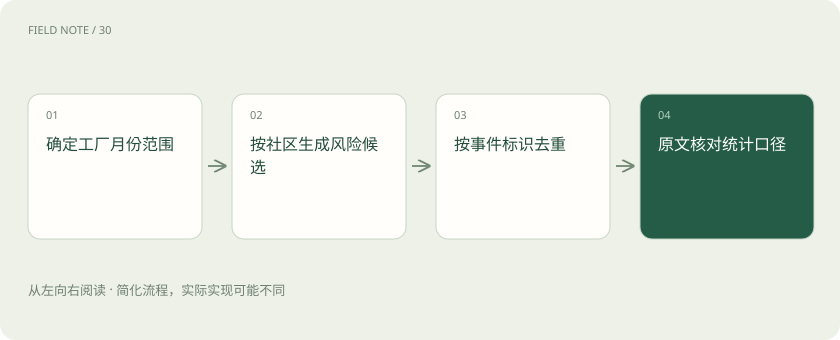

# GraphRAG 查询：问题尺度决定路线

> 依据问题尺度选择Basic、Local、Global或DRIFT，并分别核验覆盖范围、原始证据与查询成本。

专题：AI 应用 · 整理于 2026-11-05

## 前置阅读

- [RAG：让模型先查资料，再组织答案](rag.md)
- [Recall、MRR 与 nDCG：检索到底好在哪](retrieval-metrics.md)
- [让每个结论都有边界：RAG 的证据责任](deep-rag-evidence.md)

## 先用一个类比理解

像查档案馆：查某人的履历适合局部目录，归纳一整年的社会变化需要跨馆藏整理，不能让一叠最相似文件代表全部。

类比只帮助建立直觉，不等同于完整机制。

## 一图看懂

## 先识别问题尺度

质量负责人问“今年各工厂反复出现的交付风险是什么”。它要求跨全语料归纳，不能用最相似的五份事故单代表所有工厂。先写清范围、时间、覆盖单位和输出要求，再决定检索路线。全局问题仍可能受索引缺失影响，全文库索引不等于所有现实事件。

先要求输出风险类别、涉及工厂、时间窗口和例外，才能判断回答是否覆盖目标。若问题转为“某份合同第三条写什么”，就应切到直接文本证据，而非继续全局总结。

## 四种路线的含义

核对当日 Microsoft 文档，Local 面向具体实体及其相关图信息与文本，Global 利用社区报告组织全局归纳，DRIFT 结合社区背景和后续局部探索，Basic 提供基础向量检索路径。这是该项目当前查询分类，不代表所有 graph RAG 产品都提供同名接口。

路线并非质量高低的阶梯。Basic 在精确条款问答上可能更经济；Global 的优势目标是跨资料聚合。这里采用文档概念分类，具体参数和接口须以所用发行版本为准。

## 局部查询走通证据

问“供应商甲与二厂延期有什么联系”，先定位甲的实体候选，再取相关关系和文本单元。若存在两个同名主体，先消歧再展开邻接信息。答案需要合同编号和交付单支持；邻接边只能指示去哪里找，边多并不意味着因果关系更强。

扩展邻居时可限制关系类型与有效期，避免把甲的历史子公司全部塞进上下文。若相关交付事件在第二跳，需明确为什么允许继续展开，以及哪些无关分支被舍弃。

## 全局查询完整示例

对全年事故库先明确纳入一月至十二月的有效记录，再让社区报告提供风险候选，例如物料短缺、运输延误与验收返工。随后回到各类代表记录核对时间与工厂。若只有三厂数据，报告应说“已收录三厂”，不能扩张成集团整体情况。

可先做工厂乘月份的覆盖表，标出无记录单元，再给每个风险类别配两种不同记录类型。这样读者能区分“没有发现事故”与“这个工厂根本没有材料”两种状态。

## DRIFT 的探索边界

DRIFT 从相关社区背景产生初步理解和后续问题，再用局部检索补充细节。它适合主题较宽而仍需细节的问题，但后续问题可能沿着最显眼的社区越走越窄。应记录已经覆盖的风险类别，给探索深度与预算上限，并把尚未验证的问题留在结论之外。

例如首次回答提到运输和仓储，后续问题只追问运输，就应检查是否遗漏仓储的独立证据。探索生成的问题也需要去重，不可把措辞变化算成研究范围扩大。

## 引用需要逐层核验

社区报告里的判断是派生材料，不能仅凭报告编号就断言原始事实已核实。沿报告到关系、文本单元、文档版本追踪，确认引用确实支持句子中的数量、范围与时间。若只有概述支持，标明概述层证据并限制结论强度，不能制造不存在的原文页码。

数量主张尤其危险：三条关系可能来自同一次事故的三份文档。计算事件数之前按事件标识去重，核对报告口径；引用三个文件并不自动等于三个独立事故。

## 成本与基准设计

对同一组实体问题、全局问题和混合问题比较 Basic、Local、Global、DRIFT。记录答案覆盖、证据准确、漏掉的例外、延迟、调用费用和索引开销。资源密集的全局归纳可能改善覆盖，却不保证每种事实题更准确；平均得分还会掩盖局部题退步。

小型评测可按题型分别报分位延迟和单题费用，避免全局问题的长尾被平均值吞没。索引预计算支出也应摊入总成本，否则只比较查询费会偏向重预处理方案。

## 诊断错误归纳

若系统说所有延期都因运输，先查是否只有运输社区进入上下文，再看报告是否遗漏返工，最后检查原始记录是否未入库。三种故障分别属于查询覆盖、摘要损失和数据缺失。不能一看到结论错就换模型，更不能靠扩大输出篇幅掩盖覆盖空洞。

最小定位实验是固定索引和问题，仅替换进入答案的社区集合。如果风险类别恢复，优先处理检索覆盖；若仍缺返工，则打开报告检查摘要，再决定是否回到抽取层。

## 图解：Local查询的证据路径

先确认主体，再沿相关关系取回文本，关系连接不自动证明因果。

## 图解：全局统计的防重

主题归纳与事件统计使用不同口径。

## 放在一起对比

| 对象或路线 | 处理依据 | 适用边界或检查点 |
| --- | --- | --- |
| Basic | 精确条款问题 | 向量相关切片 |
| Local | 特定供应商关联 | 实体关系与原文 |
| Global | 全年风险主题 | 社区报告聚合 |
| DRIFT | 主题背景加细节 | 报告引导局部探索 |

## 真实场景

假设库中东厂十份运输事故、西厂两份返工记录。Basic只命中运输时，不能说全年主要问题只有运输；先检查全局类别覆盖，再回查西厂的返工证据。

## 常见误区

全局覆盖不等于准确统计，社区报告中的多个描述可能对应同一事件。

## 想一想

Global回答为什么仍要回到原始事件？

查看解释

社区报告提供聚合线索，但可能压缩例外并重复表达同一事故。事件数量、时间与因果主张仍应由原始记录核验。

## 关联阅读

- [把政策文件变成可追责的知识库](deep-rag-corpus.md)
- [从候选召回到证据上下文：检索是一场逐级筛选](deep-rag-retrieval.md)

## 原始资料

- [GraphRAG 查询路线](https://microsoft.github.io/graphrag/query/overview/)
- [DRIFT 查询方法](https://microsoft.github.io/graphrag/query/drift_search/)

原创讲解；图示和类比经过简化，数字示例不代表实测。工具功能以对应版本官方资料为准。
