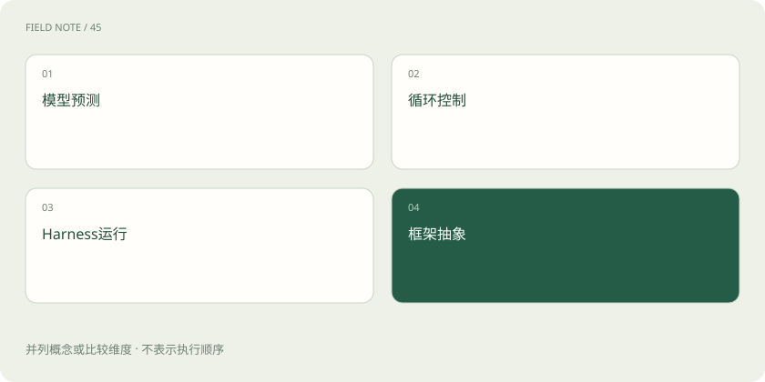
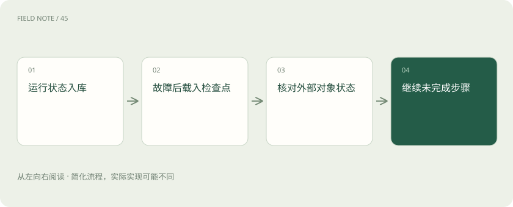

# Harness：让模型持续工作的运行环境

> Harness 替模型准备材料、执行工具、保存进度和管理预算，让长任务能有依据地继续。

专题：智能体 · 整理于 2026-11-05

## 先说这篇在讲什么

让助手连续生成几张报表，和让它回答一个问题很不一样。做到一半断网、等待人工批准、文件已生成却没收到回执，都需要模型之外的软件接住。本篇把模型、工作循环、运行环境和开发框架分开，帮助你理解任务为什么能继续，以及为什么有时应该停下。

## 先看一个具体例子

生成第三张报表时中断，恢复程序先查前两张的文件编号和版本，再核对第三张是否已生成。只有确认未完成，才继续制作。

## 遇到陌生概念，可以先读

展开前置阅读建议

- [Agent 和工作流：从回答问题到执行任务](agent.md)
- [Codex：模型、执行框架与客户端怎样组成编程助手](stack-codex.md)
- [让智能体能停、能恢复、能安全交接](deep-agent-reliability.md)

## 先用一个类比理解

模型像分析员，Harness 像工作室的档案、工具台、进度簿和门禁，框架像搭建这些设施的零件。

类比只帮助建立直觉，不等同于完整机制。

## 一图看懂

## 先分清谁在想、谁在做

模型负责根据输入提出回答或下一步建议。智能体循环负责反复读取结果、再决定下一步。Harness 是让这个循环实际工作的运行环境，负责准备材料、安排工具、保存进度和限制资源；框架则提供开发这些能力的零件与写法。同一模型放在问答页里只需回答一次，放进报表任务却要连续查数、生成文件和核对结果。模型说“我已生成”不会凭空产生文件，宿主程序真的运行工具并取得结果才算数。

## 架构图要能帮助找问题

有的团队把系统分成七层，有的按管理和执行分开，并没有必须照抄的统一层数。假如报表数据错了，要知道是选错对象、取错资料，还是写文件出错，而不是忙着多加一层。每一层都应说明自己接收什么、交出什么以及失败由谁处理。清楚的分工让维护者顺着证据找到故障；画得更复杂只会增加来回排查的距离，不能替代真实职责。

## 每一轮都要重新准备工作材料

Harness 会把任务目标、用户限制、已完成步骤、工具说明和选中的证据整理给模型，不必复制所有历史聊天。但整理不能丢掉关键限制：用户说只生成草稿，摘要不能缩成“准备报告”后就忘记不得发送。外部网页应带来源和版本，作为参考数据进入。当前阶段只展示需要的工具能减少误选，同时还要留下发现后续能力的途径，否则助手可能因为看不到工具而卡住。

## 调用工具要经过真正的调度

模型提出创建报表草稿后，调度器先检查工具是否存在、参数格式、用户身份和目标范围，再交给服务运行。网络失败、参数失败和业务拒绝应分别返回。创建草稿成功却丢失回执时，不能因为助手没看见结果就再建一份。可以用固定业务编号查询原结果；这叫幂等保护，即同一笔请求重复送达仍只产生一次结果。没有这种服务保障时，就先查状态，查不清就保留未知并暂停。

## 沙箱管活动空间，权限管具体业务

沙箱就是给程序划定可接触的文件、网络和资源范围，像安排一间只放必要材料的工作室。业务授权则回答这个用户能否修改这一位客户的等级。程序关在沙箱里，如果拿着全库管理员凭据，仍可能改错很多记录；反过来，有业务权限也不代表能读电脑里的所有文件。只读、写草稿和正式发布应分别开放。审批展示客户编号、旧值新值和影响数量，让人能看懂自己批准什么。

## 中断之后靠检查点接上

检查点是保存下来的任务进度，包括完成步骤、产物编号、外部请求状态、配置版本和下一步条件。第三张表生成时断电，恢复后先核对前两张表的文件和版本，再处理第三张；不能只凭聊天摘要相信“前两张已完成”。如果发出请求后没拿到回执，还要查远端是否成功。资料链接过期或内容更新也应重新获取并标记变化，否则旧证据可能在恢复时被误当成最新结论。例如检查点显示草稿已提交但尚无文件编号，就应把这一步列为待核对，而不是直接跳到审批。恢复程序先询问存储服务，确认结果以后再更新进度，这样审批的人看到的才是真实产物。

## 费用和时间也属于运行状态

预算不只包括模型处理的文字数量，也包括工具次数、总时长和付费业务调用。应给调查、执行以及最后保存进度和交接都留出份额。查不到必要数据可以说明缺口并停止，不要耗尽预算后猜数字。完成、权限不足、无法恢复的错误和达到上限都应有明确出口，结束时释放临时资源。预算跟随任务保存，重新启动不能把已经花掉的钱和次数清零，否则恢复会变成无限续费。

## 运行记录要能回答卡在哪里

实用记录包括输入版本、可见的动作理由、工具参数、结果、耗时和文件校验信息。它能区分模型生成慢、工具排队慢，还是服务出错后重复尝试。比较不同版本时，也要记录模型、提示和工具配置，否则无法判断哪个变化带来问题。无需让模型公开隐藏思考来完成这些检查。Harness 因此远不只是过滤危险文字的防火墙：材料准备、执行安排、资源管理和故障恢复，都直接决定报表是否交得出来。

## 图解：四种责任不能互相替代

比较的是职责：预测产生候选，循环推进任务，Harness 提供执行环境，框架提供开发抽象。

## 图解：Harness的关键检查

恢复链路需要重新核对外部状态，不能只恢复模型看到的摘要。

## 放在一起对比

| 责任环节 | 具体判断依据 | 对应处置 |
| --- | --- | --- |
| 分层图是一种教学地图 | 把企业智能体画成七层，有助于分开界面、编排、模型、工具、数据和治理责任，但七层不是行业统一标准 | 团队也可以按控制面与执行面划分 |
| 沙箱与授权是两道不同的门 | 沙箱限制进程能接触哪些文件、网络和资源；授权判断当前用户能否对指定对象实施动作 | 一个隔离进程仍可能使用过宽的业务凭据，因此不能用沙箱替代权限 |
| 预算沿生命周期消耗 | 预算包括 Token、工具次数、运行时长与业务调用成本 | 开始前为探索、执行和收尾预留份额；执行中发现证据不足时，可以停止并报告缺口，而非耗尽全部预算后输出猜测 |

## 读完先记住这一句

持续工作靠运行环境保存事实和安排执行。

## 常见误区

聊天里说过“已完成”，不能替代文件、回执与外部状态。

## 想一想

Harness 为什么不只是安全过滤器？

查看解释

它除了检查权限，还要准备下一轮材料、调用服务、存进度、安排恢复与控制预算，否则安全的任务也可能永远做不完。

## 关联阅读

- [上下文工程：在有限窗口里保住关键事实](context-engineering.md)
- [智能体设计模式：按任务结构选择控制方式](agent-design-patterns.md)

## 原始资料

- [Anthropic：上下文工程](https://www.anthropic.com/engineering/effective-context-engineering-for-ai-agents)
- [Anthropic：构建有效智能体](https://www.anthropic.com/engineering/building-effective-agents)
- [Anthropic：长期任务 Harness](https://www.anthropic.com/engineering/effective-harnesses-for-long-running-agents)

原创讲解；图示和类比经过简化，数字示例不代表实测。工具功能以对应版本官方资料为准。
