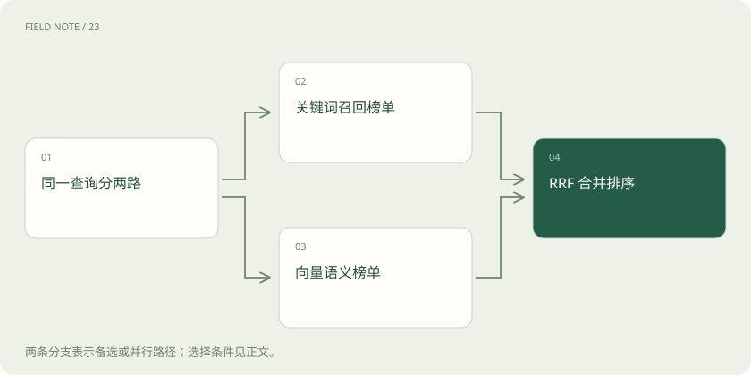

# 混合检索与 RRF：让关键词和语义互补

> 关键词检索擅长精确名称、编号和罕见词，向量检索更容易处理不同说法表达相近意图。

专题：AI 应用 · 整理于 2026-11-04

## 前置阅读

- [RAG：让模型先查资料，再组织答案](rag.md)

## 先用一个类比理解

像两位馆员分别按书名和主题找书，再按各自榜单合并推荐。

类比只帮助建立直觉，不等同于完整机制。

## 一图看懂

## 概念边界

关键词检索擅长精确名称、编号和罕见词，向量检索更容易处理不同说法表达相近意图。混合检索先分别产生候选，融合层再形成一个排序列表，不是把两类原始分数随意相加。

## 内部怎样运作

RRF 根据结果在各列表中的名次累计贡献，避免直接比较不可比的分值。候选窗口决定哪些文档有机会被融合，窗口外材料无法凭空出现。融合还需要处理相同文档标识、过滤条件与访问权限。

## 把机制放进具体场景

假设 RRF 的 k=60，文档甲在两榜排名1和10，分数为1/61+1/70≈0.03068；乙排名3和3，得2/63≈0.03175，因此乙在前。原始相关性分值不同并不妨碍融合，但榜单外的材料没有贡献。

## 取舍与容易忽略的限制

名次融合弱化了不同分值尺度的差异，但也会丢掉原始分数间距的信息。两份榜单若高度相似，融合收益可能有限；若都没有召回关键材料，则融合不能修复覆盖缺口。实际使用还需统一过滤范围、文档标识和去重规则，否则同一证据可能被拆成多个条目占据候选位置。

## 放在一起对比

| 方式或概念 | 主要作用 | 关键边界 |
| --- | --- | --- |
| 关键词 | 精确名称和编号 | 不同说法可能漏检 |
| 向量 | 语义接近 | 精确限制可能混淆 |
| RRF | 融合不同榜单名次 | 不能补回榜外材料 |

## 真实场景

设备报错代码适合精确关键词匹配，而“机器突然不转了”需要语义关联。把两路候选合并后再检查条件，可兼顾编号和自然语言描述。

## 常见误区

混合检索扩大覆盖的同时可能引入无关材料，应按问题类型分别评价。

## 想一想

RRF 为什么不直接把两路原始分数相加？

查看解释

不同检索器分值尺度可能不相容，RRF 主要利用名次进行融合。

## 关联阅读

- [解析与切块：知识库先要读对文档](rag-parsing.md)
- [重排：候选找到了，为什么还要再排一次](reranking.md)
- [Recall、MRR 与 nDCG：检索到底好在哪](retrieval-metrics.md)

## 原始资料

- [reciprocal rank fusion](https://www.elastic.co/docs/reference/elasticsearch/rest-apis/reciprocal-rank-fusion)

原创讲解；图示和类比经过简化，数字示例不代表实测。工具功能以对应版本官方资料为准。
