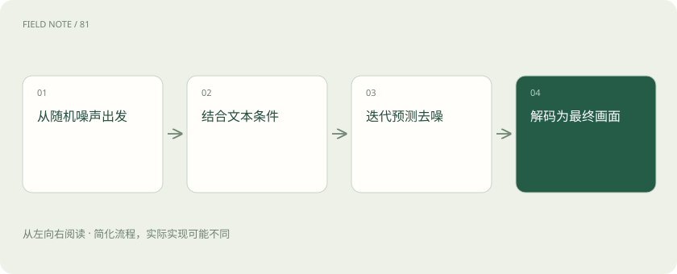

# 图像扩散：从噪声逐步形成画面

> 典型扩散生成先学习如何从带噪表示预测去噪方向，生成时逐步把随机状态变成图像。

专题：多模态 · 整理于 2026-11-04

## 前置阅读

- [AI、机器学习、大模型，到底是什么关系？](ai-map.md)

## 先用一个类比理解

像逐渐擦掉雾气让轮廓显现，但每一步都由学到的规律引导。

类比只帮助建立直觉，不等同于完整机制。

## 一图看懂

## 概念边界

典型扩散生成先学习如何从带噪表示预测去噪方向，生成时逐步把随机状态变成图像。潜空间扩散在压缩表示中进行主要运算，再解码到像素；这与语言模型逐词元生成的路径不同。

## 内部怎样运作

文本条件引导画面内容，采样步骤、引导强度和随机种子影响结果，但不同实现参数含义未必相同。图像编辑还可加入掩码、结构或参考图条件，约束越多也不保证每处细节都被保持。

## 把机制放进具体场景

生成维修海报时，模型可能画出逼真的设备，却把按钮标签拼错。添加参考图或局部掩码可以约束结构，但最终仍要核对文字、接口位置和安全标识；清晰度提高并不会自动修复这些语义错误。

## 取舍与容易忽略的限制

生成条件越复杂，冲突也可能越多。文本要求改变背景，而参考图要求保持整体结构时，模型需要在约束间折中；局部编辑的边界附近还可能产生不连续。随机种子便于控制某些重复试验条件，却不能保证跨版本完全重现。评估时应分别看画质、指令遵循、结构保持和文字准确性。

## 真实场景

想把设备海报背景换成厂房，又要求铭牌完全不变，应重点检查铭牌区域是否被重绘。视觉上相似不能替代逐字核对型号与额定参数。

## 常见误区

画面逼真不能证明事件真实，清楚的文字和精确数量也可能生成错误。

## 想一想

扩散模型是否像语言模型一样逐字画出图片？

查看解释

典型扩散并非逐字生成，它迭代更新带噪图像或潜在表示。

## 关联阅读

- [视觉理解与 OCR：看见文字不等于读懂表格](vision-ocr.md)
- [视频理解：多看几帧还要理解时间关系](video-understanding.md)
- [文本、多模态、推理模型与开源权重，怎么区分？](model-choices.md)

## 原始资料

- [Hugging Face · conditional image generation](https://huggingface.co/docs/diffusers/en/using-diffusers/conditional_image_generation)

原创讲解；图示和类比经过简化，数字示例不代表实测。工具功能以对应版本官方资料为准。
