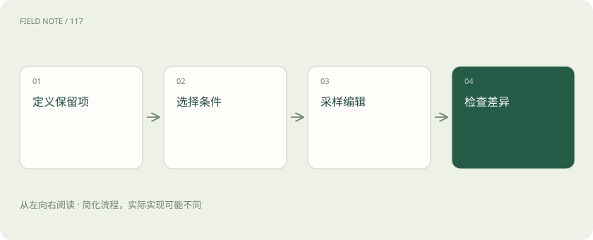
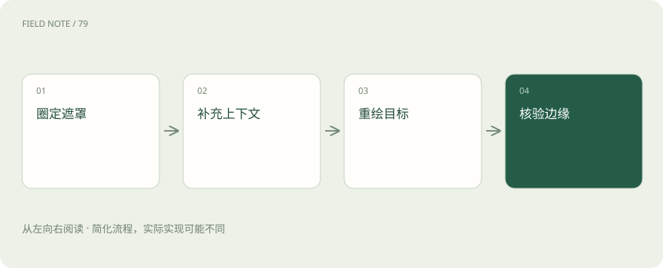

# 图像生成控制：把提示词、局部编辑与结构条件分开

> 先列出必须保留的细节，再为场景、修改区域和物体轮廓选择合适的控制办法。

专题：多模态 · 整理于 2026-11-05

## 先说这篇在讲什么

你有一张杯子的产品照，只想换成咖啡馆背景，结果杯柄变了，品牌字也变了。问题不一定是描述不够长，而是不同要求需要不同的控制办法。文字适合说场景，原图帮助保留外观，圈定区域帮助限制修改位置。先弄清哪些东西必须保留，再选工具，通常比反复堆形容词有效。

## 先看一个具体例子

只换杯子旁的水果时，把水果和需要重做的接触阴影一起圈入修改区。改完后，放大检查杯柄和品牌字是否仍与原图相同。

## 遇到陌生概念，可以先读

展开前置阅读建议

- [图像扩散：从噪声逐步形成画面](image-diffusion.md)

## 先用一个类比理解

像布置摄影棚：文字说明拍摄气氛，产品照片说明物品长什么样，圈选区域说明哪里允许修。

类比只帮助建立直觉，不等同于完整机制。

## 一图看懂

## 先说清楚哪些东西不能变

给杯子换背景前，先列出杯形、杯柄、标识和数量必须保留，再决定光线、桌面和背景可以怎样变化。这样你才能判断结果是否符合需要。“好看”太笼统，一张好看的图也可能已经换成另一款杯子。文字描述叫提示词，它能引导生成，但不是严格的排版或几何命令。

生成通常还受输入图片、模型、尺寸和随机起点影响。同一句描述出现不同构图很正常。要方便以后继续修改，应保存输入图片和完整设置。只记住提示词，无法交代这张图是怎样得到的。控制手段可以提高成功机会，仍不能自动保证商标和产品形状准确。

## 调整次数和文字影响强弱是两回事

可以把生成理解为模型多次修改画面的表示。采样步数表示进行了多少轮相关计算。采样器和调度器决定这些计算怎样推进。引导强度则影响文字等条件对结果的牵引程度。不同模型中的具体含义可能不同，因此别把网上的某个数字当成通用答案。

如果杯子总多出一个把手，增加计算轮次不一定解决问题。可能是图片条件和文字要求冲突，也可能是模型没有把形状画好。先固定其他设置，只改一个因素，比较几张结果。先挑出构图和杯形合格的方案，再花时间精修，比对错误方案反复加大计算量更有用。

## 用原图重新生成，会保留多少

图生图就是把已有图片作为生成起点，再允许模型作一定改动。变化幅度较小时，通常更接近原图；幅度较大时，模型可以重新安排更多内容。实际效果还取决于所用工具。它适合换风格、改气氛，却不能保证没有指定的位置都完全保持原样。

把白天的杯子照片改成黄昏，杯壁的反光可能随背景一起变化，品牌字也可能被重画。如果品牌必须原样保留，可以考虑保留原产品图层，再与新背景合成。要先区分“允许重新创作”和“必须精确修图”这两种要求，再决定是否适合用生成方式完成。

## 圈出要修改的地方，还要考虑周围

Inpainting通常叫局部重绘：用一张区域标记图告诉系统哪里需要重新生成。这张标记图叫遮罩。不同工具对白色和黑色的解释可能相反，使用前要看说明，不能凭习惯猜。圈得太大，可能把杯柄也改掉；圈得太小，可能留下旧物体的阴影。

比如把杯子旁的水果换成书，不仅要考虑水果本身，还要考虑桌上的阴影、杯壁里的反射。只圈住水果轮廓，书可能像悬浮在桌上。改完后要放大看新旧内容的接缝和光照，再比较应该保留的区域。局部重绘是在限制修改范围，并不会自动理解哪些细节属于你的产品。

## 轮廓图能管形状，不能包办品牌细节

ControlNet是一类给受支持的生成过程增加控制条件的方法。你可以提供物体边缘、远近关系或人物姿势等信息。边缘图告诉系统主要轮廓在哪里，深度图帮助表示哪些地方更近、哪些更远。这些条件提供的是部分结构信息，不是产品的完整说明书。

一张杯子轮廓图能帮助固定杯柄方向，却不能保证杯身文字拼写准确。如果轮廓来自另一款杯子，再要求保持原产品，输入本身就矛盾。先检查轮廓是否正确，再调整控制力度。还要确认控制模型能与所用的基础模型一起工作，不能把不同模型的控制文件随意混用。

## 参考图片和LoRA分别提供什么

参考图片可以通过相应的适配工具，把外观或风格信息传给生成模型。它像给画师看样图，但能保留多少细节取决于具体模型。LoRA则是保存较小一组参数改动的方法。参数是影响模型计算的数值。加载LoRA，就是在适合的基础模型上加入这些改动，它不是简单附上一张样图。

想让同一款杯子出现在多处背景，可以先尝试参考图。若考虑专门训练，就需要足够且获准使用的样本。如果每张样本都拍在木桌上，模型可能连木桌也学进去。换成新背景试一试，才能知道它记住的是杯子的特点，还是把杯子和桌子混成了一套。

## ComfyUI和Diffusers怎样帮你组织步骤

ComfyUI用连接起来的方块展示生成过程。每个方块负责一步工作，例如加载模型、处理图片或生成画面。这些方块通常叫节点。Diffusers则提供模型及生成流程等软件组件，方便开发者组合步骤。它们都是组织生成工作的工具，名称本身不能说明最后图片一定有多好。

用ComfyUI时，你可以查看遮罩有没有连到需要它的步骤。用Diffusers时，开发者可以记录输入和设置。要保存可继续使用的成果，应保留完整流程、模型文件信息和原始图片。额外安装的自定义节点来自不同作者，其功能和维护情况需要单独了解，不能因为出现在同一个画布上就当作官方核心功能。

## 最后按具体要求逐项比较

完成图片后，先看杯子是不是正确产品，再看背景有没有改好，最后看不该改的位置有没有变化。杯柄变形、商标拼错、阴影方向不对，是不同问题。把失败原因写清楚，下次才知道该换轮廓条件、缩小修改范围，还是保留原图部分进行合成。

比较控制办法时，使用同一张输入图和相同任务，再分别尝试只有文字、加入轮廓、加入参考图。这样更容易看出每种办法帮助了什么。保留失败图片也有价值。一次成功不能证明任何产品都能保真，官方文档说明组件能做什么，也不等于保证你的每项交付要求都能自动满足。

## 图解：局部修图路径

阴影和反射可能需要纳入编辑范围。

## 图解：结构条件准备

控制图正确是使用结构控制的前提。

## 放在一起对比

| 维度 | 能力 | 边界 |
| --- | --- | --- |
| 提示词 | 语义场景 | 难以严格约束文字 |
| 遮罩 | 指定编辑区域 | 边缘仍需检查 |
| ControlNet | 结构条件 | 不等于身份保证 |
| LoRA | 参数适配 | 需要兼容底座 |

## 读完先记住这一句

先列出必须保留的细节，再为场景、修改区域和物体轮廓选择合适的控制办法。

## 常见误区

参考图、轮廓图和固定随机种子都能帮助控制结果，但各自只能解决部分问题。

## 想一想

有了杯子的边缘图，品牌字是不是就一定正确？

查看解释

不是。边缘图主要帮助固定轮廓和位置，不能完整表达品牌文字。需要另外处理文字，并对照原产品检查。

## 关联阅读

- [图像扩散：从噪声逐步形成画面](image-diffusion.md)

## 原始资料

- [Diffusers ControlNet](https://huggingface.co/docs/diffusers/api/pipelines/controlnet)
- [ComfyUI官方仓库](https://github.com/Comfy-Org/ComfyUI)
- [Diffusers文档](https://huggingface.co/docs/diffusers)

原创讲解；图示和类比经过简化，数字示例不代表实测。工具功能以对应版本官方资料为准。
