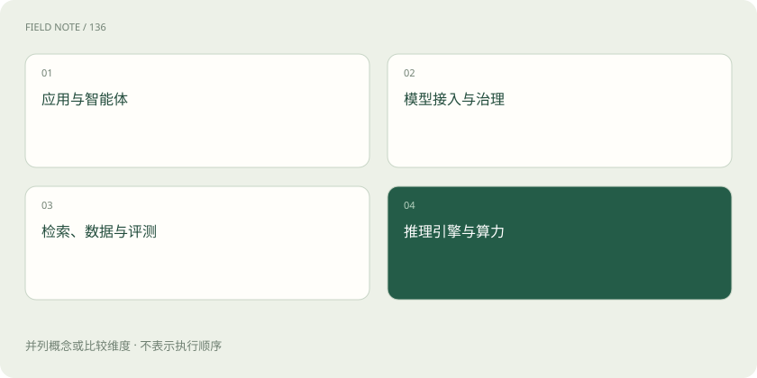

# AI 技术栈全景：市场上这些工具分别卖什么？

> 先弄清每种工具承担哪一步工作，再判断自己的项目是否需要它。

专题：行业技术栈 · 整理于 2026-11-04

## 先说这篇在讲什么

打开一张 AI 产品清单，你可能会看到几十个陌生名字。有的负责回答问题，有的负责找资料，还有的只是让模型跑起来。先别急着记品牌。我们从“给公司做一个客服助手”这件小事出发，看看每一步缺什么，再把工具放到它该在的位置。

## 先看一个具体例子

公司已有数据库时，先检查它能否支持资料检索，再决定是否新增独立向量数据库。组件越多，需要维护的连接也越多。

## 遇到陌生概念，可以先读

展开前置阅读建议

- [AI、机器学习、大模型，到底是什么关系？](ai-map.md)

## 先用一个类比理解

开餐厅时，厨师、菜谱、冰箱和收银台各做一件事。不能因为冰箱很贵，就认为它能替厨师做饭；AI 工具也要按工作分工理解。

类比只帮助建立直觉，不等同于完整机制。

## 一图看懂

## 先想好助手要帮谁做什么

假设你要做一个能回答退货问题的客服助手。顾客需要的是清楚的答复，所以先确定它要回答哪些问题，再看背后需要什么：有人安排查资料和回答的顺序，有模型理解问题并组织语言，有地方保存退货规则，还有机器运行程序。面向顾客的部分叫应用层；安排步骤的部分常叫编排层。产品可能同时承担几项工作，这些名称只是帮助我们看清分工。

## 沿着一次提问认识工具

顾客问“拆封后还能退吗”，程序先找规则，再请模型回答。组织这些步骤，可以了解 LangChain、Dify；寻找相近资料，可以了解 Milvus、pgvector。要统一接入不同模型，可以了解 LiteLLM 这样的网关；让模型在机器上提供回答服务，可以了解 vLLM、SGLang。Hugging Face 提供模型和数据相关生态，Langfuse、MLflow 可用于追踪过程和评测效果。这些是职责示例，并非排名；项目之间有重叠，当前能力和许可要查官方说明。

## 选工具前，把六件事问明白

先问：它究竟替我们解决哪件事？用真实问题试过，回答质量够不够？能否接上已有资料和员工权限？每次等待多久、花多少钱？出故障怎样恢复，将来换产品能否搬走？最后看许可证和数据政策是否允许自己的用途。把答案写下来，再看演示和排行榜，才不容易被漂亮的展示带偏。个人读几份资料，通常没有必要一开始就搭一整套服务器和数据库。

## 读完先记住这一句

按要完成的工作认识工具，比背品牌名单更有用。

## 常见误区

产品清单帮助理解分工，不代表采购建议或市场份额；某个工具的功能和商业条款也可能调整。

## 想一想

一个平台可以调用十种模型，是不是说明它自己研发了十种模型？

查看解释

不是。它可能只是把十家服务接进来。接入是会调用，部署是能运行，训练是能用数据调整模型，自主研发又涉及模型本身的设计与建设。

## 关联阅读

- [云端还是本地：从一项业务试点做选择](cloud-local-case.md)
- [推理网关：为什么企业不直接调用模型？](gateway.md)
- [vLLM、批处理、并行与 Kubernetes 各管什么？](serving-stack.md)

## 原始资料

- [Hugging Face · 文档入口](https://huggingface.co/docs)
- [Dify · 文档](https://docs.dify.ai/)
- [LangChain · 文档](https://docs.langchain.com/)
- [LiteLLM · 网关文档](https://docs.litellm.ai/docs/)
- [Milvus · 文档](https://milvus.io/docs)
- [pgvector · 项目](https://github.com/pgvector/pgvector)
- [vLLM · 项目](https://github.com/vllm-project/vllm)
- [SGLang · 文档](https://docs.sglang.ai/)
- [Langfuse · 文档](https://langfuse.com/docs)
- [MLflow · 文档](https://mlflow.org/docs/latest/)

原创讲解；图示和类比经过简化，数字示例不代表实测。工具功能以对应版本官方资料为准。
