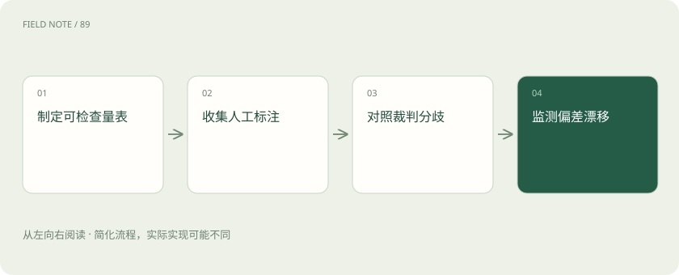

# 模型裁判：先校准评分，再相信排行榜

> 请模型帮忙阅卷之前，先用人工批好的答案检查它会不会偏心或漏掉关键错误。

专题：评测运行 · 整理于 2026-11-04

## 先说这篇在讲什么

请模型给答案打分，就像请人批改试卷，省下不少逐题检查的时间。但这位阅卷老师也会偏心：长答案看起来更认真，排在前面的答案更容易被选中。我们先拿人已经判清楚的题试一试，看看它为什么扣分，再决定哪些评分可以交给它。

## 先看一个具体例子

两份答案都引用了同一条过期规定，裁判可能都给高分。给它正确适用的权威版本，并逐项核对引用是否支持结论，比比较哪份文笔好更有用。

## 遇到陌生概念，可以先读

展开前置阅读建议

- [大模型评测：不要只问排行榜第一是谁](evaluation.md)

## 先用一个类比理解

像新老师先试批标准卷，再决定哪些试卷交给他。

类比只帮助建立直觉，不等同于完整机制。

## 一图看懂

## 先看答案对不对，再看写得漂不漂亮

两份维修建议摆在面前，一份短而准确，一份写得很长却弄错零件。我们希望评分的人选前者。让大模型来做这件事，就叫“模型裁判”。它能帮忙检查大量答案，但也可能被篇幅、语气或排版打动。把评分拆成几项更容易检查：事实对不对，问题答全没有，引用能不能证明结论，格式是否符合要求。

## 先拿一叠批好的试卷试试它

先请懂业务的人给一组答案打分，再让裁判独立评分。不要只看两边有多少题意见相同，还要打开意见不同的题：它把哪种错判成了对？哪种好答案被低估了？这个过程叫“校准”，意思是先摸清评分尺子是否合适。把裁判模型版本和评分提示保存下来，后面比较才知道尺子有没有换。

## 调换答案顺序，看看它会不会改口

同样的两份维修答案，先把甲放前面，再把乙放前面。如果赢家跟着位置变，就可能有位置偏差。也可以藏起模型名称，避免它因名气加分。让裁判指出支持关键结论的原文，再由人检查这些原文是否真的相关，能帮助区分它是在核对事实，还是只觉得这段话写得像正确答案。

## 别让一个平均分盖住严重误判

即使大多数题与人工意见一致，也可能总把危险维修建议评成高分。要把事实错误、引用不支持、安全要求等分别检查，尤其翻看高分里的错误答案。换裁判或改评分提示后，保留一批始终相同的对照题重新评分；否则分数上涨可能只是新裁判更宽松。人工复查也要留下理由，方便以后理解分歧。

## 读完先记住这一句

让模型评分前，先确认它能分清答得好和写得好。

## 常见误区

裁判说得很肯定，不代表判得准；同一家族的模型也可能一起漏掉同一种错误。

## 想一想

裁判赞同自己写的答案，就能相信它吗？

查看解释

还不能。它写答案和评分时可能犯同样的错，要拿独立人工判断作对照，检查意见不同的地方。

## 关联阅读

- [大模型评测：不要只问排行榜第一是谁](evaluation.md)
- [DPO、RLHF、GRPO：怎样学习回答偏好](preference-alignment.md)
- [评测集怎么分：避免把背过的题当能力](eval-splits.md)

## 原始资料

- [Judging LLM-as-a-Judge with MT-Bench and Chatbot Arena](https://arxiv.org/abs/2306.05685)

原创讲解；图示和类比经过简化，数字示例不代表实测。工具功能以对应版本官方资料为准。
