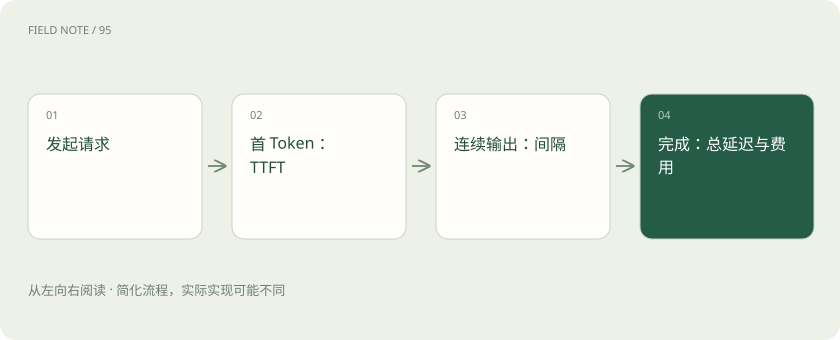

# TTFT、吞吐、P95 和成本：一张性能报告怎么看？

> 第一段文字等多久、后面生成多快、最慢用户等多久，是不同的性能问题。

专题：评测运行 · 整理于 2026-11-04

## 先说这篇在讲什么

你打开聊天软件，可能先等五秒，随后文字很快出来；也可能立刻显示第一个字，后面却断断续续。两种体验差别很大。这篇把常见报告指标翻成用户实际感受到的等待和花费。

## 先看一个具体例子

两套服务输出长度不同，直接比较“完成用时”会混入长度影响。先统一测试条件，再比较延迟分位数和质量。

## 遇到陌生概念，可以先读

展开前置阅读建议

- [Prefill、Decode 与 KV Cache：一次回答的内部旅程](prefill-decode.md)

## 先用一个类比理解

餐馆从下单到第一道菜像 TTFT，上菜间隔像 Token 间隔，全部吃齐像端到端延迟，每小时服务多少桌像吞吐。这个类比不代表每个 Token 是同等大小的信息。

类比只帮助建立直觉，不等同于完整机制。

## 一图看懂

## TTFT：多久开始看到第一个输出

TTFT 是 Time To First Token 的缩写，表示从规定的起点到首个输出 Token 的时间。报告要说清从客户端发出请求算，还是从服务端接到请求算。首个网络事件也可能只是状态信息，并不是用户能看到的文字。

## 吞吐：一段时间一共完成多少工作

吞吐可以按每秒处理多少请求、多少 Token 来表示。它更接近餐厅每小时能出多少份餐，而不是每个顾客等多久。同样的吞吐，如果输出长度不同，含义也可能不同；比较时还要看是否满足延迟和质量要求。

## P95：照顾比较慢的那部分请求

把一批请求按等待时间从短到长排列，P95 大致是其中 95% 不会超过的时间。它不是最慢时间，也不是平均时间。平均三秒可能掩盖少量人等半分钟的问题，因此服务通常还关注较慢请求的体验。

## 便宜的一次调用，不一定省下整项任务的钱

如果便宜模型经常答错，需要重试、换模型或人工返工，总花费可能更高。应看完成合格任务用了多少次调用和多少资源，再把失败、重试、缓存以及人工补救算进去。没有可靠完成任务，只报每次调用低价，容易产生误导。

## 读完先记住这一句

看速度报告时，要同时看等待、持续生成、失败率和完成一项任务的总花费。

## 常见误区

流式响应能改善感知等待，不意味着完整答案一定更早完成；示例价格不是任何厂商报价。

## 想一想

平均延迟低，就能保证多数高峰用户体验好吗？

查看解释

不能。还应检查尾部延迟、到达流量、失败率和排队情况。

## 关联阅读

- [配额、预算与计量：三个不同的控制面](gateway-budgets.md)
- [模型路由：质量、成本与失败代价怎么比](routing-evaluation.md)
- [PD 分离的下一层：KV 传输和容量配比](pd-kv-capacity.md)

## 原始资料

- [vLLM · 指标设计](https://docs.vllm.ai/en/latest/design/metrics/)
- [Prometheus · Histograms and summaries](https://prometheus.io/docs/practices/histograms/)

原创讲解；图示和类比经过简化，数字示例不代表实测。工具功能以对应版本官方资料为准。
