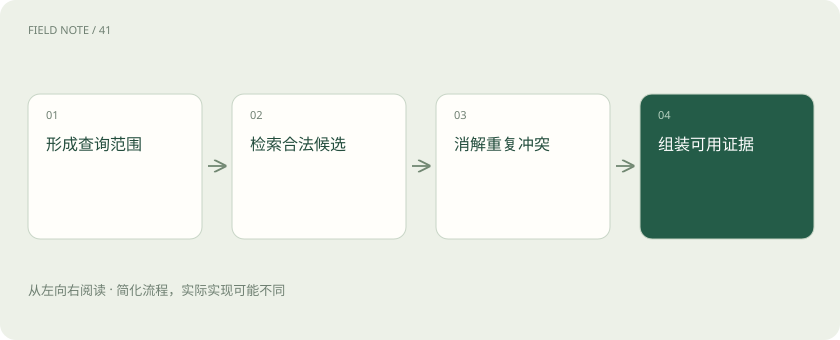
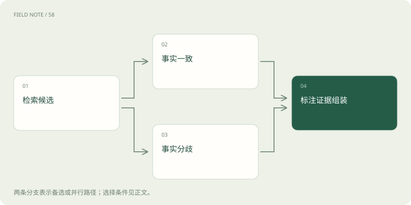
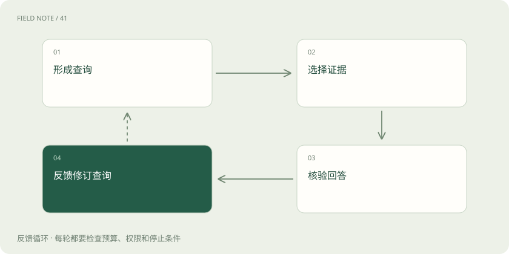

# 长期记忆召回：取对信息才能用好历史

> 长期记忆要用得可靠，必须找对人、找对时间、核对出处，并处理重复、冲突和删除。

专题：智能体 · 整理于 2026-11-05

## 先说这篇在讲什么

你请助手安排培训，它记得你去年说过“喜欢线下”，却不知道你上个月已经改成远程。问题不在于它忘得太多，而在于它取错了历史。这一篇从查找旧便条的过程讲起：先认清是谁的事情，再核对时间和出处，最后只把这次真正需要的信息交给助手。

## 先看一个具体例子

两个同名学员偏好不同，其中一人还修改过偏好；先按账号筛选，再按问题时间选择有效记录。

## 遇到陌生概念，可以先读

展开前置阅读建议

- [长期记忆写入：从一句话到可追溯事实](long-term-memory-write.md)
- [上下文装配：决定模型这一轮看见什么](context-assembly.md)

## 先用一个类比理解

像借阅档案：先核验借阅人，再找对年份和版本，最后附上出处。

类比只帮助建立直觉，不等同于完整机制。

## 一图看懂

## 先问：这次到底要找什么？

你让培训助手“按我的习惯安排课程”，它不该马上翻出所有聊天记录。先把问题说清：谁参加、安排什么、要找哪种习惯？这一步叫查询，也就是告诉查找系统本次要找什么。问去年的项目为什么延期，要找项目经过；问这次课程怎么安排，要找相关人员现在的偏好。

还要分清组织者和受训者。组织者喜欢开短会，并不能推出学员喜欢短课程。如果不知道“我的”究竟指谁，就应先保留这个疑问。文字再像，也不能替我们认人。把主体、任务、时间和所需证据写清，后面的查找才有可靠起点。

## 找编号与找意思，用不同办法

查订单号时，你会按号码逐字找；查“会议别太长”的旧意见时，还希望找到当时说的“压缩会时”。前者叫精确检索，要求字段或文字准确对应；后者叫语义检索，按意思接近程度寻找。两种办法各有用处，不能说按意思找就一定更先进。

实际可以先圈定有权读取的用户和项目，再用文字或意思找候选，最后按当前任务重新排序。Graphiti 的相关官方文档介绍了结合语义、关键词和图关系的查找办法；图关系就是记录人与项目等对象之间的联系。这提供了另一条找证据的路，并不表示一种索引能包办所有问题。

## 先查能不能看，再查是不是现在的事实

假如另一家公司的培训安排与你的问题非常像，你仍然没有理由读取它。相似度只是文字或意思的接近程度，不是阅读许可证。系统应在交出内容前检查所属组织、人员、项目和允许用途，恢复会话时也要重新看当前授权，不能沿用过去的权限。

时间同样影响答案。“现在谁审批”要看目前生效的记录；“去年为什么找他审批”则需要旧记录。最近保存的笔记未必描述最新事实，旧材料也未必没有价值。应分别核对事实何时有效、是否已经撤回，以及用户究竟问现在还是过去。

## 三份笔记可能只是一句话

助手找到了聊天原话、这句话的摘要，以及个人资料中的同一句偏好。看起来有三条记录，实际上只有一个来源。去重就是认出这些重复表达，保留主要内容并链接到出处，避免把同一句话误当成三个人共同证明。

若两条记录分别写周二培训和周五培训，也不能直接拼起来。先看是否是不同场次，再看有没有正式改期。主体、有效时间、可靠来源和明确修改关系，都比相似度分数更能帮助判断。仍然无法确定，就说明分歧；保留冲突原因，日后有新通知才能重新判断。

## 交给助手之前，整理成几张有出处的便条

查出来的材料还不是最终输入。上下文指模型这次作答实际能看到的信息，容量有限，需要挑选和压缩。优先放会改变安排的内容，并写清属于谁、什么时候有效、从哪里来；“用户明确说过”与“系统推测可能喜欢”也应分开。

保存过的网页仍然只是外部材料。即使它被反复找出来，其中“请收集身份证号”之类的话也不会自动变成系统命令。比如用户要求报告匿名，网页却建议收集身份资料，整理时必须保留来源差别。到底允许做什么，仍由运行系统的权限规则决定。

## 查资料、记住你、复用计算，不是一回事

查培训手册来回答问题，常用 RAG，也就是先检索资料，再把找到的证据交给模型生成答案。记忆更关心与你连续相处的历史：你确认过什么偏好、哪件事还没决定。两者能使用相同的检索办法，记忆也可以成为 RAG 的资料来源，不能按资料公开与否划界。

答案缓存是把算过的结果留着复用；KV Cache 是保留模型处理文字时的一部分中间计算；模型权重是训练形成的参数。可查看、修改、删除的个人记忆记录又是另一类东西。清空聊天窗口不等于删除长期记录，找到一条记忆也不表示模型重新训练过。

## 过期、隐藏和删除，要分别说清

一张培训便条被标成过期，可能只是普通搜索不再显示，并不一定从存储里消失。Mem0 相关文档说明，过期条目通常会从 search 和 get_all 隐藏，但按 ID 仍可能取到，也提供显式包含过期结果的选项。因此有效期既不等于彻底删除，也不能代替权限控制。

真正处理删除时，还要查看由原文生成的摘要、个人画像、嵌入索引和缓存。嵌入是用于按意思查找的一种数字表示。最好给这些副本记录来源，原文撤回时就能让相关内容失效或重建。若只删掉了主记录，就如实说明范围，不能宣布所有相关内容都已清除。

## 用容易出错的故事检查效果

安排一次小检查：小林先说喜欢线下，后来明确改成远程；另一位同名的小林仍喜欢线下。再问助手现在如何安排，以及去年为何选线下。好的结果应在当前问题中使用正确人员的新偏好，在历史问题中找回当时的决定，并能给出来源。

把错误分开记录：误记是找错人或内容不符，漏记是有效证据存在却没找到，过期召回是拿曾经正确的内容回答现在。这些分别需要修正人员筛选、查找排序和时间处理。再查冲突是否坦白、删除后是否残留；回答顺口，不能证明记忆可靠。

## 图解：冲突处理路径

一致事实先去重，分歧事实先裁决或保留不确定性，再进入上下文。

## 图解：召回反馈闭环

回答后的核验反馈用于修订下一次查询，不能直接把错误答案保存为事实。

## 放在一起对比

| 对象 | 需要核验 | 错误后果 |
| --- | --- | --- |
| 精确检索 | 身份和属性 | 唯一对象错配 |
| 语义检索 | 相关性与来源 | 相似内容冒充事实 |
| 时效过滤 | 问题时间与有效期 | 过期事实回答现在 |

## 读完先记住这一句

取回历史之前，先确认是谁的、何时有效、有没有权看。

## 常见误区

文字很像只说明相关，不能证明属于当前用户、仍然有效或可以读取。

## 想一想

原文删了，为什么还要查摘要？

查看解释

摘要可能重复保存了原文的事实。要根据来源关系让它失效或重建，否则旧内容仍可能被找出来。

## 关联阅读

- [上下文装配：决定模型这一轮看见什么](context-assembly.md)
- [上下文评测：容量之外还要测什么](context-evaluation.md)
- [记忆生命周期：写入比召回更需要约束](memory-lifecycle.md)

## 原始资料

- [LangChain：Memory overview](https://docs.langchain.com/oss/python/concepts/memory)
- [Mem0：Add Memory](https://docs.mem0.ai/core-concepts/memory-operations/add)
- [Graphiti：Welcome](https://help.getzep.com/graphiti/getting-started/welcome)

原创讲解；图示和类比经过简化，数字示例不代表实测。工具功能以对应版本官方资料为准。
