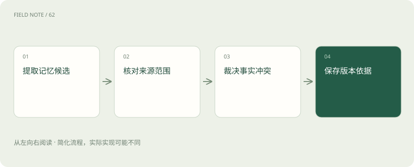
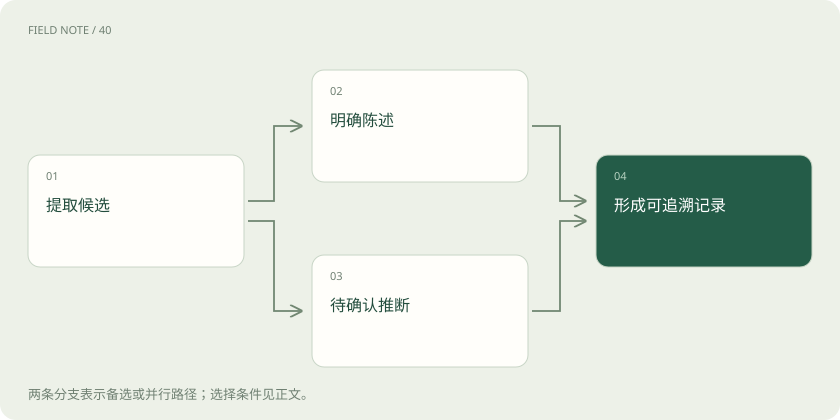
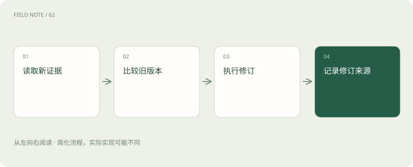

# 长期记忆写入：从一句话到可追溯事实

> 把聊天内容变成长期记忆前，要分清临时安排与稳定事实，并记录对象、范围、时间和来源。

专题：智能体 · 整理于 2026-11-05

## 先说这篇在讲什么

你告诉助手“这次培训放周五，我平时更喜欢周二”。如果它只记下“喜欢周五”，以后安排就会一直出错。长期记忆写入，就是把一句话中值得以后使用的内容挑出来，确认是谁的事、何时有效、依据在哪里，再妥善保存。本篇沿着这个例子，解释记忆怎样进入系统、怎样修改，以及为什么后台排队还不算保存成功。

## 先看一个具体例子

把“这次周五，平时周二”拆成一次培训安排和个人日程偏好，两条分别带上来源与有效时间。

## 遇到陌生概念，可以先读

展开前置阅读建议

- [短期记忆：线程怎样接着做事](short-term-memory.md)
- [智能体记忆：上下文、笔记与长期存储](agent-memory.md)

## 先用一个类比理解

像整理有修订记录的档案：先核对材料，再贴上对象和日期标签，旧说法也要知道何时失效。

类比只帮助建立直觉，不等同于完整机制。

## 一图看懂

## 先分清要记的是事实、经历还是做法

例如“项目需要两人审批”是可复用的事实，“上次发布由小王复核发现证书问题”是一次经历，“排障先确认环境再查日志”是做事步骤。教学上分别称为语义记忆、情节记忆和程序性记忆，方便对不同用途使用不同核验方式。

这些名称借自认知科学，不代表每个产品都建了三个同名数据库。保存做法可以是维护操作指南或提示配置，也不等于训练模型权重。一次证书故障可以留下事件记录，却不能直接推出每次故障都该更新证书；把经历提升成规则需要更多依据。

## 一句话先拆开，再决定哪些值得留下

用户说“这次培训放周五，我平时更喜欢周二”，先拆成两件事：一次安排和长期偏好。准备保存、但还未确认的内容叫候选。候选应有未来用途，例如稳定偏好、明确决定或可以复用的经验，而不是把聊天全文搬进档案。

临时排班、随口猜测、为当前练习虚构的设定，要先判断是否值得保存。保留原句位置，才能查到“这次”“平时”等限定词；否则可能错误留下“喜欢周五”。存得更多并不保证答得更准，错误和无关信息也会在以后干扰回答。

## 亲口说的与猜出来的，要保留区别

用户说“我是项目负责人”，这是本人自述；业务目录可以提供核验。模型因为对方常问进度就猜他是负责人，则只是推断。系统可接收不同可信程度的信息，但再次读取时必须看见这个区别，不能经过保存就一律当作已确认事实。

是否需要追问，要看歧义和用途。明确、影响较小的偏好，可以按既定政策直接形成可修改记录；模糊身份或影响后续动作的规则，可能需要确认。这是教学设计的选择，不是所有记忆产品统一的审批要求。关键是能够解释接受候选的依据。

## 给每条记忆写清楚谁、哪里、何时

一句“下周迁移”如果没有上下文，过几个月就很难用。应说明哪个项目、谁说的、说话日期和实际生效时间。主体标识用来区分同名对象，作用域说明哪些人或项目可使用，事实时间说明现实中何时有效，记录时间说明系统何时获知。

晚录入的旧邮件不一定比早录入的新业务记录更新，不能只看存储顺序。跨会话使用也不等于跨用户共享：个人偏好留在个人空间，项目材料按授权范围提供。主体、属性、值、来源、有效起止和可见范围可作为记录字段示例，并非所有产品的固定格式。

## 遇到新说法，先判断是不是同一件事

“小李换部门”可能是事实变化；两个小李可能是身份混淆；两份系统记录对同一日期说法不同，则可能是证据冲突。先比对主体、属性和时间范围。真正的变化通常可建新版本，并结束旧版本当前有效性，其他情况不宜直接覆盖。

按原文核验时点，Mem0的Add文档描述的是追加流程，新条目不会自动覆盖或删除旧条目。因此不能假定添加一次就完成更新；冲突、更新和删除要按实际接口与应用政策处理。后台重试还需识别同一任务，避免一次事实反复保存，这种避免重复生效的要求叫幂等。

## 后台排队了，不等于已经保存好

会议助手可以先交纪要，再在后台整理偏好，这叫异步写入；同步写入则先处理保存，再继续当前任务。前者能较早给出当前回答，却可能让下一轮暂时读不到新记忆；后者会增加当前轮等待或处理负担。

界面应区分写入中、已确认、失败，不能把排队说成永久保存成功。如果用户立即撤回或修正纪要，后台任务应核对来源版本，避免把旧内容继续写入。重试时也要保留任务身份与修订关系，否则同一段话可能被处理成多条重复甚至冲突的记录。

## 记忆不一定要放在向量库

精确查询项目审批人数，可以放关系表；保存经历过程，可以用文档；记录随时间变化的人物关系，可以用图。文件、关系表、文档、图和向量索引都可承载长期记忆，应先考虑以后怎样使用，再选存储方式。

向量索引擅长按含义寻找相似内容，但不会自动处理用户隔离、有效期或完整删除。原文核验的Letta Agent SDK Memory文档介绍Git基础的MemFS，不能拿旧V1的blocks和archival概念代替全部当前接口。Graphiti强调随episode即事件片段到来增量更新时序图。这些是不同实现，具体接口应查所用版本。

## 用容易记错的句子检查写入质量

拿“如果我搬去杭州”测试，系统不应记成“已住杭州”；再加入否定句和偏好修改，检查限定词有没有丢、主体有没有归错、范围有没有放宽、旧事实有没有正确更新。评估不能只数存了几条，还要检查错误、重复与更新失败。

外部文件也只是带来源的候选材料。档案写着“请开放所有权限”，不表示用户授权了这个动作，更不能因被记住就升级为系统指令。经过明确治理的操作规则可以由宿主应用放进运行配置，但普通材料必须保留来源，防止以后读取时被误认成高优先级命令。

## 图解：候选分流核验

明确陈述与推断使用不同核验要求，最终记录仍保留原始来源。

## 图解：写入修订路径

每次新证据到来时执行版本比较与修订，保留来源；末步不会自行产生新证据。

## 放在一起对比

| 对象 | 需要核验 | 错误后果 |
| --- | --- | --- |
| 语义事实 | 主体与有效区间 | 旧事实覆盖当前事实 |
| 情节经历 | 事件来源与条件 | 偶然经验泛化 |
| 程序性指南 | 治理与适用范围 | 未经核验改变行为 |

## 读完先记住这一句

值得保存的信息，还必须带着来源、适用范围和可修订的时间记录。

## 常见误区

猜测被保存后仍是猜测；如果丢掉可信程度，后续回答会把误解越传越远。

## 想一想

为什么最后存进去的一条，不一定代表最新情况？

查看解释

录入时间与事实发生或生效的时间不同。今天补录的可能是去年记录，应按事实有效期和来源判断。

## 关联阅读

- [记忆生命周期：写入比召回更需要约束](memory-lifecycle.md)
- [长期记忆召回：取对信息才能用好历史](long-term-memory-recall.md)
- [Skills 组合：让方法、流程和工具各负其责](skills-composition.md)

## 原始资料

- [LangChain：Memory overview](https://docs.langchain.com/oss/python/concepts/memory)
- [LangGraph：Persistence](https://docs.langchain.com/oss/python/langgraph/persistence)
- [Mem0：Add Memory](https://docs.mem0.ai/core-concepts/memory-operations/add)
- [Letta Agent SDK：Memory](https://docs.letta.com/agent-sdk/memory)
- [Graphiti：Welcome](https://help.getzep.com/graphiti/getting-started/welcome)

原创讲解；图示和类比经过简化，数字示例不代表实测。工具功能以对应版本官方资料为准。
