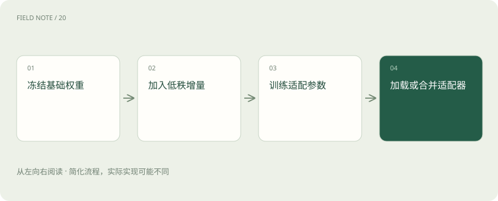

# LoRA 与 QLoRA：少改参数也能学习

> LoRA 通常冻结原始权重，在选定层训练低秩增量，相当于学习受约束的补充修改。

专题：训练与对齐 · 整理于 2026-11-04

## 前置阅读

- [训练、微调与推理：学习和使用是两回事](training-inference.md)

## 先用一个类比理解

像保留原书，在若干位置贴上可学习的修订页。

类比只帮助建立直觉，不等同于完整机制。

## 一图看懂

## 概念边界

LoRA 通常冻结原始权重，在选定层训练低秩增量，相当于学习受约束的补充修改。它减少需要训练和保存的参数，但模型前向计算仍依赖基础模型，不是把大模型自动缩成小模型。

## 内部怎样运作

QLoRA 在量化基础权重的条件下训练适配器，从而降低一部分显存需求。优化器状态、激活和序列长度仍占空间；量化精度、目标层和秩会影响效果，部署前还要验证合并或加载方式。

## 把机制放进具体场景

团队用 LoRA 学习售后术语后，部署时仍需加载匹配的基础模型。若采用 QLoRA 训练，量化主要作用于冻结的底座；适配器及训练中间状态仍有自己的精度与空间要求，不能按压缩文件大小估算全部显存。

## 取舍与容易忽略的限制

低秩限制是对可训练修改空间的约束，不是任务难度的保证。选择哪些层加入适配、允许多大的秩，以及采用何种量化方式，都可能改变学习效果。部署多个适配器时，还需确认它们共享同一底座条件，并单独检验切换与合并后的行为，避免把训练产物当作独立完整模型。

## 放在一起对比

| 方式或概念 | 主要作用 | 关键边界 |
| --- | --- | --- |
| LoRA | 训练低秩增量 | 底座仍参与计算 |
| QLoRA | 量化冻结底座再训练适配器 | 仍需激活及训练状态空间 |

## 真实场景

同一家企业的客服与维修助手可学习不同适配器，但不能把其中一个适配器随意装到另一版基础模型上；版本对应关系属于交付材料的一部分。

## 常见误区

适配器需要匹配基础模型版本；训练显存下降不能直接推断线上延迟等比例下降。

## 想一想

QLoRA 是否表示推理时一定比 LoRA 快？

查看解释

不是，训练省显存与线上速度是不同指标，还取决于量化算子和部署方式。

## 关联阅读

- [SFT：用示范回答教会任务形式](sft-behavior.md)
- [GPU、显存和量化：模型为什么装不下？](gpu-memory.md)
- [文本、多模态、推理模型与开源权重，怎么区分？](model-choices.md)

## 原始资料

- [Hugging Face · lora](https://huggingface.co/docs/peft/en/developer_guides/lora)
- [QLoRA 原始论文](https://arxiv.org/abs/2305.14314)

原创讲解；图示和类比经过简化，数字示例不代表实测。工具功能以对应版本官方资料为准。
