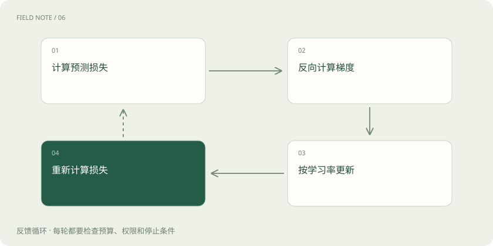

# 损失和梯度：模型怎样知道该往哪改

> 预测误差并非人的不满意程度；损失把训练目标变成可计算的数值。

专题：AI 基础 · 整理于 2026-11-04

## 前置阅读

- [训练、微调与推理：学习和使用是两回事](training-inference.md)

## 先用一个类比理解

像下山时先测坡度，再决定迈多大一步。

类比只帮助建立直觉，不等同于完整机制。

## 一图看懂

## 概念边界

预测误差并非人的不满意程度；损失把训练目标变成可计算的数值。梯度描述参数微小改变时损失变化的方向，优化器据此调整参数。一次更新通常综合一批样本，不会只为一句话改一个独立开关。

## 内部怎样运作

学习率决定每步走多远，过大可能越过合适区域，过小则进展缓慢。训练损失下降可能伴随对训练材料的记忆，必须观察未参与更新的数据。

## 把机制放进具体场景

假设只有一个参数 w，损失为 (w−3)²。w=1 时损失是4，梯度为−4；学习率0.1让参数更新为1.4，新损失2.56。若学习率取1，参数跳到5，损失仍为4，说明步子过大可能越过低点。

## 取舍与容易忽略的限制

梯度只描述当前位置附近的变化，不是通往正确答案的导航地图。实际神经网络有大量相互作用的参数，优化器还可能利用历史梯度调整步长。因此不能根据某一次损失下降判断训练已稳定；需要观察一段更新过程，并区分随机批次造成的波动与持续发散。

## 放在一起对比

| 方式或概念 | 主要作用 | 关键边界 |
| --- | --- | --- |
| 损失 | 衡量目标偏差 | 不等于用户满意度 |
| 梯度 | 指出局部变化方向 | 不保证到达全局最优 |
| 学习率 | 决定更新幅度 | 过大可能震荡 |

## 真实场景

假设两批样本分别强调简短与详细回答，更新方向可能冲突。混合采样比例决定哪类信号更常出现，不能只看某一批训练后是否立即改善。

## 常见误区

训练成绩和实际任务成绩需要分开记录；文字预测更准不保证引用更可靠。

## 想一想

训练损失为零是否代表用户问题都能答对？

查看解释

不代表，损失只衡量给定训练目标与样本，未覆盖的问题仍可能失败。

## 关联阅读

- [训练、微调与推理：学习和使用是两回事](training-inference.md)
- [SFT：用示范回答教会任务形式](sft-behavior.md)
- [训练数据质量：先修教材再加课时](data-quality.md)

## 原始资料

- [gradient descent](https://developers.google.com/machine-learning/crash-course/linear-regression/gradient-descent)

原创讲解；图示和类比经过简化，数字示例不代表实测。工具功能以对应版本官方资料为准。
