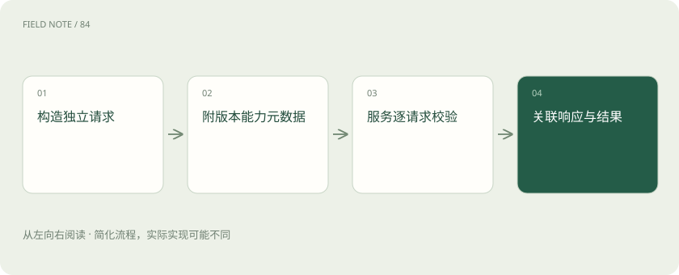
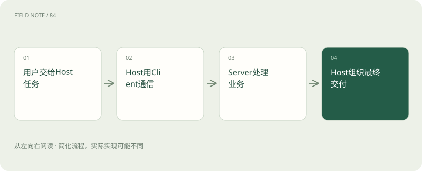
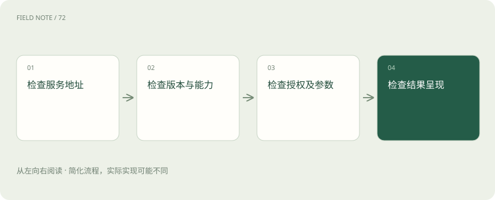

# MCP 生命周期：从连接想象转向请求契约

> 沿一次请求理解Host、Client与Server，分清协议版本、能力发现和产品任务状态。

专题：协议与技能 · 整理于 2026-11-05

## 前置阅读

- [MCP、A2A 与 Skills：接口、委派和方法为什么要分开](stack-protocols.md)
- [Codex：模型、执行框架与客户端怎样组成编程助手](stack-codex.md)

## 先用一个类比理解

像跨部门服务台：大厅接待需求，窗口传递申请，业务科室核验并办理。

类比只帮助建立直觉，不等同于完整机制。

## 一图看懂

## 三个角色分别负责什么

Host 是承载用户体验、模型上下文和工具策略的应用；Client 是其中与某个服务交互的协议组件；Server 暴露可访问的业务能力。一个产品可同时承担多个角色，名称不是三个必须独立部署的进程。

客户经理说“总结客户近三个月进展”，是给 Host 的任务。Client 传递查询，CRM Server 查询记录；Server 不因此取得整个聊天记录，也不替 Host 决定最终报告。

部署图应标出模型服务与 MCP Server 之间由谁转发信息。模型通常通过宿主看到能力描述与结果，不能据此认为模型供应商直接持有每个业务系统的连接。这个区分决定凭据放在哪里。

## 先确定所谈的版本

本文核对的是 2026-07-28 规范。该版本强调无状态、自包含请求与逐请求能力协商。把早期初始化、长会话和关闭顺序画成永恒必经流程，会误导读者理解当前实现。

旧客户端仍可能使用旧版本流程，产品也可能保留自己的聊天会话。讨论故障时应同时记录协议版本、产品版本和传输方式，不能用产品的“已连接”图标推断底层协商细节。

团队维护兼容矩阵时，应按具体版本逐项列出支持功能。旧资料仍可用于理解历史实现，但应明确标注适用范围，不能将旧流程中的步骤直接列为新版产品的验收要求。

## 发现不是自动具备能力

服务目录或配置帮助定位 Server；能力发现帮助知道它实际提供什么。这两层都不等于业务 API 已存在。没有客户查询接口，连接协议不能凭空生成客户资料。

采购演示中应要求展示具体工具及输入约束，而非只看连接成功。CRM 查询需要适配真实字段、分页、租户边界和错误语义；标准化消息降低重复接线成本，业务集成工作仍然存在。

服务发现还要区分可信来源与可访问地址。一个地址能响应协议消息，不代表其运营者值得接收客户数据。登记服务时，应明确负责人、用途、数据去向和退出机制。

## 请求需要携带自身条件

在当前规范中，请求包含用于说明协议版本、客户端信息和客户端能力的元数据。服务端据此理解当前请求，不应假设上一次调用已经永久设定能力。

例如连接池把两位员工的请求送到不同实例，业务服务仍须根据各自请求识别调用条件。恢复传输不等于恢复用户授权，更不能沿用另一位员工的工具目录。

无状态描述的是协议交互条件，不等于数据库没有状态。查询结果依然会受客户记录更新影响，因此同样参数在不同时间返回不同事实，并不必然说明协议实现错误。

## 传输只是消息的通道

stdio 常见于本地由应用管理的子进程；HTTP 常见于远程服务。两者都需要明确消息格式与错误处理，却具有不同的部署、身份和故障边界。

本地进程启动失败应检查路径与环境；远程请求被拒绝应检查地址、身份及资源权限。把两类问题都归为“模型没学会 MCP”，会把诊断方向带离真正原因。

远程网关可能返回普通网页或身份登录页，客户端需要识别这不是有效协议结果。只检查 HTTP 成功状态不足以确认消息已经按预期处理，还要核对响应内容和关联关系。

## 能力协商限制双向请求

Server 不能仅因能够返回文本，就假设 Client 支持所有额外能力。双方要依据所采用版本和扩展规则确认支持范围，未支持的功能需要退化或明确失败。

例如长任务扩展与基础查询不是同一承诺。产品若只实现查询，就不能根据扩展示意图宣传异步恢复；界面应把不可用原因解释清楚，避免让用户误以为查询仍在后台运行。

当产品宣传支持某项扩展时，应要求展示双方实际协商与对应行为。规范中的可选能力不是最低配置，不能从一个实现支持扩展推导所有 MCP 客户端都能直接复用。

## 生命周期故障如何定位

把一次查询拆成定位服务、构造请求、身份核验、业务执行、结果呈现五个观察点。每个观察点记录安全的关联标识与时间，敏感令牌和客户原文不应成为默认日志。

服务端完成查询但 Host 超时，是结果交付问题；权限拒绝是访问边界生效。重试前区分只读查询与有副作用操作，尤其不能把网络重试当作重新执行业务的通行证。

关联标识应贯穿宿主、网关与业务服务，但外部展示时需要脱敏。若不同系统的时间不一致，先校准观察时间再推断执行顺序，否则容易把后发生的错误当成前置原因。

## 聊天状态与协议状态分开

聊天历史、任务计划和审批记录通常属于 Host 的产品状态。协议请求即使无状态，应用仍可能保存业务状态；反过来，维持一个网络通道也不保证任务历史完整。

验收时让同一任务换一个服务实例继续只读查询，检查是否还能得到正确身份与版本处理；再检查 Host 是否正确保留证据。这个实验分别验证协议请求的完整性和产品任务的连续性。

用户关闭窗口之后任务是否继续，是产品生命周期政策。应在界面与文档说明，而不应根据传输是否保持连接猜测；取消请求也不应被描述成已经撤回所有完成的业务动作。

## 图解：角色职责如何交接

Host负责用户任务，Client负责协议交互，Server负责能力与业务边界。

## 图解：查询失败的定位顺序

按失败层寻找证据，避免把网络故障归因于模型推理。

## 放在一起对比

| 组成部分 | 负责什么 | 边界或修正方向 |
| --- | --- | --- |
| Host | 组织任务与上下文 | 不替业务授予权限 |
| Client | 传递协议消息 | 不生成业务事实 |
| Server | 提供并校验能力 | 不决定完整用户任务 |

## 真实场景

只读查询在网关重连后落到新实例，新实例仍能依据请求识别版本与身份；Host 的聊天历史另行恢复。这个结果分别证明请求自包含与产品历史可恢复，不能互相替代。

## 常见误区

把产品聊天会话与协议连接生命周期混为一谈，会把新版本无状态请求误讲成长连接初始化的必经流程。

## 想一想

新实例收到请求时，为什么不能依赖原实例的初始化记忆？

查看解释

当前版本的请求需要自包含并携带相应协议元数据；应用聊天状态与业务数据库状态是另外的层次。

## 关联阅读

- [MCP 工具契约：读懂一次 CRM 查询](mcp-tools-contract.md)
- [MCP、A2A 与 Skills：接口、委派和方法为什么要分开](stack-protocols.md)

## 原始资料

- [MCP 架构](https://modelcontextprotocol.io/specification/2026-07-28/architecture)
- [MCP 传输](https://modelcontextprotocol.io/specification/2026-07-28/basic/transports)
- [MCP 2026-07-28 规范与关键约定](https://modelcontextprotocol.io/specification/2026-07-28)

原创讲解；图示和类比经过简化，数字示例不代表实测。工具功能以对应版本官方资料为准。
