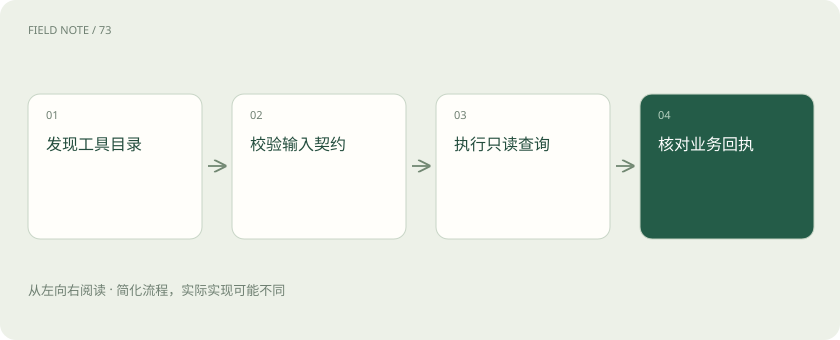
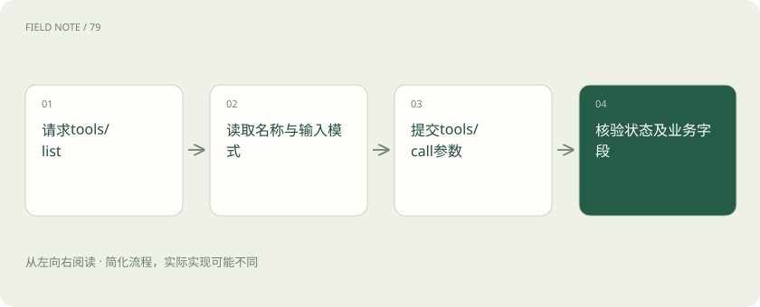
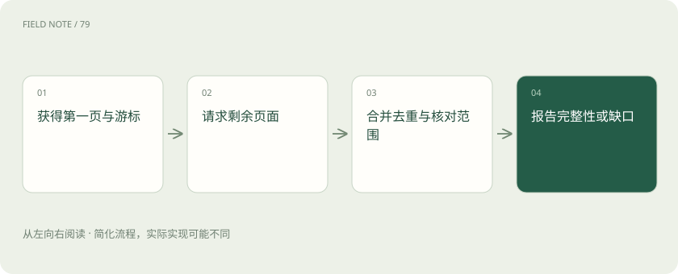

# MCP 工具契约：读懂一次 CRM 查询

> 沿着查询客户记录的过程，学会检查工具参数、数据范围、分页和失败状态，让总结有事实依据。

专题：协议与技能 · 整理于 2026-11-05

## 先说这篇在讲什么

假设你要让助手整理客户的拜访情况，第一步不是直接写总结，而是查对客户、填好查询条件，再检查记录有没有取全。本篇沿着一次 CRM 查询，解释工具清单、参数、返回结果和分页如何配合。读完后，你能看出“接口有回应”和“报告事实完整”之间还差哪些检查。

## 先看一个具体例子

例如，crm_activity_search 首次返回二十条记录和下一页标记。助手继续取回剩余七条，去重后报告二十七条；若第二页失败，则报告“已获取二十条，查询未完整”，而不宣称全部完成。

## 遇到陌生概念，可以先读

展开前置阅读建议

- [MCP、A2A 与 Skills：接口、委派和方法为什么要分开](stack-protocols.md)
- [Codex：模型、执行框架与客户端怎样组成编程助手](stack-codex.md)

## 先用一个类比理解

像去窗口查档案：先找对窗口、填对申请单，最后确认拿到的资料是否完整。

类比只帮助建立直觉，不等同于完整机制。

## 一图看懂

## 先分清：查资料、办事情、套格式

你让助手整理客户 C17 的拜访记录，它需要三样东西：客户资料、查询记录的入口、纪要的写法。MCP 把这三类帮助分别叫 Resources、Tools 和 Prompts。可以把它们想成资料柜、办事窗口和空白表格。

需要执行查询时用工具，需要读取已有资料时看资源，需要复用提问或报告格式时用提示模板。三者能配合，但模板不会自动查询最新记录，资料也不会因为改名叫工具就能执行动作。

分类还不能说明安全程度：资料柜可能放着手机号，工具也可能只算一道加法。能不能用，仍要看具体数据和操作。

## 填对表格，还要查对客户

查询入口要求填客户编号、开始日期、结束日期和每页条数。这些字段的格式要求叫输入模式，好比表格上写着“日期请填年月日”。先按要求填写，系统才知道你要查什么。

例如填写 C17、2026-08-01 到 2026-10-31，还要明确采用哪个时区、是否包含最后一天。后台随后检查客户是否存在、是否属于员工团队、时间跨度是否过大。格式正确只完成了第一步。

没填筛选条件和填了空列表也可能不同。前者可能采用最近一个月，后者可能取消筛选。说明必须写清楚，助手不能凭直觉猜。

## 先拿今天能用的工具清单

助手所在的应用先通过 tools/list 获取工具清单，再看每个工具做什么、怎么填参数。清单也可能分几页，需要继续读取才能知道完整内容。

换一个员工登录，可用工具可能不同；服务升级，名字和返回字段也可能变化。应用不能把第一次拿到的清单永久沿用。支持清单变化通知时应据此刷新，调用失败时也要考虑信息是否过期。

保存清单时应区分身份和版本。否则新员工可能看到旧员工的入口，助手也可能用昨天的填写方式调用今天的工具。清单只是发现入口的依据，并不证明已经办成事情。

## 沿着一次查询看谁在做事

用户说“总结 C17 最近活动”，应用先确认 C17 指的是哪家公司。如果两家公司同名，就先分清对象，不能让模型随手猜一个编号。

宿主应用叫 Host，负责承接任务；连接工具服务的组件叫 Client，负责按 MCP 规则通信；服务端则真正检查员工团队并查询记录。Client 找到 crm_activity_search 后提交参数，服务端才开始执行。

假设返回三条记录和下一页标记，Host 可以整理这三条，但还不能称它们为全部。它要继续查询，或明确告诉用户当前仅得到部分记录，并说明员工能看见的数据范围。

## 收到结果后，先读数字的含义

工具可以返回一段文字，也可以返回便于程序读取的字段，例如条数、查询区间和下一页标记。这类有固定组织方式的数据叫结构化内容。输出模式可以规定字段格式，应用仍要检查数字到底代表什么。

比如 total_visible=3 表示当前权限下可见三条，不等于公司总共三条。还要区分活动发生时间、数据更新时间和本次查询时间，不能把昨天的缓存说成刚刚查到的新事实。

金额是否含税、条数是否去重，也需要明确。字段是数字只能证明它能被程序读取，不能证明它符合这份报告需要的统计方法。

## 有响应，不一定查成功

像快递系统回了“无法派送”，收到回信不代表包裹送到了。工具同样可能正常返回一条执行失败说明。应用要先看状态和错误内容，再决定是否可以总结业务事实。

参数格式不对、工具名字不存在、客户无法访问、CRM 临时故障，处理方法各不相同。临时故障可以按限制重试；权限拒绝不能靠换一个工具入口绕过。

有的系统为保护隐私，不区分客户不存在还是无权访问。这时向用户说明无法读取即可，不能连续试探附近编号寻找隐藏客户，也不能把空结果说成客户没有任何活动。

## 模型提要求，MCP 负责传递

模型可能生成一份结构化请求：“调用这个名称的函数，参数如下。”这通常叫函数调用。它表达的是模型想做什么，还需要应用把请求交给真正能执行的服务。

MCP 解决应用与能力服务怎样交流。Host 可以把 MCP 工具说明转换成模型供应商支持的函数描述，再把模型给出的参数送往工具。转换时要处理名称、参数和结果的差异。

应用可以不用 MCP 而直接实现函数调用，也可以让用户点击按钮调用 MCP。压缩工具说明时要保留单位、日期范围等关键要求，否则模型虽能提出请求，却容易填错内容。

## 验收时，把报告追到原始记录

检查助手是否可靠，可以准备一个有跨团队记录、没有活动的客户，以及活动超过一页的客户。让它分别查询，观察是否正确处理权限、空结果和分页。

保留脱敏后的工具清单版本、实际参数、员工可见范围、返回状态和报告，可以逐步核对一句结论从哪里来。不必把客户隐私全文放进日志，但应能找到相应查询证据。

清单上有工具、模型提出调用、服务端执行成功、报告引用正确，是连续几步。最后一句“查询成功”的截图无法代替这些证据。验收重点是事实能否追溯、缺失是否说明。

## 图解：从目录到实际调用

发现目录提供调用依据，真正执行还需参数与业务校验。

## 图解：分页结果的有限交付

页面读取失败时保留已知事实和未完成范围，不能把部分数量当作总量。

## 放在一起对比

| 组成部分 | 负责什么 | 边界或修正方向 |
| --- | --- | --- |
| Tools | 执行调用动作 | 描述不等于已执行 |
| Resources | 提供可读取上下文 | 可读不等于无敏感性 |
| Prompts | 提供消息模板 | 模板不等于实时事实 |

## 读完先记住这一句

工具返回后，还要核对客户、范围、分页和状态，才能写出可靠总结。

## 常见误区

容易误会的是：接口响应成功与完整业务查询成功不同；遗漏分页仍可能形成格式正确但事实不全的报告。

## 想一想

试着判断：工具只返回第一页时，能把当前条数写成客户全部活动数吗？

查看解释

判断依据是：不能。需要依据分页标记继续获取或明确截断与可见范围；响应成功不能证明数据完整。

## 关联阅读

- [MCP 授权治理：身份成立之后还要核对什么](mcp-auth-governance.md)
- [MCP、A2A 与 Skills：接口、委派和方法为什么要分开](stack-protocols.md)

## 原始资料

- [Tools 调用契约](https://modelcontextprotocol.io/specification/2026-07-28/server/tools)
- [Resources 上下文](https://modelcontextprotocol.io/specification/2026-07-28/server/resources)
- [MCP 原语概览](https://modelcontextprotocol.io/specification/2026-07-28)

原创讲解；图示和类比经过简化，数字示例不代表实测。工具功能以对应版本官方资料为准。
