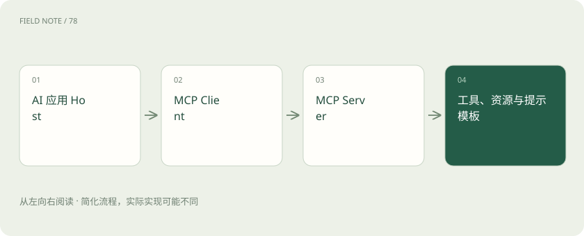

# MCP、API、Skill：三个词，三种职责

> API 提供能力接口，MCP 统一部分连接方式，Skill 通常组织可复用的任务指导。

专题：智能体 · 整理于 2026-11-04

## 前置阅读

- [Agent 和工作流：从回答问题到执行任务](agent.md)

## 先用一个类比理解

API 像某台设备的操作面板；MCP 像统一接头；Skill 像操作手册。接头和手册都不会自动赋予使用设备的权限。

类比只帮助建立直觉，不等同于完整机制。

## 一图看懂

## API 是更广泛的接口概念

查天气、读取订单、调用模型都可以通过 API。MCP 不是用来替代所有 API，而是让 AI 应用以共同协议发现和使用外部能力；服务器背后仍可能调用普通业务 API。

## MCP 的几个角色

Host 是承载 AI 功能的应用，Client 与 Server 建立协议连接。Server 可以暴露工具、资源和提示模板。各客户端支持范围、传输方式与协议版本可能不同，接入前应核对。

## Skill 的含义取决于平台

很多工具把任务说明、脚本和参考资料打包为 Skill，指导助手如何完成某类工作。它不是一个能包办全部平台的统一执行协议。需要什么权限仍由应用和运行环境控制。

## 真实场景

一个知识助手通过 MCP 连接文档服务，服务内部调用文档 API；另有“周报 Skill”规定摘要结构。这三层可以同时存在。

## 常见误区

MCP 不保证工具可信，也不代表接上就能访问全部数据。外部内容中的指令仍应被当作不可信输入。

## 想一想

有了 MCP 就不需要 API 和权限验证了吗？

查看解释

仍然需要。协议连接、业务接口和访问控制是不同职责。

## 关联阅读

- [工具可靠性：接口成功为何仍可能办错事](agent-tool-reliability.md)
- [智能体记忆：上下文、笔记与长期存储](agent-memory.md)
- [多智能体协作：分工收益与协调成本](multi-agent-coordination.md)

## 原始资料

- [MCP · 协议介绍](https://modelcontextprotocol.io/docs/getting-started/intro)
- [Agent Skills · 概览](https://agentskills.io/what-are-skills)

原创讲解；图示和类比经过简化，数字示例不代表实测。工具功能以对应版本官方资料为准。
