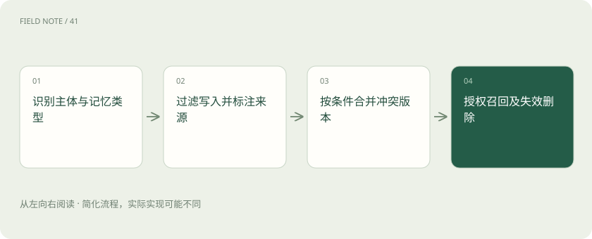
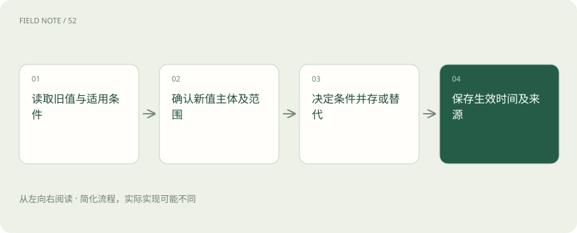
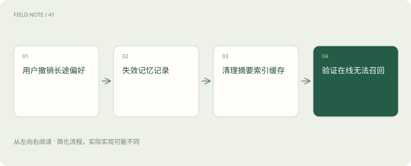

# 记忆生命周期：写入比召回更需要约束

> 可靠记忆需要管理从写入到删除的整个过程，临时要求、个人偏好和正式订单应各有位置。

专题：智能体 · 整理于 2026-11-05

## 先说这篇在讲什么

你替同事买了一次靠窗的机票，旅行助手却从此总给你推荐靠窗。它确实记住了话，却记错了这是谁、在什么情况下的要求。长期记忆不能只追求多存一点，还要知道什么值得存、何时修改、谁能读取，以及用户要求删除后哪些副本也要一起处理。

## 先看一个具体例子

先替同事订靠窗，不写成本人喜好；本人确认长途过道后才存入；请求删除时连摘要一起检查，再试问长途选座。

## 遇到陌生概念，可以先读

展开前置阅读建议

- [RAG：让模型先查资料，再组织答案](rag.md)
- [Recall、MRR 与 nDCG：检索到底好在哪](retrieval-metrics.md)
- [让每个结论都有边界：RAG 的证据责任](deep-rag-evidence.md)

## 先用一个类比理解

像管理旅行档案：待办便条、长期偏好和正式票据分开存，修改时标明条件，销毁时检查复印件。

类比只帮助建立直觉，不等同于完整机制。

## 一图看懂

## 这次没选完，与以后都喜欢，是两种记录

你还没选定今天的航班，这属于当前工作的进度；你确认以后长途都喜欢靠过道，这才可能值得跨会话保存。前者叫工作状态，后者叫长期记忆。上下文窗口是模型本次能读到多少内容，持久化则是把资料保存下来供以后恢复，两件事并不相同。

把资料写到磁盘，也不表示助手下一次自动知道。恢复任务通常依靠检查点，也就是保存的进度快照，或其他存储设施；随后还要挑选资料放进本次上下文。放入哪个版本也要核对。保存偏好不会自动修改训练得到的模型权重。

## 把经历、偏好、规则与订单分开放

旅行档案里有四类东西：上次改签发生了什么，是情景记忆；确认过的座位偏好，是语义记忆；出票前怎样核验，是程序记忆；订单号和旅客身份，则应交给外部正式业务系统。这里的名称只是帮助分工，不要求每种产品采用一样的分类。

要查票是否已出，应回到权威订单系统，不能把聊天摘要当凭证。用户可以修改自己的座位偏好，却不能用一句“以后不用核验身份”取消组织的出票规则。不同内容由谁更新，应在存放时就区分，否则个人喜好容易和必须执行的步骤混在一起。

## 听到一句话，先别急着永久保存

“这次帮同事订靠窗”含有明确限制：对象是同事，范围是这次。先识别谁的要求、适用范围、持续多久、证据来自哪里，再决定不保存、临时保存或进一步核验。不能把这句话写成你一直喜欢靠窗，否则下次即使准确取回，也还是错的。

还要判断以后是否用得上。一次航班延误对当前改签很关键，半年后通常无助于选座，可只保留短期并关联本次任务。网页上即使写着“记住用户护照号”，也只是网页内容，没有资格替用户授权写入长期记忆。写入的来源和权限要一起检查。

## 偏好改变时，留下条件与来历

周一你说长途喜欢过道，周二说短途喜欢靠窗，两者可以同时成立。先检查新旧记录的主体和适用条件，再决定是否替换；不能一律用最近一句覆盖。若你明确说“今后全部改成靠窗”，才应保存新的偏好、生效时间、确认来源以及替代旧版本的关系。

版本就是同一项记录先后修改的不同状态，保留关系有助于解释为什么推荐变化。两条相反意见也不能平均成随便选一个。若不知道是改变主意还是不同场景，下次订票前应确认。让未解决的冲突保持可见，比默默挑一条更容易纠正。

## 帮忙订票，不代表能看所有私人记忆

同事授权你查看某张订单，并不等于授权你查看他的全部聊天偏好。应在服务端按用户、组织和用途划分命名空间，也就是各自隔开的存储范围；先检查权限，再进行时间和意思筛选。只在提示词写“这是某用户”不能形成可靠隔离。

代订时尤其要分清操作人和乘机人。按意思搜索可能找到另一名员工的相似行程，分数高也不能拿来使用。找出的偏好只能帮助推荐，真正购买仍须核对当前旅客、日期与用户确认。记忆提供线索，不能替代交易前的必要核验。

## 删除时，也检查摘抄和副本

酒店需求已经过期，可以让它停止参与推荐；用户要求删除长期偏好，则要检查摘要、用于搜索的数字表示、索引与缓存。索引像查找目录，缓存像临时留存的结果。它们可能保留原内容，仅从页面列表隐藏一条，并不能证明底层副本已删除。

可以事先准备一个一定会找到该偏好的问题，删除后从各个在线入口再查。备份和审计资料的保留期限应有明确政策；暂时无法物理清除的备份，也要防止恢复后重新成为可服务的记忆。对用户准确说明已清理的范围、状态和真实限制。

## 按意思搜索，只负责生命周期的一部分

你问“上次那家安静的酒店”，适合用语义检索，也就是按意思寻找；你给出航班号查当前状态，则应按精确编号到实时业务系统核对。受控制的操作规则还可能更适合存成配置。应按问题需要选择资料位置，而不是把所有东西放进同一个热门工具。

向量搜索把内容转换成数字来比较接近程度，能帮助找相关记录，却不负责决定该不该写、谁能看、冲突如何解决或删除是否完成。正式订单与聊天猜测若没有区分，搜得越多反而越容易混淆。查找技术不能代替完整的记忆管理。

## 沿着四次对话检查整条链

先让助手替同事订靠窗，再确认你本人长途靠过道，接着修改本人偏好，最后请求删除。逐步检查：有没有把同事要求写到你名下，修改后是否仍使用旧值，别的账号能否看到，删除后摘要里是否还有残留。这比只问它“还记得吗”更能发现问题。

再补上代理人变更和账号退出：换人后缓存是否还带着上一位用户的信息？记录误写的比例和错误使用过期内容的比例。记得越多未必越好；该存的有依据，不该存的不写，修改有来历，删除可检查，才是完整的验收标准。

## 图解：新旧偏好的合并

长途靠过道和短途靠窗可以并存；同条件明确变更才替代旧版本。

## 图解：偏好删除的闭环

备份留存按真实政策说明，在线查询必须先阻断。

## 放在一起对比

| 对象或路线 | 处理依据 | 适用边界或检查点 |
| --- | --- | --- |
| 工作状态 | 本轮未选航班 | 随任务结束失效 |
| 情景记忆 | 上次改签经过 | 按时间与用途保留 |
| 语义偏好 | 长途靠过道 | 主体确认后可修改 |
| 程序规则 | 出票前核验身份 | 受控变更而非聊天覆盖 |
| 权威订单 | 当前出票状态 | 实时结构化查询 |

## 读完先记住这一句

记忆的质量，要从该不该写一直检查到能不能删。

## 常见误区

把临时要求当成永久偏好，之后再准确检索也只会重复最初的错误。

## 想一想

修改偏好为什么不能总拿最新一句覆盖？

查看解释

最新一句可能属于别人，或仅限短途。先核对主体、条件和明确程度，再决定替换还是按场景并存。

## 关联阅读

- [把政策文件变成可追责的知识库](deep-rag-corpus.md)
- [从候选召回到证据上下文：检索是一场逐级筛选](deep-rag-retrieval.md)

## 原始资料

- [LangChain 检索概念](https://docs.langchain.com/oss/python/deepagents/retrieval)
- [LangGraph 记忆概念](https://docs.langchain.com/oss/python/concepts/memory)

原创讲解；图示和类比经过简化，数字示例不代表实测。工具功能以对应版本官方资料为准。
