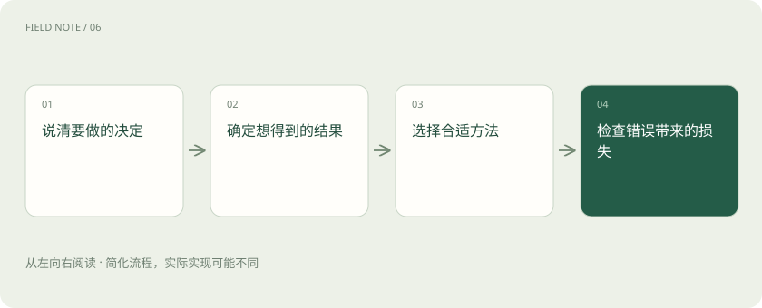
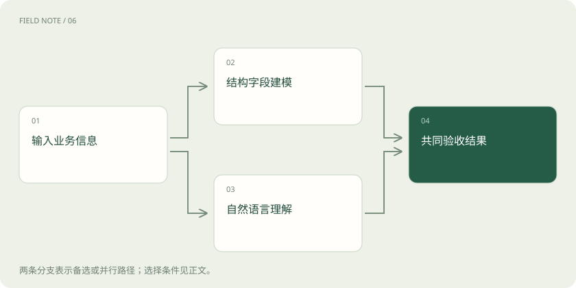
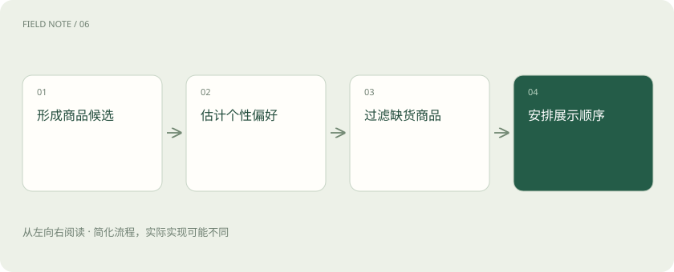

# 机器学习任务地图：先确定要预测什么

> 围绕一家生鲜店区分类别、数量、群体、排序与未来，建立传统机器学习和大语言模型的选型依据。

专题：AI 基础 · 整理于 2026-11-05

## 前置阅读

- [AI、机器学习、大模型，到底是什么关系？](ai-map.md)

## 先用一个类比理解

像经营一家生鲜店：判断商品是否滞销、估计备货量、给顾客分组和安排推荐商品，是四种不同的工作。

类比只帮助建立直觉，不等同于完整机制。

## 一图看懂

## 先写出决策再选择模型

一家生鲜店希望“用上人工智能”，这个愿望还不是机器学习任务。负责人必须先说明预测发生在什么时刻、输入当时能知道什么、输出将改变哪个决定。例如每天关店时决定明日进货量，输出应是一个数量；顾客进入商城时安排商品顺序，输出应是一列商品。两个任务即使使用同一张订单表，训练样本、目标与验证方法也不同。

这里的全部商店场景都是教学设计，非实测。学习者不需要写程序，可以先用纸画出“观察—预测—决定—结果”四格。若结果根本没有被记录，就不能直接声称能够进行监督学习。规则、人工判断和补充采集数据，也都是合理的起点。

## 分类回答属于哪一类

分类预测离散类别，例如某笔订单是否会取消。训练时需要历史订单在观察窗口结束后的真实结果，模型学习输入与取消之间的统计关系。二分类不意味着只能输出是或否，很多模型先给出一个分数，再由阈值把分数转为行动。分数也不能未经校准便当成精确概率。

店员只能每天电话确认二十笔订单时，阈值应结合处理能力与漏报代价确定。降低阈值通常会找出更多潜在取消，也会联系更多最终正常的顾客。选择分类模型之前，先问类别标签是否可靠，是否把尚未完成观察期的订单误记成“不会取消”。这种标注错误比模型名称更直接影响结果。

## 回归预测连续数量

回归回答“多少”，例如预测一笔采购的损耗重量。数字标签与类别编号不同：把苹果、香蕉分别编号为一和二，不会使商品识别变成回归；这里的数值大小没有可相加的业务意义。损耗公斤数则可以比较距离，预测多一公斤和多十公斤的错误程度不同。

平均误差也要结合业务解释。少订货可能失去订单，多订货可能造成报损，两种方向的损失并不对称。可以评估分位数预测或按业务代价构造目标，而不只追求一个对称的平均误差。输出一个区间还能够提示店长哪些日期不确定性较高，需要保留人工调整空间。

## 聚类发现相似群体

聚类没有预先给出的正确客户类别，它依据选定特征和相似性定义把顾客组织起来。例如按购买频率、客单价与生鲜占比分组，可能发现一组高频小额采购者。群体是数据和距离定义共同产生的结构，不是自动发现了顾客的真实身份，也不意味着同组的人应该收到相同营销。

如果客单价使用元、频率使用次数，大数值特征可能主导距离，因此缩放与特征选择会改变结果。店长需要查看每组样本、解释稳定性，并验证分组是否帮助实际决策。把组号写成一、二、三只是命名，不能解释为消费能力从低到高，更不能据此推断个人动机。

## 推荐重点在候选与排序

推荐为特定顾客安排候选商品，通常先从大量商品中召回一个小集合，再排序，并加入库存等约束。它可以使用分类分数、回归分数或专门的排序目标，但业务问题不是独立判断每件商品好不好。界面只展示六个位置，商品之间存在位置竞争，缺货商品再高分也不能直接推荐。

历史点击受旧界面曝光影响。没点击一个从未展示的商品，不代表顾客不喜欢它。评估必须区分候选能否覆盖相关商品、排序能否把它们放在前面，以及上线后是否增加有效购买。只提高点击率可能诱导夸张图片，降低利润或增加退货，所以推荐目标需要同时观察后续结果。

## 预测未来首先尊重时间

预测明日销量通常是回归形式，但时间结构使验证方式不同。季节、节假日、促销与供货中断都可能影响未来。把未来订单随机混入训练集，会让评估看似优秀，却无法模拟店长在今天做决定时真正拥有的信息。所谓预测不是因为输出带日期便自动具有可靠性。

应选择一个历史截止日，只用此前可获取的数据训练，再预测之后的一段时间。商品真实需求还可能被缺货掩盖：卖出十箱不代表需求只有十箱。店长应分别记录库存不足和实际销量，否则模型容易把被压低的销售当成正常需求，持续给缺货商品安排过少库存。

## 传统模型和语言模型各有输入优势

如果主要信息是整齐的订单字段、样本规模有限、需要稳定低延迟，线性模型、树和集成方法通常值得作为基线。大语言模型擅长处理自然语言表达和开放式生成，可以从顾客留言中提取需求，或解释预测依据，但生成流畅说明不等于数值预测更准确。

可以让语言模型把“希望周末送到，别选太熟的”整理成结构化要求，再交给库存与配送系统执行。此时语言理解与数量预测是不同模块，分别评估。也可以比较端到端方案，但必须让它们使用相同可用信息和成本边界，不能把额外人工清洗数据的收益全部记在模型能力上。

## 把任务写成可以验收的契约

最后为生鲜店写一句完整目标：“每天二十二点，使用此前的销售和库存，为次日每种商品给出进货建议，按缺货与报损的综合成本验收。”这句话明确了时点、输入、对象、输出与代价，比“采用先进算法”更能指导落地。若需要顾客分群，应另写一份探索任务说明。

上线前先比较人工规则、简单统计和候选模型；上线后还要检查供应商改变、节假日错位及反馈延迟。分类、回归、聚类、推荐和时间预测可以组合，但每个环节必须有明确责任。一个系统可能先聚类分析群体，再预测商品需求，最后生成解释，不能用最后一段漂亮文字代替前面各环节的验证。

## 图解：两类输入的选型分支

结构数据和语言输入走不同处理路径后，回到同一业务结果验收。

## 图解：商品推荐的四个关口

推荐包含候选、偏好、可用性与位置竞争。

## 放在一起对比

| 任务维度 | 一种选择 | 另一种选择 |
| --- | --- | --- |
| 输出 | 分类：离散类别 | 回归：连续数量 |
| 标签 | 聚类：没有目标类别 | 监督学习：有目标结果 |
| 主要能力 | 结构化建模：数值与类别关系 | 语言模型：语言与多模态表示（也可结合结构数据） |
| 验证 | 随机同分布样本 | 未来预测：按时间回放 |

## 真实场景

本站教学例子，非实测：先用简单规则估计次日备货量，用分类器标记高报损风险，再让语言模型解释促销反馈；各环节用自己的目标验收。

## 常见误区

没有事先定义业务输出，只因工具热门便选择大模型，可能把可直接验证的预测问题变成难以验收的聊天回答。

## 想一想

为什么顾客分组编号不能直接解释成消费等级？

查看解释

聚类组号只是命名，含义取决于特征和相似性定义，必须查看样本并独立验证。

## 关联阅读

- [AI、机器学习、大模型，到底是什么关系？](ai-map.md)

## 原始资料

- [scikit-learn：监督学习](https://scikit-learn.org/stable/supervised_learning.html)
- [scikit-learn：无监督学习](https://scikit-learn.org/stable/unsupervised_learning.html)

原创讲解；图示和类比经过简化，数字示例不代表实测。工具功能以对应版本官方资料为准。
