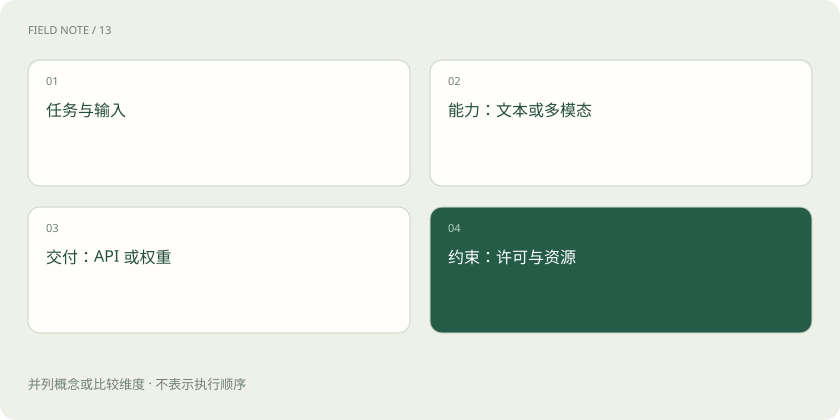

# 文本、多模态、推理模型与开源权重，怎么区分？

> 看模型时，分别问：能接收什么、能生成什么、擅长哪些任务、能否下载使用。

专题：模型能力 · 整理于 2026-11-04

## 先说这篇在讲什么

你看到“支持图片”“推理模型”“开放权重”，容易以为它们都在描述模型有多强。其实这是几个不同问题：它能看什么、能输出什么、擅长什么，以及怎样使用。先把这些分开，就不容易被标签绕晕。

## 先看一个具体例子

把一张扫描报价单交给模型，它可能正确说出“有五种零件”，却把其中一项单价读错。确认金额时，应回到原图核对；不能只因为总结写得很流畅就认为表格也读准了。

## 遇到陌生概念，可以先读

展开前置阅读建议

- [AI、机器学习、大模型，到底是什么关系？](ai-map.md)

## 先用一个类比理解

看模型标签像挑手机：能拍照、能录音、存储多大、是否支持某种应用，是不同指标，不能合并成一个“全都行”。

类比只帮助建立直觉，不等同于完整机制。

## 一图看懂

## 多模态：能看图、听声音，还是能生成它们

“模态”可以先理解为信息的形式，例如文字、图片、声音、视频。“多模态”就是涉及不止一种形式。有的模型接收图片后用文字解释，有的还能生成图片；有的能听录音，却不能生成语音。因此，能看图和能画图，是两项不同能力。

## 能上传图片，为什么还会看错表格

想象你给朋友发一张很模糊的报价单：他可能认得出这是一张表，却看不清 8 和 3，也可能把价格对应到错误型号。模型也有类似限制。图片分辨率就是画面包含多少细节；图太小、字太密、表格跨页，都可能让信息丢失。“支持图片”只说明有接收图片的能力，不是保证每个数字都能读对。

## 录音和视频也会丢信息

录音太长，可能需要分段处理；视频常常不会把每一帧都完整交给模型，而是选取部分画面，这叫采样。如果只看到动作前后的两帧，就可能漏掉中间发生的事。一次允许处理多少内容，又受到模型和软件的长度限制。这些限制影响实际效果，不只是文件能不能上传。

## 两个“推理”，说的事情不同

“推理模型”通常强调解题、分步计算或检查结果的能力；“模型推理服务”则是把模型运行起来，接收问题并返回结果。普通聊天模型同样需要推理服务。可以类比“擅长解题的人”和“让人接单工作的服务”：前者讲本领，后者讲运行过程。

## 能下载模型，不等于所有东西都公开

开放权重通常意味着能取得保存模型参数的文件。它不自动表示训练资料也公开，或所有使用方式都没有条件。通过 API 使用模型，则是把请求交给别人的服务运行。选择时先确认自己的任务能否完成，再看下载、部署、服务和许可方面的具体说明。

## 放在一起对比

| 任务举例 | 交给模型的内容 | 希望得到的结果 | 仍要注意 |
| --- | --- | --- | --- |
| 看图问答 | 图片和问题 | 文字说明 | 认出表格不代表每个数都读准 |
| 生成图片 | 文字要求或参考图片 | 新图片 | 能看图不自动代表能画图 |
| 识别录音 | 一段声音 | 转成文字 | 噪声、口音和否定词可能影响结果 |
| 理解视频 | 视频或选取的画面 | 动作或事件说明 | 抽到的画面可能漏掉中间动作 |

## 读完先记住这一句

能收到一种材料，不等于能准确处理其中所有细节。

## 常见误区

看到“支持图片”就推断能精确读任何扫描表格，或看到“开放权重”就推断训练资料和一切使用权都开放，都会误解标签。

## 想一想

能理解图片的模型，一定能按要求画一张图吗？

查看解释

不一定。接收图片并理解内容，与生成图片，是不同的输入输出能力，要分别确认。

## 关联阅读

- [视觉理解与 OCR：看见文字不等于读懂表格](vision-ocr.md)
- [ASR 与 TTS：从声音到文字，再到声音](speech-asr-tts.md)
- [云端还是本地：从一项业务试点做选择](cloud-local-case.md)

## 原始资料

- [Hugging Face · 模型卡](https://huggingface.co/docs/hub/model-cards)
- [Transformers · 多模态聊天](https://huggingface.co/docs/transformers/chat_templating_multimodal)

原创讲解；图示和类比经过简化，数字示例不代表实测。工具功能以对应版本官方资料为准。
