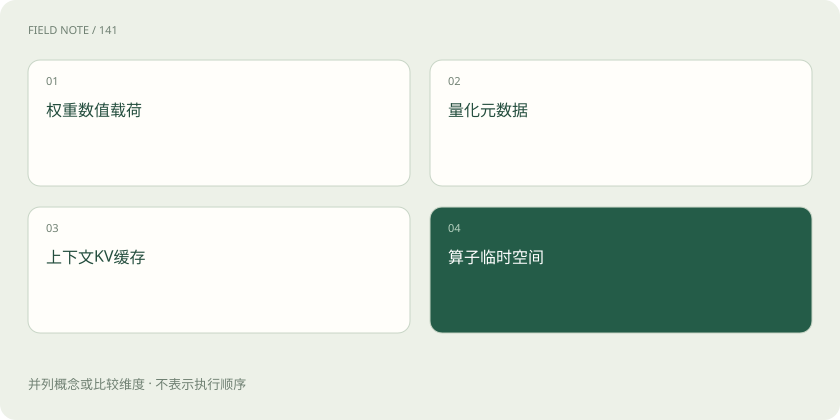
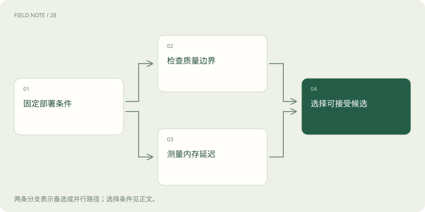

# 模型压缩：精度、内存与延迟如何一起衡量

> 压缩可以减少数字精度、删去部件或训练小模型，但文件更小不保证运行更快，也必须检查关键回答质量。

专题：训练与对齐 · 整理于 2026-11-05

## 先说这篇在讲什么

想把维修助手放进现场设备，先别急着追求最小文件。设备能否装下、多久开始回答、数字阈值有没有答错，都要一起看。这里从具体使用条件讲起，解释量化、剪枝和蒸馏分别改变什么，以及如何判断压缩真的值得。

## 先看一个具体例子

权重文件缩小后，长手册仍撑满 KV 缓存；应固定输入长度测试缓存方案，不能只继续压缩权重。

## 遇到陌生概念，可以先读

展开前置阅读建议

- [GPU、显存和量化：模型为什么装不下？](gpu-memory.md)

## 先用一个类比理解

像整理出差行李：换小包装、删掉物品和改带简化工具是不同办法，要试过能否完成现场工作。

类比只帮助建立直觉，不等同于完整机制。

## 一图看懂

## 维修设备装不下模型，先确定要省什么

现场维修助手希望离线运行，设备内存小，用户又希望尽快看到建议。这时压缩有价值，但要先区分模型文件占多少硬盘、加载权重占多少内存、运行最高占多少，以及多久出现第一个字、之后生成多快。它们是不同指标，不能拿一个代替全部。

例如文件变小了，长手册的运行缓存仍可能撑满设备。如果硬件不擅长处理低精度数字，压缩后还可能更慢。比较前要固定设备、执行软件、输入与输出长度和同时服务人数。否则测到的变化可能来自测试条件，而不是压缩方法。

## PTQ：训练完以后换一种数字记法

模型参数是许多数字。训练后量化 PTQ 用占位更少的数字表示已有权重，有些方案也量化激活，即计算过程中产生的中间结果。标定数据是一批有代表性的试用材料，用来观察数值范围或选择量化设置。通常不用完整重新训练，但准备、转换和检查仍需计算与时间。

四位表示每个数的编码位数较少，却没说清怎样分组、怎样处理正负范围、哪些层参与、是否量化激活。维修助手的标定材料应包含数字阈值、缩写、长输入和需要拒答的问题。只拿简单闲聊标定，可能遗漏重要场景的数值范围，导致压缩后的专业判断变差。

## QAT：练习时就适应更粗的数字

量化感知训练 QAT 会在训练中模拟或纳入低精度表示的影响，让模型有机会调整参数，适应数字变粗后的误差。它通常比直接 PTQ 多用训练数据和算力。训练时用的模拟方式还需要与部署后真实执行方式对应，训练完成并不等于设备已经能高效运行。

假设量化后的助手把少量安全阈值答错，可以把 QAT 列为候选修复办法，再检查其他能力有没有下降。它不是无损压缩保证，也不能承诺任意低位宽都恢复原表现。数据、目标和设备支持都会影响结果，新增训练费用也应算进总成本。

## GPTQ 与 AWQ：怎样减少量化带来的错误

GPTQ 和 AWQ 都属于常见的训练后权重量化方法。GPTQ 利用标定时观察到的激活和相关误差信息，逐步量化并补偿权重误差。AWQ 利用激活信息判断哪些权重通道对输出更重要，再通过缩放等办法减轻低精度误差。因此它们并非简单地把所有数字一律四舍五入。

这两种方法也不负责学习最新维修规则。效果取决于模型、实现、标定样本、分组方式及设备上的执行内核，也就是实际完成数值运算的软件部件。别处的加速演示不能直接当作本设备表现，还要确认输出格式受支持、转换是否占额外空间，以及代码与模型权重各自的使用条件。

## 十六位变四位，只能先算原始数字账

用十亿个参数举例：每个参数十六位，相当于两个字节，原始数字约二十亿字节；四位相当于半个字节，约五亿字节。这个算术例子得到理论四倍缩减，说的是原始数值载荷，不是已经测得整台设备少用四倍内存。

实际还需要保存缩放因子、零点等换算信息，还可能有未量化层、内存对齐、运行缓存和临时工作区。转换或加载时若原版与压缩版同时存在，峰值甚至更高。有些运算还会先把数字还原到较高精度再执行。报告要分别列文件大小、常驻权重和完整运行峰值。

## KV 缓存：模型变小后，长手册仍可能装不下

模型逐字生成回答时，会存下已经处理过的文字对应的键和值，称为 KV 缓存，避免每次都重新计算所有历史。缓存随上下文长度、同时请求数、层数、KV 头数和数值精度变化。分组查询注意力会改变相关头数，因此不能只根据模型参数数量估计缓存。

权重量化后，缓存可能反而成为主要内存开销。KV 量化专门降低这部分精度，可能让更长手册装得下，但也增加转换成本和误差。必须测试模型能否在长文中准确找回限制条件；短问答平均分可能发现不了问题。后端是否支持对应缓存格式，也影响能否真正部署。

## 剪枝是删部件，蒸馏是教小模型

剪枝会移除部分权重、通道、注意力头或层。非结构化剪枝可能只是让许多位置变成零，原来的大表形状仍在；没有合适的稀疏执行支持，设备可能照样逐个算。结构化剪枝直接减少某些部件，更容易缩小真实计算规模，但可能伤害能力，并需要重新训练补救。

蒸馏则让较小的学生模型学习教师的答案、输出分布或中间行为。学生结构更小，有机会真正少算，但不会自动继承教师全部知识。只练常见维修故障，可能丢掉罕见风险边界，教师错误也可能传下来。蒸馏可与量化组合，每一步都应单独检查损失。

## 先守住回答质量，再比较设备成本

验收维修助手时，除了内存和速度，还要检查专业正确性、危险建议、是否恰当拒答，以及长文中的依据能否找准。一个数字阈值错误可能比几句措辞变化严重得多，不能只看平均语言质量。先设最低质量要求，再比较达到要求的候选，才知道哪个适合现场。

四位模型更小却更慢时，可以评估较高精度、不同批量或更小的蒸馏学生。TorchAO 提供量化等效率优化工具，但真实收益仍取决于模型格式、执行内核和设备。保存测试条件与版本，区分理论估算和真实测量；本文没有进行训练或设备跑分，位宽数字也不是速度承诺。

## 图解：内存账本分开核对

并列账目共同构成运行需求，不能用一项替代总量。

## 图解：压缩候选的验收路径

质量与资源是并行约束，任何一侧失败都不能直接准入。

## 放在一起对比

| 选择 | 机制或收益 | 限制与核验 |
| --- | --- | --- |
| PTQ | 训练后量化 | 标定与内核影响结果 |
| QAT | 训练适应量化误差 | 增加训练成本 |
| 剪枝 | 移除权重或结构 | 稀疏不保证加速 |
| 蒸馏 | 小模型学习教师行为 | 覆盖与容量限制迁移 |

## 读完先记住这一句

压缩是否成功，要同时看目标设备上的质量、内存与速度。

## 常见误区

把原始数字从十六位降到四位，直接说成总内存降四倍、回答快四倍；额外数据与执行方式都会影响结果。

## 想一想

剪掉许多权重并变成零，为什么回答速度仍可能没变？

查看解释

如果原有大表形状没变，执行软件仍按完整表计算，零值不会自动减少工作，还可能多出管理成本。

## 关联阅读

- [GPU、显存和量化：模型为什么装不下？](gpu-memory.md)

## 原始资料

- [torchao 官方文档](https://docs.pytorch.org/ao/stable/index.html)
- [AWQ 原仓库](https://github.com/mit-han-lab/llm-awq)
- [GPTQ 原论文](https://arxiv.org/abs/2210.17323)
- [AWQ 原论文](https://arxiv.org/abs/2306.00978)
- [KIVI 缓存量化原论文](https://arxiv.org/abs/2402.02750)

原创讲解；图示和类比经过简化，数字示例不代表实测。工具功能以对应版本官方资料为准。
