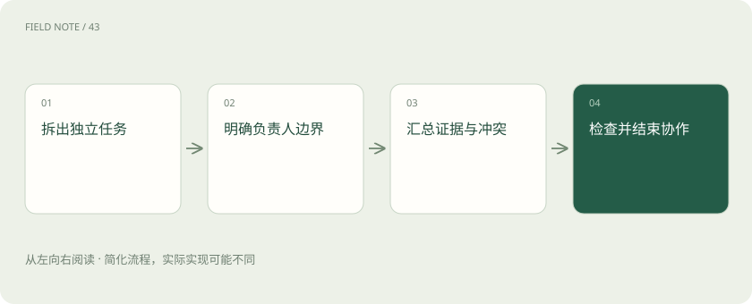

# 多智能体协作：分工收益与协调成本

> 多个智能体可以分别搜集证据、提出方案或复核结论，适用于能够独立推进的子任务。

专题：智能体 · 整理于 2026-11-04

## 前置阅读

- [计划与停止：智能体怎样避免一直忙下去](agent-planning.md)

## 先用一个类比理解

像编辑部，采访、核实与审稿可分工，但同一稿件要明确谁能改。

类比只帮助建立直觉，不等同于完整机制。

## 一图看懂

## 概念边界

多个智能体可以分别搜集证据、提出方案或复核结论，适用于能够独立推进的子任务。它们仍可能共享同一模型的偏差，多次一致不等于独立证据，也不应简单用投票替代事实核验。

## 内部怎样运作

协作需要明确负责人、输入输出、共享状态和终止规则。并行修改同一材料可能互相覆盖，消息过多也会挤占上下文。对有严格顺序依赖的任务，增加参与者可能反而延长完成时间。

## 把机制放进具体场景

调查设备故障时，可让不同智能体分别查维护记录和厂家手册，再由负责人对照时间线。若两者都引用同一篇转载，不能算两份独立证据；若同时修改最终结论，应指定合并规则以防互相覆盖。

## 取舍与容易忽略的限制

协作需要控制共享信息的范围。完整转发全部历史会扩大上下文成本，也可能把某个未经证实的假设传播给所有参与者。让每个角色提供来源、确定程度和未解决问题，更利于负责人识别真正分歧。独立任务适合并行，强依赖任务则应等待前一步产生可用输入后再启动。

## 真实场景

一名智能体审核账单、另一名检查合同费率，可以并行读取材料；最终核算必须等费率口径确定，否则两个看似独立的金额结论无法直接拼接。

## 常见误区

先衡量分工带来的质量收益，再扣除协调延迟、调用费用和故障面。

## 想一想

三个智能体给出相同答案，是否就是三份独立证据？

查看解释

不是，它们可能共享训练偏差、同一来源或前一个智能体的结论。

## 关联阅读

- [计划与停止：智能体怎样避免一直忙下去](agent-planning.md)
- [工具可靠性：接口成功为何仍可能办错事](agent-tool-reliability.md)
- [模型裁判：先校准评分，再相信排行榜](judge-calibration.md)

## 原始资料

- [multi agent research system](https://www.anthropic.com/engineering/multi-agent-research-system)

原创讲解；图示和类比经过简化，数字示例不代表实测。工具功能以对应版本官方资料为准。
