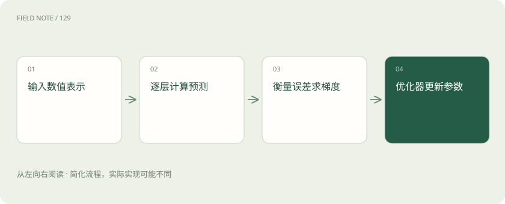
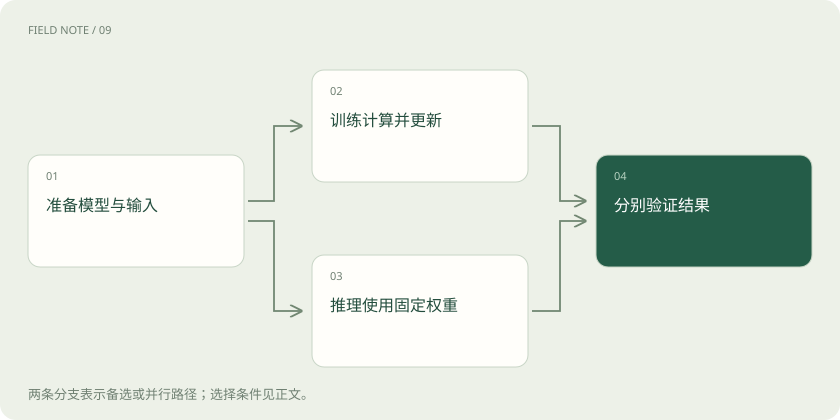

# 神经网络怎样学习：从一次预测到参数更新

> 神经网络先把资料变成数字，逐层计算预测，再根据误差求出参数的调整方向，由优化器更新；能否用于新数据还要另行验证。

专题：AI 基础 · 整理于 2026-11-05

## 先说这篇在讲什么

便利店想估计明天要备多少盒鲜奶，可以把过去的价格、促销和天气交给一个计算模型。模型先算出数量，再利用历史实际销量调整内部数字。本篇沿着这件事说明神经网络怎样计算、怎样训练，以及为什么训练成绩变好后，还需要用未来日期检查。

## 先看一个具体例子

先用某天资料预测鲜奶需求，再对照实际销量算损失；反向传播求参数梯度，优化器更新一次。然后用未参与训练的日期重新预测，检查是否真的改善。

## 遇到陌生概念，可以先读

展开前置阅读建议

- [损失和梯度：模型怎样知道该往哪改](loss-gradient.md)
- [概率、Logits 与 Softmax：模型“有把握”是什么意思？](probability-softmax.md)

## 先用一个类比理解

像一张带有许多可调数字的计算表：输入沿公式得到预测，用历史答案检查误差，再调整数字，最后拿新资料检验。

类比只帮助建立直觉，不等同于完整机制。

## 一图看懂

## 先把备货资料整理成数字

便利店拿到价格、日期、天气和商品名称后，不能把整张杂乱表格直接当作可靠输入。价格要统一单位，缺失值要处理，商品名称也要转换成适当数字。神经网络处理的是数值数组，张量就是这类可以有多个维度的数组；图片可以用像素或图像块表示，文字可以拆成Token并变成向量，向量是一组数字。

把鲜奶编号设为八、面包设为二，只是在区分商品，并不表示鲜奶需求是面包的四倍。类别需要合适编码，也可以让模型学习表示它的数字。连续数量还要检查尺度。输入怎样整理，决定网络能利用什么信息，训练并不能无条件修复缺失或混乱的资料。

## 一层计算会组合出一组新数字

模型先把价格乘一个数、促销标记乘另一个数，再相加并加上一个调整量，就得到一个中间结果。这里乘的数叫权重，加上的调整量叫偏置，它们都是训练中可改变的参数。一层可以同时做许多这样的组合，下一层继续处理上一层算出的结果，最后产生需求估计。

可以直观理解为前一层组合价格与促销，后一层再结合天气和商品信息。但这只是帮助理解，并不表示某个计算单元必定专门负责“购买意愿”。这些单元有时叫神经元，它们是数学计算，并非人的脑细胞。信息常分散在许多数字里，不能看一个权重就编出完整因果故事；层数、连接方式、数据和目标共同影响效果。

## 为什么层与层之间还要加一道处理

鲜奶小幅降价时销量变化不大，降价很大时却可能明显上升。若每层都只按固定比例相加，即使叠很多层，整体仍可合成一次同类计算，难以表达这种随范围改变的反应。激活函数是在层之间加入的非线性运算；非线性指变化不必始终按同一比例进行，让网络有机会表示更复杂关系。

能表示这种关系，不代表训练一定能找到，也不代表它适用于未来。若历史资料里从未出现大幅降价，模型在这一范围的估计仍可能很差。观察到一条弯曲的预测线，只说明计算能画出它，不能证明商店的实际需求就遵守这条线。模型还需要覆盖相应情况的数据和独立验证。

## 先算预测，再规定错多少算严重

模型输入某天的资料，沿各层公式算出预测销量，这个过程叫前向计算。随后把预测与历史实际销量比较，用一个公式得到误差分数，这个公式叫损失函数。数量预测可以用适合任务的误差公式；如果任务是判断商品属于哪类，则常使用和类别概率有关的目标，不能把所有问题都套同一分数。

损失规定训练优先修正什么。假如缺货的代价远高于多备少量商品，仅看平均误差可能忽略少见却昂贵的缺货日。训练分数与最终经营成本并不总是一致。应分别观察训练损失、新数据上的预测指标以及真正的报损和缺货结果。损失下降可以说明训练目标改善，却不能直接证明商店经营一定变好。

## 从误差倒着算每个参数的影响

某天预测八十盒、实际一百盒，程序需要知道当前哪些参数微调会让误差变小。反向传播沿刚才的计算步骤倒着求导，使用的是链式法则：把相连运算的局部变化关系接起来。得到的梯度描述在当前数据和参数附近，微小改变参数会怎样影响损失，不能理解为给某个单元分配业务责任。

PyTorch的autograd等自动微分工具可以记录需要求导的运算，再据此计算梯度。算出梯度后参数通常还没更新，需要后续优化器执行更新；求导也不是把正确答案直接存进权重。数值精度、运算结构及梯度截断等处理都可能影响结果。出现异常时，应检查数据和计算过程，而不是说模型没有认真思考。

## 有了方向，还要决定每次改多少

梯度提示附近哪个方向可能降低损失，优化器再根据当前梯度以及可能保存的历史信息修改参数。学习率就是控制改动步幅的设置：太大可能越过有用区域甚至不稳定，太小则进展缓慢。训练经常每次只看一部分样本，因此不同批次的方向会有波动，曲线不必每一步都下降。

batch是一次处理的一批样本，通常每批更新一次，也可以先累积几批梯度再更新；epoch通常表示把训练数据完整遍历一遍。因此批次数、遍历轮数和参数更新次数并不是同一个数。批次增大还会影响内存、处理速度和优化效果。比较设置时，应一起说明总数据量、更新次数和验证效果，不能只凭每秒样本数判断更好。

## 实际使用模型，不等于继续训练

商店输入明天天气，预测从八十变成九十盒，可能只是输入不同导致计算结果不同，内部参数并没有改变。训练通常包含求梯度和更新参数；推理是使用已有参数算结果。聊天时提示词、上下文、随机采样或外部记忆也能改变回答，不能因此认定模型每聊一次就学会了新知识。

某些系统会额外运行训练流程，那需要明确说明参数在哪里、何时更新。运行设置也要分清：评估模式会改变某些层的工作方式，关闭梯度记录则控制是否保存自动微分所需信息，这是两个操作。进入评估模式既不是重新训练，也不保证全部随机性或内存开销消失。参数和运行配置承担不同职责。

## 最后用没参与训练的日期检查

如果网络只在过去资料上预测准确，商店仍不能放心让它决定明天备货。它可能记住样本，或偷偷利用了预测时还不可能知道的字段，这叫数据泄漏；历史答案本身也可能带偏差。参数成功更新、训练误差降低、真实任务有效，是三件需要分别证明的事。

评估应使用没有参与拟合和调参的数据，并保留简单规则或简单模型作对照。备货时尤其应按真实时间提供当时能知道的输入，再检查新商品、促销日和普通日的数量误差与经营代价。若网络在未来日期回放中不能稳定超过规则，就应保留规则并寻找原因。更复杂的网络通常需要更多数据和资源，理解训练过程有助于验证假设，而不是让所有问题都默认换成神经网络。

## 图解：计算梯度与更新参数分开

梯度计算依赖当前计算图；优化器更新是随后的独立环节。此图只画一次训练步。

## 图解：训练与推理的两条路径

这里比较两种运行用途，不表示一次任务必须同时训练和推理；在线自适应需要另说明更新机制。

## 放在一起对比

| 环节 | 直接承担什么 | 不能据此判断 |
| --- | --- | --- |
| 前向计算 | 从输入计算预测 | 参数已经学习新知识 |
| 损失函数 | 定义当前优化差异 | 业务收益必然增加 |
| 反向传播 | 计算参数的局部梯度 | 参数已经更新或因果解释成立 |
| 优化器更新 | 按规则改变参数 | 未见任务表现必然提高 |
| 独立评估 | 检查未见条件表现 | 覆盖所有未来分布 |

## 读完先记住这一句

训练是在误差指导下更新参数，是否学到可用规律必须用新数据检查。

## 常见误区

求梯度、更新参数和切换评估模式是不同操作；把它们混在一起，会误判模型何时学到了东西。

## 想一想

改了提示词后答案变了，能说明模型参数已经更新吗？

查看解释

不能。输入变化本来就可能改变输出。只有实际执行了参数更新过程，才有依据讨论权重怎样改变；效果还需要独立数据验证。

## 关联阅读

- [泛化与数据泄漏：高分为什么可能没有用](generalization-leakage.md)
- [一句话穿过 Transformer：从文字到下一个词](deep-transformer-journey.md)
- [训练框架分工：PyTorch、Transformers、PEFT 与 TRL](training-framework-stack.md)

## 原始资料

- [PyTorch：自动微分](https://docs.pytorch.org/tutorials/beginner/basics/autogradqs_tutorial.html)
- [PyTorch：优化模型参数](https://docs.pytorch.org/tutorials/beginner/basics/optimization_tutorial.html)
- [Transformers：Trainer 与梯度累积](https://huggingface.co/docs/transformers/main_classes/trainer)

原创讲解；图示和类比经过简化，数字示例不代表实测。工具功能以对应版本官方资料为准。
