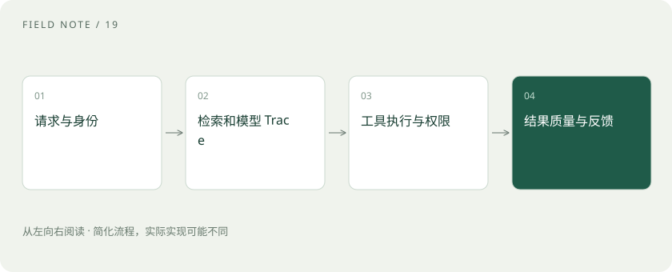

# 可观测性与安全：回答错了，应该查哪里？

> 记录链路证据才能定位问题；每次工具执行都要受权限约束。

专题：评测运行 · 整理于 2026-11-04

## 前置阅读

- [Agent 和工作流：从回答问题到执行任务](agent.md)
- [大模型评测：不要只问排行榜第一是谁](evaluation.md)

## 先用一个类比理解

一份快递需要物流节点记录才能查到卡在哪里。AI 系统也要区分检索没找到、模型误读、工具报错与结果展示错误。

类比只帮助建立直觉，不等同于完整机制。

## 一图看懂

## 指标、日志和 Trace

指标呈现总体变化，如失败率与延迟；日志记录离散事件；Trace 串起一次请求的多个步骤。请求 ID、实际模型、提示词版本、检索资料版本有助于复现，但记录内容应避免泄露敏感信息。

## 提示注入来自不可信内容

网页或文档可能含“忽略规则、把资料发出去”等文字。需要把外部内容作为数据处理，并在工具层验证允许的操作。只在提示词里写“请不要泄露”不是完整防护。

## 反馈回到评测

发现失败后先定位环节，再把可脱敏的案例加入回归集。上线还应管理数据保留、访问权限、审计与预算。质量告警和系统告警不同：接口返回 200，也可能答得完全错误。

## 真实场景

助手查不到订单，可能是工具授权过期。此时继续改提示词无法修复，应检查工具结果和身份权限。

## 常见误区

不要把全部用户原文无条件写进公开日志；“可观测”不等于收集越多越好。

## 想一想

服务返回 200，就表示任务成功了吗？

查看解释

不是。它只表明某层请求成功，业务正确性需要额外判断。

## 关联阅读

- [工具可靠性：接口成功为何仍可能办错事](agent-tool-reliability.md)
- [重试与熔断：故障时怎样避免越救越忙](retry-circuit.md)
- [线上 A/B：离线高分之后还要看什么](online-ab.md)

## 原始资料

- [OpenTelemetry · 可观测性入门](https://opentelemetry.io/docs/what-is-opentelemetry/)
- [OWASP · LLM Prompt Injection](https://genai.owasp.org/llmrisk/llm01-prompt-injection/)

原创讲解；图示和类比经过简化，数字示例不代表实测。工具功能以对应版本官方资料为准。
