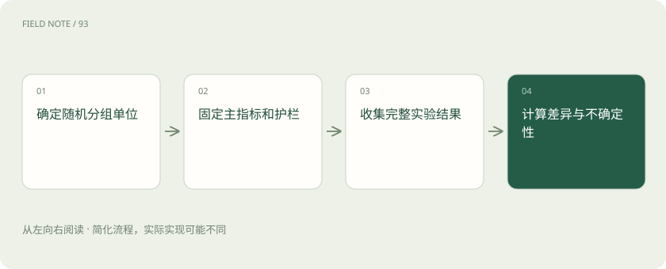

# 线上 A/B：离线高分之后还要看什么

> 让用户随机使用不同方案，比较办事结果，同时检查费用、投诉和错误操作。

专题：评测运行 · 整理于 2026-11-04

## 先说这篇在讲什么

练习题上表现更好，不代表真实用户办事就更顺。可以让一部分用户继续用旧助手，另一部分用新助手，同期比较任务是否完成。这就是 A/B 实验。分组要尽量公平，也要提前说好看什么、看多久，避免刚看到一天好成绩就急着宣布新版获胜。

## 先看一个具体例子

新版让用户发出更多消息，可能是聊得深入，也可能是第一轮没答明白。把消息量与工单完成、重复提问原因一起看，才能解释变化。

## 遇到陌生概念，可以先读

展开前置阅读建议

- [大模型评测：不要只问排行榜第一是谁](evaluation.md)

## 先用一个类比理解

像同期开放两扇服务窗口，随机分配顾客，再看谁真正办成了事。

类比只帮助建立直觉，不等同于完整机制。

## 一图看懂

## 让两组面对尽量相似的任务

像把顾客随机分到两扇服务窗口，A/B 实验把符合条件的用户或任务分给两个方案。可以按用户、会话或整个组织分组，具体取决于谁会互相影响。同一个任务不要做到一半换组。还要核对两组的问题难度、出现时间是否接近；如果新版专接简单题，完成率更高也说明不了模型更好。

## 先说好怎样算赢，什么时候结束

实验前选一个最关心的结果，例如任务完成率，称为主指标。同时列出不能明显变坏的保护指标，例如错误操作、投诉、响应时间和费用。新版完成率提高却频繁下错订单，不能算成功。还要事先安排需要多少样本、观察多久、什么时候可以停止。样本太少或每天看一眼、挑领先那天结束，都容易把偶然波动当成改进。

## 算清楚提升了多少，再判断是不是巧合

假设两组各做1000次任务，A完成600次，B完成640次。完成率从60%变成64%，差了4个百分点；用这4除以原来的60，得到相对提升约6.67%。这是这次看到的差异，还不能保证再来一批用户仍如此。需要用统计方法估计差异可能波动多大，并按事先约好的停止规则作判断。

## 分组随机，也要检查实际有没有跑偏

如果白天全用A、夜晚全用B，用户和任务差异就会混进结果。若同一个用户反复换组，已经学会的用法也可能影响比较。实验期间应检查实际分配是否符合设计。最后除了问差异是否可能由随机波动造成，还要问这点收益是否值得部署和运营投入，以及投诉、错误操作等是否仍在团队能接受的范围内。

## 读完先记住这一句

同期随机比较真实任务结果，同时检查错误、投诉和费用有没有变坏。

## 常见误区

用户待得更久不一定更满意，也可能是一直没办成事。先看任务结果，再解释停留时间。

## 想一想

完成率从60%变成64%，该说提高4%吗？

查看解释

准确说是提高4个百分点；相对于原来的60%，提高比例约为6.67%。

## 关联阅读

- [大模型评测：不要只问排行榜第一是谁](evaluation.md)
- [模型裁判：先校准评分，再相信排行榜](judge-calibration.md)
- [TTFT、吞吐、P95 和成本：一张性能报告怎么看？](latency-cost.md)

## 原始资料

- [experimentation platform exp](https://www.microsoft.com/en-us/research/group/experimentation-platform-exp/)

原创讲解；图示和类比经过简化，数字示例不代表实测。工具功能以对应版本官方资料为准。
