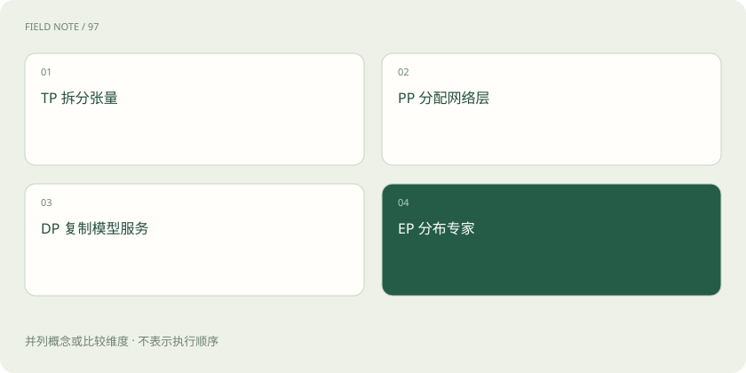

# TP、PP、DP、EP：多张卡究竟分了什么

> 多张 GPU 可以分担一个模型，也可以各跑一个副本；不同并行方式分担的东西不同。

专题：推理设施 · 整理于 2026-11-04

## 先说这篇在讲什么

四个人一起做饭，可以各做一份完整套餐，也可以有人切菜、有人炒菜，还可以共同完成一道大菜。GPU 的并行也有不同分工，TP、PP、DP、EP 就是常见的几种安排。

## 先看一个具体例子

两台机器各有多张卡，但机器之间网络较慢。把频繁通信的张量分片跨机器放置，可能不如把完整服务副本分开部署，具体仍取决于模型能否在单机装下。

## 遇到陌生概念，可以先读

展开前置阅读建议

- [GPU、显存和量化：模型为什么装不下？](gpu-memory.md)

## 先用一个类比理解

像分办宴席：切一道菜、分烹饪工序、复制厨房、分专门菜系是不同方案。

类比只帮助建立直觉，不等同于完整机制。

## 一图看懂

## TP：一起算同一部分

TP 是张量并行。张量可以先理解为多维数组，模型里的大矩阵就属于其中一种。把某些大运算分给多张卡一起算，结果还要交换和合并。它能帮助运行较大的模型，也依赖设备间通信。

## PP：不同卡接力完成不同层

PP 是流水线并行。模型的前面几层交给一组设备，后面几层交给另一组，像生产线接力。若只有少量任务，可能出现一部分卡在等上一段的情况，因此切分与任务安排会影响利用率。

## DP：各自处理不同样本或请求

DP 是数据并行。训练时，多个副本处理不同数据，再按训练规则同步；服务时，多个独立副本也可以分担用户请求。副本增加主要改善可同时接待多少人，并不等于单个请求自动用上所有副本的显存。

## EP：不同设备放不同专家

EP 是专家并行，常见于 MoE 模型。不同专家分布在不同设备，路由把需要的计算交过去。若很多内容集中找同一批专家，就可能出现有人忙、有人闲。几种并行方式还可以组合，但组合后要同时考虑显存、通信与调度。

## 放在一起对比

| 方式或概念 | 主要作用 | 关键边界 |
| --- | --- | --- |
| TP | 拆张量计算 | 设备间通信 |
| PP | 拆网络层阶段 | 流水线空闲 |
| DP | 复制服务副本 | 不能自然减少单副本权重 |
| EP | 分布专家 | 专家负载不均 |

## 读完先记住这一句

先问拆的是模型、计算步骤、请求，还是专家，再问用了几张卡。

## 常见误区

卡越多不保证单请求越快，必须明确是在解决装不下还是处理不过来。

## 想一想

增加 DP 副本能否自动让每个副本占用更少权重显存？

查看解释

不能，每个完整副本仍需容纳相应权重，切分权重需要其他并行方式。

## 关联阅读

- [GPU、显存和量化：模型为什么装不下？](gpu-memory.md)
- [vLLM、批处理、并行与 Kubernetes 各管什么？](serving-stack.md)
- [PD 分离的下一层：KV 传输和容量配比](pd-kv-capacity.md)

## 原始资料

- [vLLM · parallelism scaling](https://docs.vllm.ai/en/latest/serving/parallelism_scaling/)
- [vLLM · Expert Parallel Deployment](https://docs.vllm.ai/en/latest/serving/expert_parallel_deployment/)

原创讲解；图示和类比经过简化，数字示例不代表实测。工具功能以对应版本官方资料为准。
