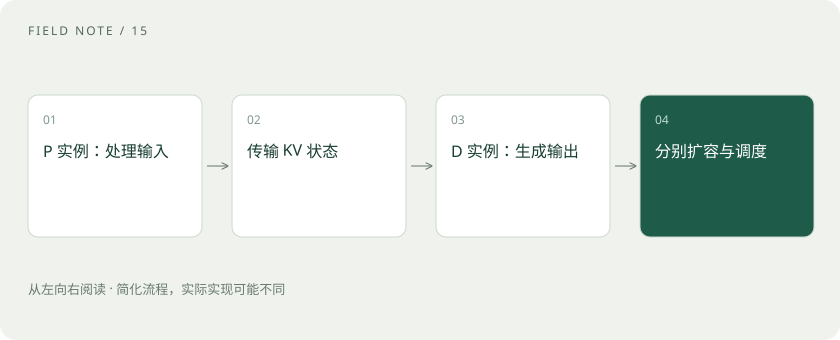

# PD 分离：把读题和写答案交给不同实例

> P 是 Prefill，D 是 Decode；分离后要在实例间传递 KV 状态。

专题：推理设施 · 整理于 2026-11-04

## 前置阅读

- [Prefill、Decode 与 KV Cache：一次回答的内部旅程](prefill-decode.md)

## 先用一个类比理解

餐厅把备菜和出餐分工，能分别安排人手，也会增加传菜与协调。若传菜太慢，分工未必比一体完成更好。

类比只帮助建立直觉，不等同于完整机制。

## 一图看懂

## 为什么想要分离

长输入处理与持续生成的资源特征不同。混合运行时，调度和资源竞争可能影响首 Token 延迟或生成间隔。分离为两阶段独立调优、扩容与调度提供了空间。

## 关键不是两个字母，而是传输和调度

Prefill 完成后，Decode 实例需要相应的 KV 状态。网络带宽、传输实现、兼容性和额外排队都影响结果。系统还要处理实例选择、失败恢复以及资源利用不平衡。

## 如何判断适不适合

比较相同模型、硬件预算、输入输出分布和到达流量下的端到端指标。观察 TTFT、生成间隔、满足延迟目标的吞吐与成本。低并发或短输入场景中，通信与复杂度可能抵消收益。

## 真实场景

假设业务既有超长文档分析，又有正在流式生成的问答，可以评估隔离阶段是否缓解干扰；不能仅凭架构图就宣布吞吐翻倍。

## 常见误区

PD 分离不是训练和推理分离，也不是自动把一个大模型切成两个不同模型。具体实现能力应以对应引擎版本为准。

## 想一想

网络很慢时，PD 分离还能保证更快吗？

查看解释

不能。KV 传输与排队可能使端到端性能变差。

## 关联阅读

- [PD 分离的下一层：KV 传输和容量配比](pd-kv-capacity.md)
- [TP、PP、DP、EP：多张卡究竟分了什么](parallelism-types.md)
- [TTFT、吞吐、P95 和成本：一张性能报告怎么看？](latency-cost.md)

## 原始资料

- [vLLM · Disaggregated Prefilling](https://docs.vllm.ai/en/latest/features/disagg_prefill/)

原创讲解；图示和类比经过简化，数字示例不代表实测。工具功能以对应版本官方资料为准。
