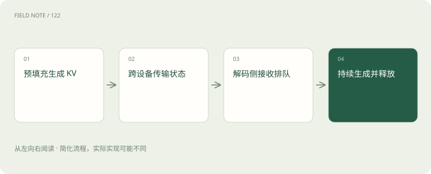

# PD 分离的下一层：KV 传输和容量配比

> 预填充与解码拆开后，输入计算产生的 KV 状态必须送到解码侧。

专题：推理设施 · 整理于 2026-11-04

## 前置阅读

- [PD 分离：把读题和写答案交给不同实例](pd-disaggregation.md)

## 先用一个类比理解

像前后厨分开经营，半成品运输和两边产能必须对得上。

类比只帮助建立直觉，不等同于完整机制。

## 一图看懂

## 概念边界

预填充与解码拆开后，输入计算产生的 KV 状态必须送到解码侧。传输不是免费的：数据量受序列长度、层数、KV 头与精度影响，网络拥塞或目标显存不足都可能抵消隔离收益。

## 内部怎样运作

预填充能力与解码能力要按真实流量配比，长输入短输出和短输入长输出需要不同配置。还需处理传输失败、状态生命周期和排队。拆分便于分别扩容，也增加连接器、调度和观测复杂度。

## 把机制放进具体场景

假设每个请求传输0.5GB的KV，每秒到达8个请求，则平均需传4GB/s。若有效传输能力只有3GB/s，队列会增长。又假设平均解码持续5秒，则稳定状态约有40个活跃解码请求；按每个起始KV为0.5GB估算已有20GB，还没计入增长与额外开销。

## 取舍与容易忽略的限制

容量规划既要看平均流量，也要看突发与长尾。长输入突然增多时，KV传输量上升；长输出增多时，解码驻留时间拉长，两者可能同时挤占接收侧空间。分离部署需要明确背压和状态回收机制，否则取消请求或传输失败留下的状态会继续占用容量，并把局部故障扩散到排队链路。

## 放在一起对比

| 方式或概念 | 主要作用 | 关键边界 |
| --- | --- | --- |
| 合并部署 | 同实例处理两阶段 | 可能互相干扰 |
| PD分离 | 分别调度和扩容 | 增加KV传输与容量协调 |

## 真实场景

夜间批量上传长报告会偏重预填充，白天短问长答则偏重解码。两阶段固定一比一配置可能同时在不同时间闲置一侧、挤满另一侧。

## 常见误区

PD 分离不是默认更快，低负载或网络条件不足时合并部署可能更合适。

## 想一想

预填充计算够快，为什么解码仍可能迟迟开始不了？

查看解释

KV传输、接收侧容量或排队可能成为新的瓶颈。

## 关联阅读

- [PD 分离：把读题和写答案交给不同实例](pd-disaggregation.md)
- [TP、PP、DP、EP：多张卡究竟分了什么](parallelism-types.md)
- [连续批处理与分块预填充：让不同请求一起走](batching-prefill.md)

## 原始资料

- [vLLM · disagg prefill](https://docs.vllm.ai/en/latest/features/disagg_prefill/)

原创讲解；图示和类比经过简化，数字示例不代表实测。工具功能以对应版本官方资料为准。
