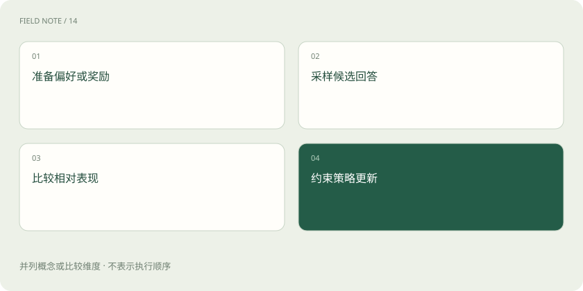

# DPO、RLHF、GRPO：怎样学习回答偏好

> 给同一个问题的几份回答比较好坏，可以用来调整模型更倾向怎样作答。

专题：训练与对齐 · 整理于 2026-11-04

## 先说这篇在讲什么

你给新人看两份客服回复：一份未经查询就承诺已退款，一份说明需要先查订单。告诉他后者更合适，就是一种偏好反馈。模型也可以利用类似比较继续学习，但“更好”的标准要讲清楚，否则它可能只学会讨好评分。

## 先看一个具体例子

若评分只看礼貌，一份“非常抱歉，已经退款成功”的假承诺也可能拿高分。要把是否有依据、是否真实执行纳入判断。

## 遇到陌生概念，可以先读

展开前置阅读建议

- [SFT：用示范回答教会任务形式](sft-behavior.md)

## 先用一个类比理解

像比较两份工作结果来教新人判断好坏，而不只是让他照抄一份标准答案。

类比只帮助建立直觉，不等同于完整机制。

## 一图看懂

## 先看“哪份更好”教的是什么

指令样本给一份示范答案，偏好数据则比较同一请求下的两份或多份答案。例如比较有依据地说明不确定，与编造确定结论。偏好可以关注准确、清楚、简洁或安全，但要符合具体任务；维修操作里为了简短删掉断电要求，就不一定是好回答。

## RLHF：先学评分，再用评分调整行为

RLHF 常指利用人类反馈的强化学习。一条经典路线是先让人比较回答，用比较结果训练奖励模型，也就是学习打分的模型；再根据这个评分继续调整回答模型。这里的“奖励”是训练信号，不是模型真的获得人类意义上的奖品。评分器也会错，需要检查它偏爱了什么。

## DPO：直接利用收集好的比较

DPO 可以利用已有偏好对，让模型更倾向被偏好的回答。可以先理解成直接从两份答案的比较中学习，而不必照搬前面先训练奖励模型、再进行同样在线强化学习的流程。它仍然是在调整参数，不是运行时临时问一次裁判。更深入的公式在后续章节再看。

## GRPO：生成一组，再作相对比较

GRPO 通常让当前模型对同一问题产生一组答案，按奖励在组内比较，形成更新方向。奖励可以来自人，也可以来自规则或其他评价器，例如算式是否正确。若奖励只看某种表面特征，模型可能把这个特征做得很好，却没解决真正目标。改进局部评分时，也要观察其他任务有没有退步。

## 放在一起对比

| 方式或概念 | 主要作用 | 关键边界 |
| --- | --- | --- |
| 经典RLHF | 奖励模型加策略优化 | 奖励可能被投机 |
| DPO | 从偏好对直接优化 | 依赖偏好数据覆盖 |
| GRPO | 比较同题一组回答奖励 | 奖励设计至关重要 |

## 读完先记住这一句

模型会朝评分鼓励的方向变化，所以评分标准本身需要认真设计。

## 常见误区

偏好不是客观真理本身；不同任务的好答案标准可能不同，评分漏洞也可能被放大。

## 想一想

为什么训练分数提高，实际回答仍可能更糟？

查看解释

因为奖励可能只衡量了好听、长短或表面格式，没有衡量事实和任务结果。模型可能更会拿分，却没更会办事。

## 关联阅读

- [SFT：用示范回答教会任务形式](sft-behavior.md)
- [模型裁判：先校准评分，再相信排行榜](judge-calibration.md)
- [训练数据质量：先修教材再加课时](data-quality.md)

## 原始资料

- [TRL · GRPO Trainer](https://huggingface.co/docs/trl/en/grpo_trainer)
- [TRL · DPO Trainer](https://huggingface.co/docs/trl/en/dpo_trainer)
- [TRL · Reward Trainer](https://huggingface.co/docs/trl/en/reward_trainer)

原创讲解；图示和类比经过简化，数字示例不代表实测。工具功能以对应版本官方资料为准。
