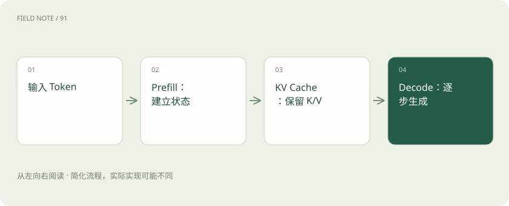

# Prefill、Decode 与 KV Cache：一次回答的内部旅程

> 先处理已有输入，再逐步生成；KV Cache 保存可复用的注意力计算状态。

专题：推理设施 · 整理于 2026-11-04

## 前置阅读

- [Transformer、Attention 和 MoE：不看公式也能理解](transformer.md)
- [GPU、显存和量化：模型为什么装不下？](gpu-memory.md)

## 先用一个类比理解

像先读完题目做笔记，再逐句写答案。笔记帮助避免每写一句都从头重复部分计算，但笔记会占空间，也不能代替原理上的完整计算。

类比只帮助建立直觉，不等同于完整机制。

## 一图看懂

## Prefill 主要处理输入

在常见自回归 Transformer 服务中，输入 Token 经过模型计算并形成 KV 状态。输入长短、是否命中前缀缓存、硬件和批次安排都会影响这部分时间。

## Decode 逐步产生输出

生成一个 Token 后，把它加入后续生成的条件。缓存此前 Token 的 Key 和 Value，可避免在后续步骤中重复计算它们；仍要进行新 Token 的相关计算与注意力操作。

## 缓存有不同层次

会话内 KV Cache、跨请求前缀缓存、完整回答缓存是不同东西。前缀缓存依赖相同且可兼容的前缀状态；它不保证语义相近的任意问题都能复用，也不直接缩短输出 Token 数。

## 真实场景

许多用户使用同一段长系统提示词时，前缀缓存可能节省重复输入计算；如果每次开头都不同，命中机会可能减少。

## 常见误区

KV Cache 不是知识库，也不是一份永久聊天记录。缓存复用还要考虑租户隔离与数据安全。

## 想一想

复用了输入前缀，后续几百字回答是否就不必生成？

查看解释

仍需生成。前缀缓存主要减少可复用输入部分的计算。

## 关联阅读

- [缓存感知路由：把请求送到有共同前缀的地方](cache-routing.md)
- [连续批处理与分块预填充：让不同请求一起走](batching-prefill.md)
- [PD 分离：把读题和写答案交给不同实例](pd-disaggregation.md)

## 原始资料

- [vLLM · 前缀缓存](https://docs.vllm.ai/en/latest/features/automatic_prefix_caching/)
- [vLLM · Paged Attention](https://docs.vllm.ai/en/latest/design/paged_attention/)

原创讲解；图示和类比经过简化，数字示例不代表实测。工具功能以对应版本官方资料为准。
