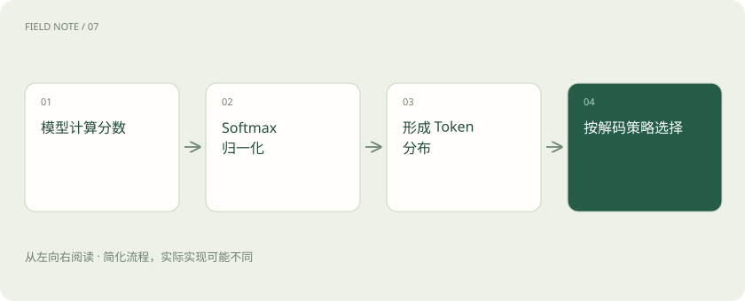

# 概率、Logits 与 Softmax：模型“有把握”是什么意思？

> 模型对下一 Token 的分布，不等于对整段答案真实程度的置信度。

专题：AI 基础 · 整理于 2026-11-04

## 前置阅读

- [Token、上下文和幻觉：为什么它会忘，也会编？](tokens-context.md)

## 先用一个类比理解

餐厅预测下一位顾客更可能点哪道菜，和判断这道菜的食材说明是否真实，是不同问题。

类比只帮助建立直觉，不等同于完整机制。

## 一图看懂

## 先区分分数和概率

Logits 是模型输出的未归一化分数，可正可负，不要求总和等于1。Softmax 对分数做指数变换再归一化，得到一组非负、总和为1的值。它把相对分数转成当前候选集合上的分布，不会核查外部事实。

## 三个候选的教学例子

假设只存在三个候选，Logits 为 [0,0,0]，Softmax 给每个候选1/3。若分数为 [ln2,0,0]，指数值是 [2,1,1]，概率就是 [1/2,1/4,1/4]。这解释了归一化，不代表真实词表只有三个词。改变温度会进一步改变分布的尖锐程度。

## 高概率词序列也会说错话

训练数据里常见的说法，可能得到很高的下一词概率，但事实可能已经过期。一个由常见词组成的错误日期，不会因为句子流畅而变真。把多 Token 的概率组合成整段分数还会受到长度与切分方式影响，不能直接变成统一的事实正确率。

## 置信度校准要靠外部结果

如果一个系统说“90%把握”的100个同类判断中只有60个正确，它的把握就没有校准好。校准需要明确预测事件、可靠标注与独立样本。检索相似度、裁判评分、自报信心和真实正确率是不同量，展示时要分别解释口径。

## 真实场景

模型非常肯定地说某项制度仍有效，但它使用的是旧资料。应检查制度发布日期与当前版本，而不是把回答语气当证据。

## 常见误区

Softmax 分布归一化不代表事实已被验证；也不是所有模型接口都会提供 Token 概率。

## 想一想

下一个 Token 的概率为90%，能说整段答案有90%概率正确吗？

查看解释

不能。二者对应的事件和测量方法不同，事实正确率需要另行评估。

## 关联阅读

- [温度、Top-p 与解码：答案为什么会变](sampling-decoding.md)
- [模型裁判：先校准评分，再相信排行榜](judge-calibration.md)
- [大模型评测：不要只问排行榜第一是谁](evaluation.md)

## 原始资料

- [Google ML Crash Course · Softmax](https://developers.google.com/machine-learning/crash-course/neural-networks/multi-class)
- [Hugging Face · 生成参数与分数](https://huggingface.co/docs/transformers/main_classes/text_generation)

原创讲解；图示和类比经过简化，数字示例不代表实测。工具功能以对应版本官方资料为准。
