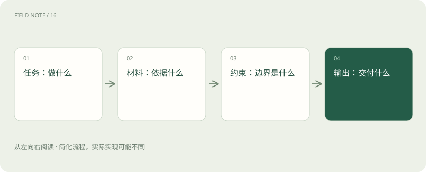

# 提示词：把需求说明白，比背咒语更有用

> 说明任务、材料、约束和输出形式，比堆砌身份设定更可靠。

专题：AI 应用 · 整理于 2026-11-04

## 先用一个类比理解

给同事布置任务时，只说“帮我弄好”通常不够。你会交代目的、参考材料、不能做什么以及交付格式，提示词也遵循类似原则。

## 一图看懂

## 把模糊愿望变成可判断要求

“写得专业”难以验收；“用三段向非技术读者解释，保留两个风险点”更具体。给出少量示例能够说明你希望的格式和判断标准，但示例也可能把模型引向错误模式。

## 结构化输出解决格式，不包办事实

JSON 是常见的数据交换格式，像一张字段固定的表。约束输出结构可以帮助程序读取，但格式合规和内容正确仍应分别检查。某字段是合法数字，不代表这个数字有来源。

## 给资料与给指令分清边界

上传的网页和文档可能包含让模型改变行为的文字。系统应把外部内容作为待处理数据，而非自动提升为高权限指令。模型调用工具时，还需要应用层验证权限和参数。

## 真实场景

可以这样表达：“依据下方文章，给新手写 150 字摘要；列出两个原文支持的结论；原文没说的内容标为未知。”这是可复用的要求，不是万能模板。

## 常见误区

要求“你是世界顶级专家”不能替代事实来源、明确约束和结果检查。

## 想一想

输出符合 JSON 结构，能证明其中事实正确吗？

查看解释

不能。结构验证和事实验证解决不同问题。

## 原始资料

- [Anthropic · 提示词概览](https://platform.claude.com/docs/en/build-with-claude/prompt-engineering/overview)

原创入门讲解；类比和示意图经过简化。工具功能以对应版本官方文档为准。
