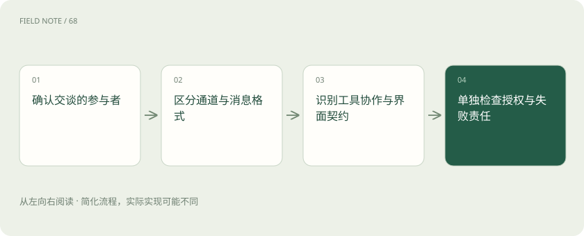
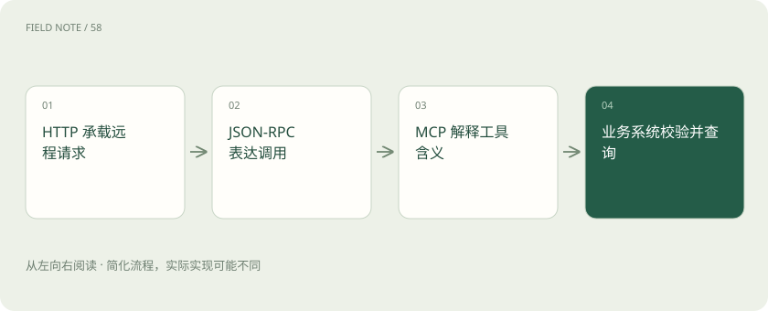
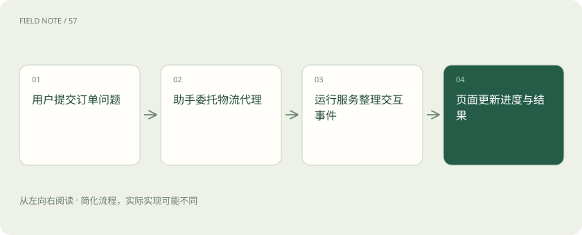

# 协议地图：HTTP、JSON-RPC、SSE、MCP、A2A、AG-UI 与 ACP 各管哪段

> 从一次订单分析请求分清通信、调用格式、事件流、授权与代理应用协议。

专题：协议与技能 · 整理于 2026-11-05

## 前置阅读

- [MCP、A2A 与 Skills：接口、委派和方法为什么要分开](stack-protocols.md)

## 先用一个类比理解

像办理跨部门业务：道路、申请单、进度广播和部门协作规则各有职责。

类比只帮助建立直觉，不等同于完整机制。

## 一图看懂

## 一、先画参与者，再看缩写

假设你要让一个客服助手查询订单，再请物流代理判断延迟原因，最后把进度显示在网页上。这里至少涉及用户、页面、助手运行服务、订单系统和物流代理。协议的价值是约定这些参与者如何交换信息，而不是让每个参与者自动具备业务能力。

读架构图时先问“哪两个角色正在交谈、要完成什么”，再问协议名称。相同产品可能同时包含多个角色；同一条网络连接也可能承载不同层次的约定。因此不要把这些缩写排成互相替代的产品排行榜。

## 二、HTTP：请求与响应的通道规则

HTTP 定义请求方法、资源地址、状态码和消息等语义。我们常把它口语化地叫通信通道，但严格说它自身也是应用层协议，不是 TCP 那种网络传输层。这里的分层是帮助理解职责，并非把所有名称硬塞进同一套网络层级。

例如助手向订单服务发出请求，HTTP 可以表达响应是否成功以及内容类型，却不能单靠一个成功状态说明订单真的存在。业务结果还要看消息内容。HTTPS 在 HTTP 通信上加入 TLS 保护，也不自动赋予调用者读取任意订单的权利。

## 三、JSON-RPC：把调用写成可关联的消息

JSON 是数据表示格式，JSON-RPC 在其上规定调用方法、参数、请求标识以及结果或错误的结构。可以把它想成统一的业务申请单：写清找哪个办理项目、提交哪些条件，以及回复应关联哪张申请。它本身不限定只能通过 HTTP 发送。

普通读者只需认出 method 表示调用名称、params 表示参数、id 用于关联回复。不带 id 的通知与等待结果的请求有不同语义。两套服务都使用 JSON-RPC，仍可能拥有完全不同的方法和参数，因此格式相同并不等于业务互通。

## 四、SSE：结果可以一段段送达

SSE 用 text/event-stream 格式让服务端持续发送事件，网页可逐条接收。它规定事件流如何表达，不规定“正在查询订单”或“需要人工确认”这些业务含义。页面出现逐字输出，也不能直接证明采用了某一种代理协议。

它主要描述服务端到客户端的事件方向，用户提交新输入通常需要另外的请求。断线、重连和事件标识也不能替代业务恢复策略：页面重新连上，并不保证后台任务从头重跑或遗漏内容全部补齐。是否支持恢复要查具体实现。

## 五、MCP：应用怎样接入工具与上下文

MCP 主要约定 AI 应用与提供工具、资源等能力的服务之间如何交互。宿主应用组织用户体验和模型使用，客户端组件与服务器沟通。把订单查询能力包装为 MCP 工具，可以让支持该约定的应用按一致方式发现和调用它。

MCP 不负责凭空建立订单数据库接口，也不保证工具结果准确。接口开发、字段映射和租户校验仍由系统完成。其具体流程会随规范版本变化，学习时应记录版本与传输方式；不能把早期连接教程中的每个步骤都当作所有版本永久必需的动作。

## 六、A2A：把一项工作交给另一个代理

A2A 关注独立代理系统之间的通信与协作。调用方可以了解对方公开的能力，发送消息，并在需要时通过任务及产物组织工作。远端代理可以有自己的推理、工具和工作流程，调用者不必知道全部内部实现。

物流代理接到“分析订单延迟并给出依据”的委托，与订单查询工具接到“返回指定订单字段”的调用，责任粒度不同。不过这是一种理解定位的方法，不是禁止交叉的边界：产品可以把复杂服务包装成工具，也可以让代理提供简单能力。选择取决于需要暴露的协作契约。

## 七、AG-UI：把运行过程送到用户界面

AG-UI 官方将其定位为连接代理与面向用户应用的事件式协议。它关注运行、消息、工具调用和状态等事件如何被前端理解。前端据此呈现进展、更新共享状态，或承接交互，而不必把所有内容都猜成普通聊天文字。

事件可能通过流式通道传递，但 SSE 和 AG-UI 不是同义词：前者提供事件流表达，后者定义代理交互事件的含义。采用 AG-UI 也不自动生成合适的界面，产品仍要设计等待、失败、确认和恢复体验，并处理事件与本地状态的一致性。

## 八、ACP：先把全名写出来

本文的 ACP 指 Agent Client Protocol，即编辑器或 IDE 与编码代理之间的通信约定，官方入口是 agentclientprotocol.com。它面向提示交互、会话以及工具使用等编辑器集成场景，并适用于本地或远程。无需会编程，也可以把它理解为编辑器与外接编码助手之间统一的接线约定。

历史资料中的 ACP 还可能指 Agent Communication Protocol，名称相近却不能直接互换。遇到旧文章应核对官网、仓库、发布日期和全名，不能仅凭缩写推断其与 A2A 的关系，更不能没有一手证据就宣称某个项目已经淘汰。

## 九、走完一次跨层请求

现在把前面的订单场景串起来：用户在网页提交“解释订单甲为什么延迟”。页面把输入交给助手运行服务，运行服务通过 MCP 调用订单工具，再按 A2A 的协作约定委托物流代理分析。运行服务最后把进度与结论转成 AG-UI 事件交给页面。这是一种可行的教学架构，不是所有产品必须照搬的标准流水线。

放大订单工具这一跳：远程实现可以用 HTTP 请求承载 JSON-RPC 消息，消息中写明工具调用与订单参数；服务回复工具结果，是否使用 SSE 取决于该实现和传输约定。再放大页面这一跳：HTTP 响应可以承载 SSE，SSE 的数据中可以是 AG-UI 事件。两个放大镜分别回答“如何运送”和“内容如何解释”，并不冲突。

## 十、授权是另一条必须说明的边界

OAuth 2.0 是授权框架，允许应用在规定条件下访问受保护资源；它不是单独的用户身份认证协议，也不意味着拿到令牌就获得全部业务权限。需要身份认证时通常还要看相应身份层机制，服务端还应核对受众、范围和实际业务对象权限。

例如员工被允许使用订单查询工具，仍不能因此查看其他租户的订单。页面同意操作、代理接受任务、网关接受令牌和业务系统允许查询，是不同判断。阅读方案时让负责人分别说明这些判断在哪里发生，就能发现“协议已支持安全”这类笼统表述遗漏了什么。

## 十一、用故障现象反查责任位置

页面没有进度，先看后台是否产生事件，再看通道是否送达，最后看前端是否理解事件。工具报告方法不存在，应检查应用协议的方法目录及版本；收到 HTTP 拒绝，则检查访问条件与网关响应。不要用“代理不聪明”解释所有集成故障。

理解这张地图后，可以从实际问题选读：研究工具接入看 MCP，研究委托和任务状态看 A2A，研究页面互动看 AG-UI，研究编辑器连接看 Agent Client Protocol。无需为了显得完整在一个系统里装齐全部名称；明确每一跳的角色、版本、输入、输出和失败责任，才是可执行的设计。

## 图解：放大一跳的职责

一种可能的远程工具调用组合；不是所有实现唯一的堆叠方式。

## 图解：从委托到用户看到结果

A2A 可以承担代理协作，AG-UI 可以承担运行服务与前端之间的事件契约。

## 放在一起对比

| 名称 | 主要回答的问题 | 不能据此推断 |
| --- | --- | --- |
| HTTP | 请求与响应如何表达 | 业务一定成功 |
| JSON-RPC | 调用与回复如何关联 | 业务方法天然兼容 |
| SSE | 事件如何持续送达 | 任务自动恢复 |
| MCP | 应用如何接入工具与上下文 | 数据权限自动放开 |
| A2A | 独立代理如何通信协作 | 所有委托都立即完成 |
| AG-UI | 前端如何理解代理事件 | 界面自动完成设计 |
| Agent Client Protocol | 编辑器如何连接编码代理 | 与同缩写项目相同 |
| OAuth 2.0 | 资源访问如何获得授权 | 已完成身份认证或全部授权 |

## 真实场景

网页订单助手经 MCP 取订单，经 A2A 委托物流代理，再以 AG-UI 事件更新页面；某些网络跳使用 HTTP、JSON-RPC 或 SSE，它们分别承担不同职责。

## 常见误区

把 SSE 当作完整代理协议，或把 OAuth 令牌当作所有订单的访问许可。

## 想一想

两个服务都支持 JSON-RPC，为什么仍可能无法合作？

查看解释

JSON-RPC 统一调用与响应格式，却不统一业务方法、参数、能力、授权和任务含义；双方仍需共同的应用契约。

## 关联阅读

- [MCP 生命周期：从连接想象转向请求契约](mcp-session-lifecycle.md)
- [A2A 发现：从代理名片到可协作契约](a2a-discovery.md)
- [A2A 任务：消息、状态与产物怎样交接](a2a-task-lifecycle.md)

## 原始资料

- [HTTP 语义 RFC 9110](https://www.rfc-editor.org/rfc/rfc9110)
- [JSON-RPC 2.0](https://www.jsonrpc.org/specification)
- [SSE HTML 标准](https://html.spec.whatwg.org/multipage/server-sent-events.html)
- [MCP 架构](https://modelcontextprotocol.io/specification/2026-07-28/architecture)
- [A2A 官方规范](https://a2a-protocol.org/latest/specification)
- [AG-UI 官方仓库](https://github.com/ag-ui-protocol/ag-ui)
- [Agent Client Protocol 简介](https://agentclientprotocol.com/get-started/introduction)
- [OAuth 2.0 RFC 6749](https://www.rfc-editor.org/rfc/rfc6749)

原创讲解；图示和类比经过简化，数字示例不代表实测。工具功能以对应版本官方资料为准。
