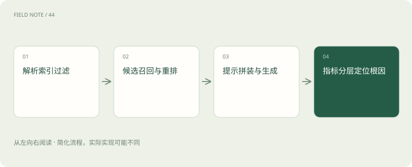
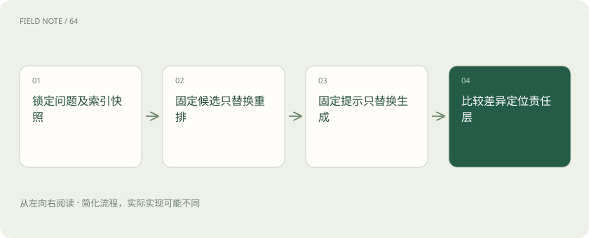
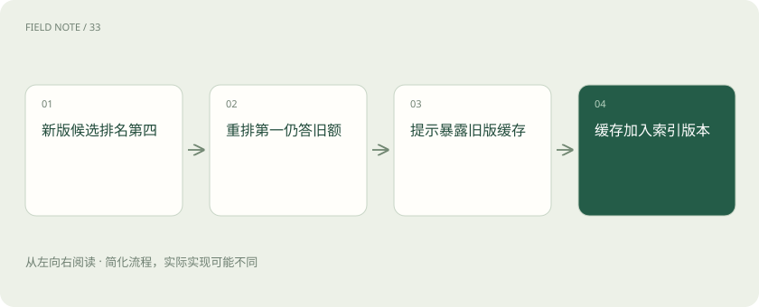

# RAG 排障：沿错误文档追到根因

> 沿解析、索引、过滤、召回、重排、提示、生成与评估逐层定位错误答案的根因。

专题：AI 应用 · 整理于 2026-11-05

## 前置阅读

- [RAG：让模型先查资料，再组织答案](rag.md)
- [Recall、MRR 与 nDCG：检索到底好在哪](retrieval-metrics.md)
- [让每个结论都有边界：RAG 的证据责任](deep-rag-evidence.md)

## 先用一个类比理解

像沿物流追查错件：先看包裹是否装对，再查入库、筛选与分拣，最后检查是否送对人，不能只责怪收件人读错标签。

类比只帮助建立直觉，不等同于完整机制。

## 一图看懂

## 固定错误现场

员工问“上海2026版餐补多少”，系统回答旧版80元，正确资料写100元。保存原问题、身份、时间、索引版本、候选文档、重排顺序、实际提示与输出。所有数字为教学构造。没有现场快照，后续重建索引后再查一次成功，也无法解释原来为何失败。

把“期望100、实得80”变成可定位事件，还需保留最终选中的政策标识。若仅有聊天截图，无法知道当时读了哪个版本；日志保存应遮蔽员工身份等与排障无关的信息。

## 解析层先看原文

打开新版政策的解析产物，发现表格把上海行和北京行串在一起，就先修解析。若原文件正确而文本错，向量模型无法恢复丢失的行列语义。检查标题、跨页表头、脚注和生效日期是否保留，避免只看正文存在就宣布解析正常。

一个可检查的产物是“城市=上海，金额=100，生效年=2026”的同一条记录。若城市与金额来自不同分页，检索即使命中关键词，也无法证明这三项原本属于同一行。

## 索引与过滤逐项核对

解析正确但新版未写入当前索引，是发布或摄取问题；已经入库却被错误的年份或部门过滤排除，是元数据问题。记录文档标识与生效范围，分别在受控条件下检查索引可见性和过滤结果。不能为提高召回而取消租户权限条件。

使用同一用户身份查文档标识，避免管理员检索成功却误判普通员工也能看到。过滤条件需要记录字段值和解释：年份可能指发布日期而非生效年，两个字段不能混用。

## 召回层用已知证据定位

把新版政策作为已知相关文档，检查它是否进入初始候选。未进入时再比较关键词、向量及混合召回，观察“餐补”和“误餐费”的术语差异。别把候选数量调大当成唯一措施：若时间过滤错了，再大的候选池也不会包含新版。

候选检查至少保存文档级和切片级两种标识。新版文档进入候选不代表正确金额所在切片已进入；只以文档命中计分，会让跨页表格和长附件的召回问题隐藏起来。

## 重排造成的假阴性

初始候选有新版，但重排把旧版置顶，可能因为旧版问题描述更相似而版本约束未被表达。保留重排前后位置，检查是否因截断丢失新版生效日期。把“旧版相似但失效”加入验证样本，比只收集完全无关文档更能暴露排序缺陷。

若第一阶段新版排名第六，重排后跌到二十之外，可固定候选集单独重排。这样能排除召回波动的干扰；同时验证业务规则是否允许先排除失效版本，再比较语义相关性。

## 上下文与生成分别判断

新版排第一却未进入实际提示，问题在拼装、去重或长度预算；新版已进入但模型仍答80元，才继续检查冲突指令和生成行为。提示应说明优先有效版本并展示日期。引用新版却写旧金额是证据不一致，不能因为有链接就判回答正确。

用包含两版政策的固定上下文测试生成，可以观察模型是否真的理解历史日期。若问2025年仍答100，说明“最新优先”的提示过强，修复应改为按提问时点选择有效区间。

## 指标如何误导

若评测只看“餐补”这个词，80元和100元都可能得高分。检索召回率衡量相关资料是否进候选，排序指标衡量位置，回答正确性与引用支持度又是不同维度。权限泄漏和过期引用需单独计数，平均正确率不能掩盖这类严重失败。

Ragas上下文精度强调相关片段的排序质量，忠实度关注回答是否被上下文支持。答80且忠实引用旧文可以有较高忠实度，却仍然业务错误，因此必须保留版本适配的独立判据。

## 用反例确认修复范围

修完上海题，再测北京题、2025年历史题、无权限用户和未发布草案。历史查询应允许回答旧标准，不能把“永远选最新”当规则。每次只改变已定位的一层，比较相同现场轨迹；若修正解析后仍错，继续追链而非宣称所有问题已解决。

本章八层排查次序是一套工程定位方案，不是任何评估库规定的固定流程。验收报告要写出根因证据、修改范围和未覆盖情况，不能把一题修复扩大描述为系统整体可靠。

## 图解：隔离故障层的实验

每次实验仅改变一个处理环节，区分候选遗漏、排序失误与生成误读。

## 图解：上海餐补错误轨迹

固定召回结果后查实际提示，避免盲目更换嵌入模型。

## 放在一起对比

| 对象或路线 | 处理依据 | 适用边界或检查点 |
| --- | --- | --- |
| 解析 | 表格行列是否正确 | 新版金额是否同属上海行 |
| 索引过滤 | 文档存在且用户可见 | 元数据生效年是否正确 |
| 召回重排 | 候选及排序位置 | 新版切片是否被压后 |
| 提示生成指标 | 实际上下文及判分 | 引用支持与业务正确分开 |

## 真实场景

上海新版切片在候选第4，重排后第1，但上下文按旧缓存拼装只保留2025版。修复缓存键加入索引版本后回答100；这条轨迹把故障定位到拼装，排除了“向量没召回”的猜测。

## 常见误区

忠实引用过期政策也可能得到较好的证据支持分，却仍然答错业务问题。

## 想一想

新版已经排第一，为什么回答仍然可能错？

查看解释

排序结果不等于实际提示。去重、缓存与截断都可能使新版未进入上下文；只有检查实际送入模型的内容，才能继续判断生成责任。

## 关联阅读

- [把政策文件变成可追责的知识库](deep-rag-corpus.md)
- [从候选召回到证据上下文：检索是一场逐级筛选](deep-rag-retrieval.md)

## 原始资料

- [Ragas：上下文精度](https://docs.ragas.io/en/stable/concepts/metrics/available_metrics/context_precision/)
- [Ragas：回答忠实度](https://docs.ragas.io/en/stable/concepts/metrics/available_metrics/faithfulness/)

原创讲解；图示和类比经过简化，数字示例不代表实测。工具功能以对应版本官方资料为准。
