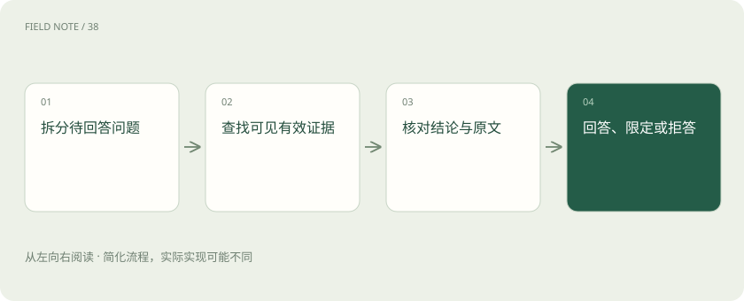

# 引用、证据与拒答：知识库助手怎样才算有依据？

> 有链接不等于有依据；必须核对原文是否支持具体结论。

专题：AI 应用 · 整理于 2026-11-04

## 前置阅读

- [RAG：让模型先查资料，再组织答案](rag.md)

## 先用一个类比理解

写报告时在页脚放一本参考书，不代表书里真的有你写的数字。引用要能指向支持该结论的段落。

类比只帮助建立直觉，不等同于完整机制。

## 一图看懂

## 区分检索到与支持结论

检索结果可能和问题同主题，却没有包含答案。证据支持要求原文与结论的主体、时间、范围和条件一致。例如“试用部门可以申请”不能支持“全公司自动开通”。回答应保留这些限定条件，而不是只把文档标题贴在后面。

## 多段资料可能互相冲突

长制度通常把规则与例外分在不同段落。系统需要检索并组织足够的上下文，同时考虑版本与生效时间。不同来源冲突时应指出冲突及依据，不应仅因某段排在第一名就认定它最新。检索分数不是文档权威程度的通用代理。

## 拒答可以分成几种情况

没有找到材料、材料有但无法确认、用户无权访问，是不同情况。可以说明当前证据不足，提出能补充范围的问题，或引导到有权限的渠道。不要为了说明权限而泄露受限文档的正文或敏感存在信息，拒答文案也应遵守应用的访问策略。

## 把证据问题变成可评测项目

为每条关键结论标注所需支持，再分别检查出处可访问、引用定位准确、原文确实支持、没有漏掉必要条件。正确答案配错引用仍应扣分；没有答案时能恰当拒答也是能力。引用可追溯与整体正确率应分开统计。

## 真实场景

问“周末能否报销打车”，检索找到工作日标准和一个应急加班例外。可信回答应区分普通周末与符合审批条件的加班，而不是只回答“可以”。

## 常见误区

引用生成得像学术论文，也可能不存在或不支持结论；不要只检查链接格式。

## 想一想

答案事实正确，但引用的段落与问题无关，算证据合格吗？

查看解释

不合格。结论正确与引用支持是两项独立要求，需分别检查。

## 关联阅读

- [解析与切块：知识库先要读对文档](rag-parsing.md)
- [Recall、MRR 与 nDCG：检索到底好在哪](retrieval-metrics.md)
- [评测集怎么分：避免把背过的题当能力](eval-splits.md)

## 原始资料

- [LangChain · 检索增强概念](https://docs.langchain.com/oss/python/langchain/retrieval)
- [Ragas · Faithfulness 指标定义](https://docs.ragas.io/en/stable/concepts/metrics/available_metrics/faithfulness/)

原创讲解；图示和类比经过简化，数字示例不代表实测。工具功能以对应版本官方资料为准。
