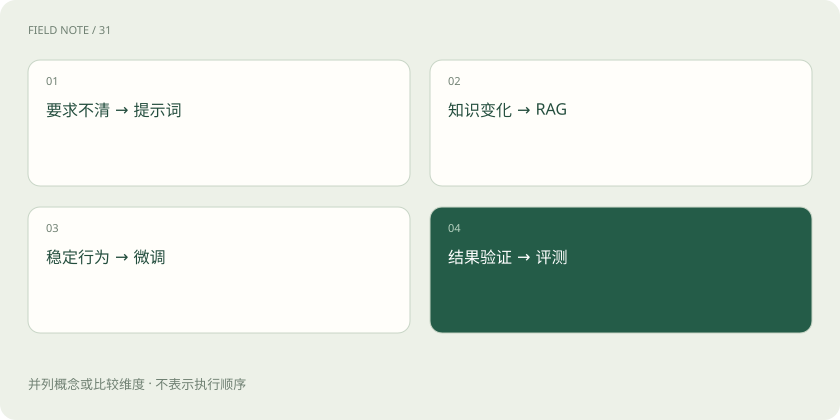

# 提示词、RAG、微调：到底该选哪个？

> 要求没说清、资料没拿到、行为不稳定，需要分别处理。

专题：AI 应用 · 整理于 2026-11-04

## 先说这篇在讲什么

客服总是答不好，究竟该改要求、补资料，还是重新训练？先拿三个问题区分：格式乱、政策旧、语气不稳定。这篇解释提示词、RAG 和微调分别能帮什么忙，让你根据错误原因选办法，再用同一批题目比较是否真的改善。

## 先看一个具体例子

客服格式乱，先明确格式；政策过时，接入最新政策；大量样本里语气持续不一致，再评估微调。一个系统可以同时采用这些办法。

## 遇到陌生概念，可以先读

展开前置阅读建议

- [训练、微调与推理：学习和使用是两回事](training-inference.md)
- [RAG：让模型先查资料，再组织答案](rag.md)

## 先用一个类比理解

带新人时，交代任务相当于提示词，给他手册相当于 RAG，用示范反复练习相当于微调。

类比只帮助建立直觉，不等同于完整机制。

## 一图看懂

## 先看是不是缺了最新资料

客服不知道今天库存还有多少，不一定是模型能力不够，而是它没有看到实时数据。制度、订单和库存都可能变化，应该接入可信资料或业务接口。RAG 是先检索相关资料再回答，适合查政策文档；查询实时订单则通常直接调用业务接口更合适，不必先把每张订单转成用于相似搜索的数字。

## 要求说清之后，才考虑要不要再训练

如果只是回复格式不对，先用提示词明确规定输出什么，并提供示例。当任务已经明确，也有足量高质量示范，但模型仍难以稳定保持语气、分类标准或处理方式时，再评估微调。微调是用任务数据继续训练模型，让它调整原先学到的行为。先记录现有方法能达到的水平，才能判断训练带来的改善值不值得成本。

## 接口坏了，训练也修不好

查询订单的接口超时、账号没有权限、资料里压根没有答案，和模型读错已有内容是不同的问题。先定位原因，才知道该改哪个环节。比较提示词、RAG 和微调时，应使用同一批题目，同时看答得对不对、要等多久、花多少钱。还要留一批没有参与调试的题目，检查改善是否也适用于新问题。

## 读完先记住这一句

先找到答错的原因，再决定改指令、接资料还是训练。

## 常见误区

微调不能保证模型准确记住并随时更新全部企业知识。要查变化中的事实，仍需可靠的数据入口。

## 想一想

库存每分钟都变，要不断重新训练吗？

查看解释

通常调用实时库存接口更合适，再让模型根据返回的数据向用户说明。

## 关联阅读

- [SFT：用示范回答教会任务形式](sft-behavior.md)
- [LoRA 与 QLoRA：少改参数也能学习](lora-qlora.md)
- [训练数据质量：先修教材再加课时](data-quality.md)

## 原始资料

- [Hugging Face · PEFT 文档](https://huggingface.co/docs/peft/index)
- [LangChain · Retrieval](https://docs.langchain.com/oss/python/langchain/retrieval)

原创讲解；图示和类比经过简化，数字示例不代表实测。工具功能以对应版本官方资料为准。
