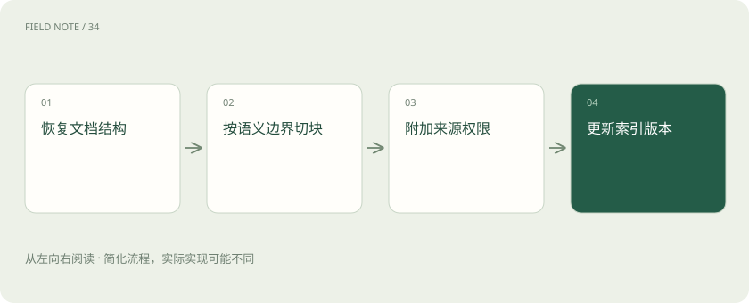

# 解析与切块：知识库先要读对文档

> 解析把文件还原为有结构的文本，表格、标题层级和阅读顺序都可能在此丢失。

专题：AI 应用 · 整理于 2026-11-04

## 前置阅读

- [RAG：让模型先查资料，再组织答案](rag.md)

## 先用一个类比理解

像拆分一本手册，页签必须带上章节名，否则剪下的句子容易失去条件。

类比只帮助建立直觉，不等同于完整机制。

## 一图看懂

## 概念边界

解析把文件还原为有结构的文本，表格、标题层级和阅读顺序都可能在此丢失。切块再把内容组织成可检索单元，不能靠切得更小弥补解析时已经丢掉的列名、脚注或权限信息。

## 内部怎样运作

小块定位精确但容易断开条件，大块保留语境却可能带入噪声。可以保留标题、来源、页码与父子关系，在命中局部后补充相邻语境。更新时要同步删除旧块，避免新旧制度同时进入答案。

## 把机制放进具体场景

手册中的“允许复位”若与上一页的“确认断电后”被切开，检索可能只拿到危险的半句话。可把限制条件与操作步骤放在同块，或在命中子块后补取父章节；表格单元还应保留对应列名。

## 取舍与容易忽略的限制

切块长度应服务于证据结构，而不是机械追求某个固定词元数。目录、表格和流程步骤的自然边界不同，同样长度可能产生截然不同的语义完整度。解析完成后应抽查原文与块内容的对应关系；若索引无法指回具体版本和位置，后续生成再流畅也难以核验制度适用性。

## 真实场景

同一制度同时保留旧版和新版时，单靠正文相似度可能命中旧条款。把生效时间与版本号作为元数据，可以先限定适用版本再检索。

## 常见误区

重叠切块会增加存储和重复证据，不能把重复命中当成多份独立佐证。

## 想一想

切块越小，答案就越准确吗？

查看解释

不一定，小块更易定位却可能失去条件，大块更完整却容易混入噪声。

## 关联阅读

- [RAG：让模型先查资料，再组织答案](rag.md)
- [混合检索与 RRF：让关键词和语义互补](hybrid-rrf.md)
- [视觉理解与 OCR：看见文字不等于读懂表格](vision-ocr.md)

## 原始资料

- [vector search how to chunk documents](https://learn.microsoft.com/en-us/azure/search/vector-search-how-to-chunk-documents)

原创讲解；图示和类比经过简化，数字示例不代表实测。工具功能以对应版本官方资料为准。
