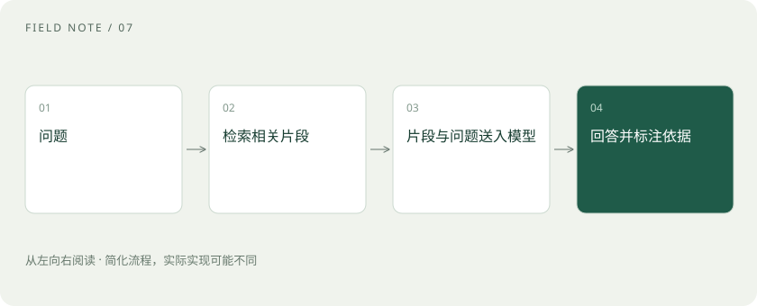

# RAG：让模型先查资料，再组织答案

> 想让模型知道最新制度，可以在它回答前，把找到的相关原文递给它，这就是 RAG。

专题：AI 应用 · 整理于 2026-11-04

## 先说这篇在讲什么

公司刚改了报销制度，模型却还在引用去年的标准，怎么办？RAG 的办法是回答前先查公司资料。这篇会带你走一遍从整理文件、找相关段落到组织答案的过程，也解释为什么换一个更大的模型，未必能修好找错资料的问题。

## 先看一个具体例子

比如今年住宿上限改了，系统却找出去年的条款。即使模型一字不差地复述，也回答不了今年的问题，应先更新资料并检查检索。

## 遇到陌生概念，可以先读

展开前置阅读建议

- [Token、上下文和幻觉：为什么它会忘，也会编？](tokens-context.md)

## 先用一个类比理解

就像请同事查手册答疑：先翻到相关页，再照着内容解释；翻错页也会答错。

类比只帮助建立直觉，不等同于完整机制。

## 一图看懂

## 先把资料整理好，提问时才能找得快

假设你要问出差能住多少钱的酒店。系统不能每次都从头读完公司的所有文件，因此会事先读取文件，把内容分成适合查找的小段，并建立方便定位的索引。等你提问，再从索引里找出可能相关的段落，选出更合适的内容，连同问题一起交给模型。交给模型的这批内容属于上下文，也就是它这次回答时能够参考的材料。

## 怎样从很多段落里找到相关的几段

你问“住酒店能报多少”，制度可能写的是“住宿费用上限”。Embedding 会把文字转成一组数字，帮助系统比较意思是否接近；向量库负责保存和查找这些数字。初步找到的内容不一定够准确，Reranker 会把问题和候选段落放在一起，再细看谁更相关。遇到编号、姓名等准确字词，关键词搜索也很有用，把两种查法结合起来叫混合检索。

## 找到了，还要看是不是能用的资料

去年和今年的住宿规定很相似，但适用时间不同。因此每段资料还要带着出处、版本和访问权限，原文更新或删除时，索引也要跟着变。模型给出的引用应当能找到原文，并且原文确实支持答案。如果没有足够资料，就应说明查不到。排查错误时，要先看资料有没有找对，再看模型有没有读对；这两个环节出的问题需要用不同办法解决。

## 读完先记住这一句

先找对资料，模型才有机会答对。

## 常见误区

RAG 通常不会改动模型内部的权重，也就是训练得到的数值；它是在回答时补充材料，并非一次读入整个数据库。

## 想一想

模型答错住宿标准，第一步查看什么？

查看解释

先查看送给模型的原文：是否找到了适用今年、对应地区的条款。资料错了，单改提示词往往解决不了。

## 关联阅读

- [解析与切块：知识库先要读对文档](rag-parsing.md)
- [混合检索与 RRF：让关键词和语义互补](hybrid-rrf.md)
- [重排：候选找到了，为什么还要再排一次](reranking.md)
- [Recall、MRR 与 nDCG：检索到底好在哪](retrieval-metrics.md)

## 原始资料

- [LangChain · Retrieval 概念](https://docs.langchain.com/oss/python/langchain/retrieval)
- [Sentence Transformers · 检索与重排](https://www.sbert.net/examples/sentence_transformer/applications/retrieve_rerank/README.html)

原创讲解；图示和类比经过简化，数字示例不代表实测。工具功能以对应版本官方资料为准。
