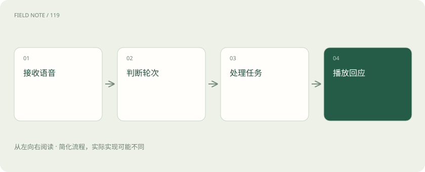
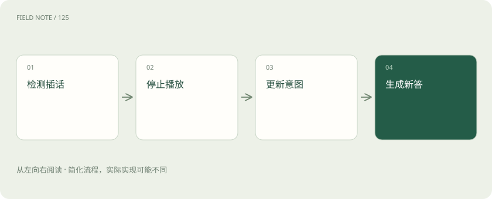

# 实时语音智能体：听说轮次与业务状态如何协同

> 听见、确认、提交和办成是不同阶段，语音助手需要把它们分别记清。

专题：多模态 · 整理于 2026-11-05

## 先说这篇在讲什么

你对电话助手说“约周三，等等，还是周四”，它需要听出你改了主意，而不能听到周三就立刻下单。你插话时，它还得停下旧回复，记住已经说到哪里，并查清预约究竟有没有成功。实时语音因此不只是听写加朗读，还要把谈话进展和实际办事进展接起来。

## 先看一个具体例子

用户确认周四两点后又说“两点半”。助手应更新安排并重新确认。若旧提交已经发出，应先查询旧预约的结果，再决定怎样修改。

## 遇到陌生概念，可以先读

展开前置阅读建议

- [ASR 与 TTS：从声音到文字，再到声音](speech-asr-tts.md)
- [Agent 和工作流：从回答问题到执行任务](agent.md)

## 先用一个类比理解

像电话接线员，一边听人改口，一边核对预约单，不能把“听到了”说成“办好了”。

类比只帮助建立直觉，不等同于完整机制。

## 一图看懂

## 先看一条语音请求经过哪些步骤

一种常见做法是先把声音转成文字，让语言模型理解和组织回复，再把文字读出来。语音转文字叫ASR，文字转声音叫TTS。几个步骤接起来，通常叫级联路线。好处是出了问题容易分开检查，也可以单独更换听写或发声工具。

代价是等待会累积，语气等信息也可能在变成文字时丢失。为了更快，可以边接收边处理，也就是流式处理。但最早听到的文字可能还会修改。用户说“周三，还是周四吧”时，可以提前查空位，却不能在意思还没稳定时就提交周三的预约。

## 直接处理声音，也要另外记清业务信息

另一类模型可以直接接收或生成声音，不必让每一步都经过可见文字，这通常叫端到端音频路线。它可能利用语气等难以用文字表达的线索，但能提供哪些转写、声音与文字怎样同步，要看具体模型和运行工具。

听出用户犹豫，不等于能替用户决定日期。预约对象、时间、用户是否确认，以及预约系统返回什么结果，仍要另外保存。模型负责自然交流，应用程序负责把这些信息接到真实业务。直接语音输入输出并不自动解决权限、参数检查和出错恢复，各种模型对插话的处理也未必相同。

## 短暂停顿不一定表示你说完了

用户说“我想预约……”后停下来翻日历，此时没有声音，却还没说完。VAD就是检测有没有语音活动的技术，主要帮助区分讲话和安静。判断现在该不该接话，还需要理解一句话或一个意思是否结束，这叫轮次检测。LiveKit等工具提供相关策略，可结合声音检测、转写等信息处理。

等待太短会抢话，等待太长又显得迟钝。短命令和长叙述适合的安排不同。出现频繁抢话时，先看是否把噪声当成讲话，再看是否误判表达结束。单纯更换更快的语言模型，未必能解决用户还没说完就被打断的问题。

## 用户插话后，要同时停声音和旧任务

助手正在念地址，用户说“日期改一下”，应让出说话机会。用户在助手讲话时插入新话，常叫Barge-in。停止扬声器播放和取消后台生成是两件事：只静音，后台可能还在写旧回复；只停生成，已经排队等待播放的声音可能仍会继续。

还要记住用户实际听到了多少。没有播放出来的说明，不能算已经告知。能记录到什么精度取决于运行工具，不能假定逐字都知道用户听见了。更重要的是，停声音不会撤回已提交的预约。旧结果晚到时，要用操作编号等信息认出它；如果预约已经生效，就先查清，再按业务规则修改或取消。

## 别把自己的声音当成用户插话

免提播放时，助手声音可能又进入麦克风，这就是回声。如果系统当成新请求，可能自己和自己对话，或不停中断自己。消除播放回声、减少环境噪声、辨别旁人说话，处理的是不同问题，不能以为打开一个降噪选项就全部解决。

测试时分别播放助手自己的声音、电视背景人声，并让用户轻声插话。提高检测门槛可能减少误触发，也可能漏掉真实用户。耳机和会议室免提的情况差别很大。应根据实际使用环境中的录音调整，不能只凭安静房间的一次演示认定可用。

## 分别量清开始说话和真正办完要多久

从用户说完到听见回复，中间包含传输、判断说完、生成内容、查询预约、合成声音和等待播放。助手马上说“我来查一下”，只代表开始回应得快，不能说明预约办得更快。应分别记录第一声回复、第一段有用信息，以及业务真正完成的时间。

这些时间记录可以帮助找到慢在哪里。若系统迟迟不认为用户说完，换更快的朗读工具帮助有限；若预约系统查询慢，提前准备不改变业务的查询可能有用。实际目标应根据网络、设备和使用场景测量，还要关注较慢的情况，不能只展示最快的一次。

## 把预约进展写清楚，避免重复办理

至少要分清正在收集信息、等待用户确认、已经提交、结果还不确定，以及已经完成。这些阶段和允许的下一步通常叫状态机，可以理解为一张办事进度表。只有收到成功结果，才应说“预约好了”。工具超时意味着没及时收到结果，不一定意味着预约失败。

如果超时后马上重新提交，可能产生两次预约。应先查询是否已生效，再决定重试。用户把两点改成两点半后，先前针对两点说的“好”也不能继续使用。确认应对应具体日期、时区、对象和当前操作。避免重复执行产生额外结果的能力叫幂等，需要业务系统配合，不能只靠说话自然。

## 用一段完整对话检查是否真的可靠

不能只测试“你好”这类单句。可以让用户先报日期，再改口，停顿查日历，在助手播报时插话，最后模拟提交中断网。恢复后检查日期是否仍正确，有没有重复预约，助手是否在结果未知时谎称成功。口音、数字、重叠讲话和回声也应分别覆盖。

检查结果时，把听写、接话时机、停止播放、信息更新和最终预约结果分开看。声音好听和事情办对都要满足。LiveKit等工具提供会话和中断相关能力，但具体预约进度、确认规则以及断线恢复，需要应用自己组织和验证，并不是接上语音模型就自动获得。

## 图解：预约确认状态

字段变化应使旧确认失效，提交后仍需读取结果。

## 图解：插话处理路径

还要协调生成取消和实际已播放内容。

## 放在一起对比

| 维度 | 能力 | 边界 |
| --- | --- | --- |
| VAD | 检测语音活动 | 不能独自判定语义结束 |
| 轮次检测 | 判断何时接话 | 需要场景权衡 |
| 打断 | 协调播放与生成 | 保留实际播放状态 |
| 工具确认 | 约束业务副作用 | 超时先查事实 |

## 读完先记住这一句

听见、确认、提交和办成是不同阶段，语音助手需要把它们分别记清。

## 常见误区

迅速说出“正在为您办理”，不代表真正完成的等待已经缩短。

## 想一想

用户改了日期，之前说的“好”还能作为提交依据吗？

查看解释

不能。那个“好”对应的是旧安排。应明确复述新日期和时间，再确认当前操作。

## 关联阅读

- [ASR 与 TTS：从声音到文字，再到声音](speech-asr-tts.md)
- [Agent 和工作流：从回答问题到执行任务](agent.md)

## 原始资料

- [LiveKit轮次与中断](https://docs.livekit.io/agents/logic/turns/)
- [LiveKit AgentSession](https://docs.livekit.io/agents/logic/sessions/)

原创讲解；图示和类比经过简化，数字示例不代表实测。工具功能以对应版本官方资料为准。
