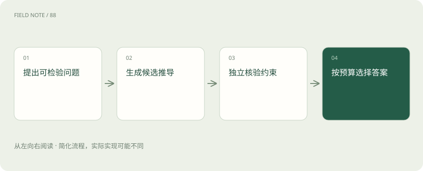
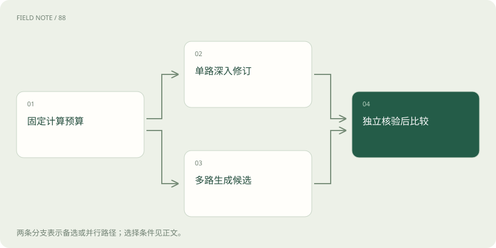

# 推理时计算：思维链、采样与验证

> 多花计算，可以用来多走几步、多试几种答案或检查结果；但想得久不保证想得对。

专题：模型能力 · 整理于 2026-11-05

## 先说这篇在讲什么

遇到一道装箱题，模型可以直接猜答案，也可以列几种方案，再用算术检查。推理时计算讲的就是处理这道题时投入多少、怎样投入。我们用十二件货的例子，区分多写步骤、多试答案和真正检查约束。

## 先看一个具体例子

装十二件货时，四个三件箱能恰好装下。模型若提出两箱五件加一箱三件，先做加法就能发现是十三件；写更多理由不会改变总数。

## 遇到陌生概念，可以先读

展开前置阅读建议

- [训练、微调与推理：学习和使用是两回事](training-inference.md)
- [温度、Top-p 与解码：答案为什么会变](sampling-decoding.md)

## 先用一个类比理解

像做题时既可以多算几步，也可以换一种解法，或拿结果验算。时间花在哪里，比单纯坐得更久更重要。

类比只帮助建立直觉，不等同于完整机制。

## 一图看懂

## 先区分解题本领和本次投入

有的模型经过专门训练，更擅长分步处理复杂任务，这类产品常被叫推理模型。推理时计算则是这一次任务使用的计算资源。两者有关，却不是一回事：普通模型也可以多试几次，擅长推理的模型也可能被限制很小预算。比较效果，要把模型本领与本次投入分开，否则可能把多花的钱误认为全是训练带来的提升。

## 把题目变成能检查的要求

假设有十二件货，甲箱装五件，乙箱装三件，需要恰好装满，而且箱数最少。我们不靠回答写得长不长评分，而是检查总件数、整箱数量和是否还有更少箱的方案。这一步很重要：如果不知道怎样算正确，就无法判断额外思考是在解决问题，还是只把错误说得更有条理。这里的题目和费用都只是教学例子。

## 思维链：把中间步骤写出来

模型先写“试几箱甲”，再算剩余数量，最后看能否用乙箱补足，这类中间推导常叫思维链。写在上下文里的步骤可以被后续生成继续使用，帮助拆开困难决策。但步骤连贯不等于正确。例如“两箱甲加一箱乙”实际上是十三件，即使后面反复解释，也不会因此变成十二件。可见说明也不一定完整反映模型内部造成答案的全部因素。

## 沿一条路多检查几次

串行计算是让当前解题路径继续前进：先列方案，再找矛盾，然后修改。它适合后一步依赖前一步的任务。风险是早期误读也会被保留下来，例如把乙箱记成四件，后面会认真地算错题。因此检查应回到原题，而不只是重读自己的答案。停止条件可以是找到满足要求的方案，并确认更少箱不可能，而不是无限重复“再想一想”。

## 同时试几条路，再挑选

并行采样会为同一题准备多个候选，有机会暴露不同错误。比如一份说四个乙箱，一份说两个甲箱加一个乙箱。但如果每份都误读了箱子规格，多数投票也可能一起错。投票是统计常见答案，不是数学证明。同时调用多路可以减少实际等待，却通常增加总计算。比较时既要看用了多久，也要看一共生成多少内容和调用几次。

## 验证器：专门检查答案的部分

验证器可以是规则、计算程序、人或另一个模型。在装箱题里，检查件数很容易：把每种箱子的数量乘容量再相加。检查“最少箱”则还要排除更少箱数，不是只看装得下。若检查器只会确认可行，它可能接受一个不够省箱的方案。验证器也会犯错，所以要把它到底检查了哪些要求说清楚，不能只因为多一个裁判就认为更可靠。

例如一份方案用了四个乙箱，检查件数得到十二，只能证明可行。如果要证明最少，还得看看三箱及以下能否组成十二。只查总和的验证器和会查最优性的验证器，能力不同。把这一差别写进评测，才能知道模型究竟改善了哪一部分。

## 搜索：根据中途结果决定接着试哪里

比起一开始随便生成十个答案，还可以先试一部分，再根据检查结果选择继续哪个方向。这叫搜索，可以类比走岔路时保留有希望的路线。它要决定每一步尝试什么、依据什么分数选择，以及什么时候停。分数若偏爱长解释或钻规则漏洞，搜索就可能把这类行为放大。搜索能力和评价标准必须配合，才能让新增计算用在有帮助的地方。

搜索还要消耗预算。每多试一条路，都可能多调用一次模型或工具；有的检查要运行代码，比读文字更贵。可以设总时限和尝试次数，把已经确认失败的方向停掉。资源有限时，把计算花在尚有希望的分支，才比无差别地重做更有意义。

## 怎样公平比较“多想一点”的价值

给同类任务分别设置较小和较大预算，记录最终合格率、等待时间和总费用，也看哪些题没有改善。有的题多试几次能发现解法，有的题缺少资料，再试也没有依据。最简单的任务未必值得投入复杂搜索。用户真正需要的不是看见更多推导文字，而是在可接受时间里得到经得起检查的结果。模型应保留失败和不确定的表达，不要把计算投入包装成正确保证。

比较任务也应按类型分开。算术题可以直接验算，开放式报告往往没有唯一答案；一个在算术中可靠的检查器，不一定能判定报告的证据是否充分。解释新增计算的效果时，要说明它在哪些题型上经过检查，而不把一类题的成功推广成全部能力。

## 图解：同预算的两种生成路径

固定总预算后，分别比较一条较长推导与多条较短候选，最后在相同核验标准下评估。

## 图解：预算的四项支出

这些是预算账目的并列部分；生成候选之外，还要计入上下文、核验与选择开销。

## 放在一起对比

| 机制 | 提供什么 | 不能保证什么 |
| --- | --- | --- |
| 串行修订 | 沿上下文逐步计算 | 不会继承错误前提 |
| 并行采样 | 覆盖不同候选 | 多数答案正确 |
| 独立验证 | 排除违反约束的方案 | 覆盖全部隐含要求 |

## 读完先记住这一句

额外计算只有帮助找到并确认更好的答案，才真正有价值。

## 常见误区

推导长、语气自信、多数候选一致，都不能代替对题目要求的检查。

## 想一想

模型多回答了两千字，能说明它解题更可靠吗？

查看解释

不能。要看新增步骤是否帮助发现错误、满足条件和验证结论。重复错误前提也可能让答案越来越长。

## 关联阅读

- [训练、微调与推理：学习和使用是两回事](training-inference.md)
- [温度、Top-p 与解码：答案为什么会变](sampling-decoding.md)

## 原始资料

- [DeepSeekMath](https://arxiv.org/abs/2402.03300)
- [TRL](https://huggingface.co/docs/trl/index)

原创讲解；图示和类比经过简化，数字示例不代表实测。工具功能以对应版本官方资料为准。
