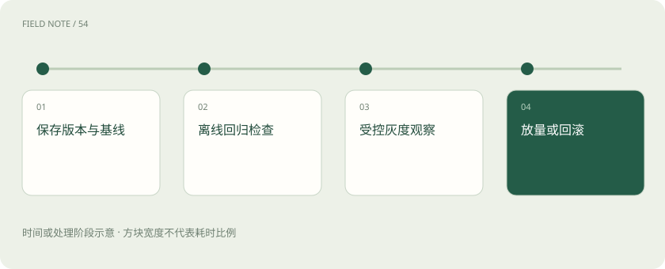

# 回归、灰度与回滚：模型更新怎样避免越升级越差？

> 升级前重做重要旧任务，上线时先小范围试用，并确认出问题后能恢复和补救。

专题：评测运行 · 整理于 2026-11-04

## 先说这篇在讲什么

给助手升级，像餐厅换菜谱：试吃满意后，先让少量顾客尝试，还要能恢复旧做法。但助手不只有一个模型，它还带着提示词、资料库和操作工具。更新前记清这套组合，更新后观察真实表现，出问题时才知道该恢复什么、哪些已办事项还需补救。

## 先看一个具体例子

新版摘要通常更好，却把“审批未完成”说成“审批通过”。即使平均分上涨，这种关键状态错误仍应挡住发布或触发退回旧版。

## 遇到陌生概念，可以先读

展开前置阅读建议

- [大模型评测：不要只问排行榜第一是谁](evaluation.md)
- [工具可靠性：接口成功为何仍可能办错事](agent-tool-reliability.md)

## 先用一个类比理解

像餐厅换菜谱，试吃后先供少量桌，还要留着旧配方；过敏原标识错了，不能靠其他菜更好吃来抵消。

类比只帮助建立直觉，不等同于完整机制。

## 一图看懂

## 记下整套配方，才能解释味道为什么变

助手的回答由模型、提示词、工具说明、检索资料、请求路由和生成参数一起决定。即使模型名字没变，内部修订也可能不同。把这些版本和实际调用的服务记下来，才知道新旧差在哪。如果同时改了模型、资料和提示词，发现效果变差时很难判断原因，最好让每次比较中的变化清楚可查。

## 用做过的重要任务检查有没有退步

升级前，把新系统放回过去的重要任务里试一遍，这叫回归测试。测试里既要有真实出错案例，也要有长期稳定的关键任务和容易踩线的问题。不能只看总分，还要单独检查有没有假报工具成功、越权读取资料。旧题也要定期审查：制度更新后答案本来就该改变，这种变化不能误判成能力退步。

## 先让少量用户试用，再决定是否扩大

只让一小部分明确选定的用户使用新版，叫灰度发布。期间看任务完成、异常操作、耗时、投诉和费用，再决定是否扩大范围。重要业务可以先复制请求给新版观察但不采用答案，或暂时只允许查询。灰度主要限制出问题时影响多少人；随机 A/B 主要比较哪个方案更好。两者能一起用，但小范围试用本身不保证比较公平。

## 恢复旧助手，不等于撤销它做过的事

回滚就是切回旧版本。但新助手已经发出的消息、写入的记忆、提交的订单不会随模型一起消失。发布前要说清遇到什么问题就停止，哪些状态能随旧版继续用，哪些动作需要补偿或人工处理。旧模型资源和配置也要保留，并实际演练一次切换，不能等故障发生才发现旧服务已经启动不了。

## 读完先记住这一句

先检查旧任务，再小范围试用，并提前验证恢复旧版和补救业务动作的方法。

## 常见误区

离线题全过不代表以后不会出错；切回旧模型也不会自动撤销它已经做过的业务操作。

## 想一想

切回旧模型，已经提交的订单会自动消失吗？

查看解释

不会。订单有自己的业务状态，需要按事先安排取消、补偿或交给人工处理。

## 关联阅读

- [评测集怎么分：避免把背过的题当能力](eval-splits.md)
- [线上 A/B：离线高分之后还要看什么](online-ab.md)
- [可观测性与安全：回答错了，应该查哪里？](observability-security.md)

## 原始资料

- [MLflow · 模型版本与别名](https://mlflow.org/docs/latest/ml/model-registry/)
- [Kubernetes · Deployment 与回滚](https://kubernetes.io/docs/concepts/workloads/controllers/deployment/)
- [Langfuse · 数据集与实验](https://langfuse.com/docs/evaluation/overview)

原创讲解；图示和类比经过简化，数字示例不代表实测。工具功能以对应版本官方资料为准。
