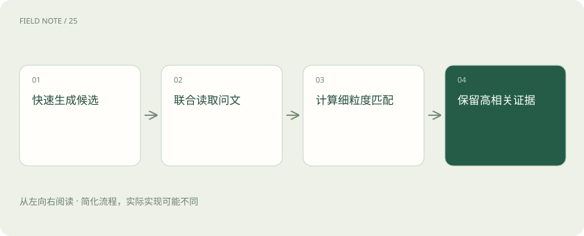

# 重排：候选找到了，为什么还要再排一次

> 召回阶段追求从大集合快速找出可能相关的材料，重排阶段对较小候选集做更细的查询与文档匹配。

专题：AI 应用 · 整理于 2026-11-04

## 前置阅读

- [混合检索与 RRF：让关键词和语义互补](hybrid-rrf.md)

## 先用一个类比理解

像海选后逐份面试，面试官只能看进入候选名单的人。

类比只帮助建立直觉，不等同于完整机制。

## 一图看懂

## 概念边界

召回阶段追求从大集合快速找出可能相关的材料，重排阶段对较小候选集做更细的查询与文档匹配。交叉编码器联合读取两者，通常比独立向量相似度表达更细的条件关系，但计算代价也不同。

## 内部怎样运作

重排只能处理已进入候选集的材料，不能修复漏召回。要控制候选数、文档长度和超时，并识别内容相关但已过期或无权访问的条目。业务过滤不能仅依赖模型给出的相关性分数。

## 把机制放进具体场景

查询“保修期外是否免费维修”时，包含“保修期内免费”的页面可能因关键词重合排前。重排器联合阅读问题和段落，有机会识别条件相反；若正确条款从未召回，重排再精细也无法选中它。

## 取舍与容易忽略的限制

重排分数通常表示特定模型下的相对匹配程度，不宜当成跨模型通用的概率阈值。候选过长可能被截断，关键限制恰好在截断处时，精排也会误判。应把权威性、时效性和权限作为独立约束处理，避免要求相关性模型同时承担它没有被训练保证的业务判断。

## 真实场景

用户只问某一机型，召回列表却包含同系列其他机型。重排应阅读具体型号及限制，不能因为维修步骤大致相似就把它们当成可互换证据。

## 常见误区

排在最前面的文档只是较符合检索目标，不自动成为事实权威。

## 想一想

重排能补回没有进入候选集的文档吗？

查看解释

不能，必须先改善召回或增加新的检索路径。

## 关联阅读

- [混合检索与 RRF：让关键词和语义互补](hybrid-rrf.md)
- [Recall、MRR 与 nDCG：检索到底好在哪](retrieval-metrics.md)
- [解析与切块：知识库先要读对文档](rag-parsing.md)

## 原始资料

- [README.html](https://www.sbert.net/examples/cross_encoder/applications/README.html)

原创讲解；图示和类比经过简化，数字示例不代表实测。工具功能以对应版本官方资料为准。
