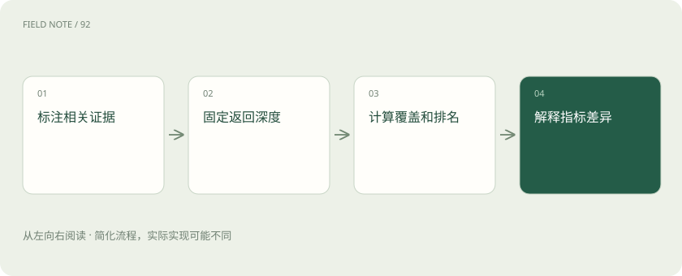

# Recall、MRR 与 nDCG：检索到底好在哪

> Recall 关注相关材料找回了多少，Precision 关注返回结果有多少相关。

专题：评测运行 · 整理于 2026-11-04

## 前置阅读

- [RAG：让模型先查资料，再组织答案](rag.md)

## 先用一个类比理解

像评价找书：既要看漏了多少，也要看第一本有用的书排多远。

类比只帮助建立直觉，不等同于完整机制。

## 一图看懂

## 概念边界

Recall 关注相关材料找回了多少，Precision 关注返回结果有多少相关。MRR 关注第一个相关结果的位置，nDCG 可以表达不同相关程度并考虑排序位置；每项指标回答的问题不一样。

## 内部怎样运作

评价前应明确问题、候选知识范围和相关性标注。某问题可能有多份等价证据，也可能必须同时命中条件和例外条款。只标注一份答案会把合理替代证据误判为错误。

## 把机制放进具体场景

假设有4份相关材料，前5条结果找回其中3份，则 Recall@5=3/4=75%，Precision@5=3/5=60%。另有两个查询，第一个相关结果分别在第1、4位，MRR=(1+1/4)/2=0.625。它不区分第一条之后还有多少有用结果。

## 取舍与容易忽略的限制

指标必须绑定返回深度和标注范围，脱离这些条件比较数值容易失真。只标一份标准证据会惩罚等价来源，只判断主题相关又可能放过条件相反的段落。对于必须同时找到主规则和例外的任务，还应单独检查证据组合是否齐全，因为首条命中无法代表推理所需信息已经具备。

## 放在一起对比

| 方式或概念 | 主要作用 | 关键边界 |
| --- | --- | --- |
| Recall | 相关材料找回比例 | 不表达无关结果多少 |
| MRR | 首个相关结果名次倒数均值 | 忽略后续覆盖 |
| nDCG | 相关等级与位置 | 需要可靠标注 |

## 真实场景

询问退货期限时，命中一般规则却漏掉定制商品例外，表面上已找到相关材料，答案仍可能错误。证据标注应包含这类必要组合。

## 常见误区

检索指标提升不保证最终回答提升，还要测证据是否真正支持回答。

## 想一想

只提高 MRR，是否保证相关材料都被找回？

查看解释

不保证，MRR重视首个相关结果，覆盖程度还要看 Recall 等指标。

## 关联阅读

- [混合检索与 RRF：让关键词和语义互补](hybrid-rrf.md)
- [重排：候选找到了，为什么还要再排一次](reranking.md)
- [大模型评测：不要只问排行榜第一是谁](evaluation.md)

## 原始资料

- [Elasticsearch · Ranking evaluation](https://www.elastic.co/docs/reference/elasticsearch/rest-apis/search-rank-eval)

原创讲解；图示和类比经过简化，数字示例不代表实测。工具功能以对应版本官方资料为准。
