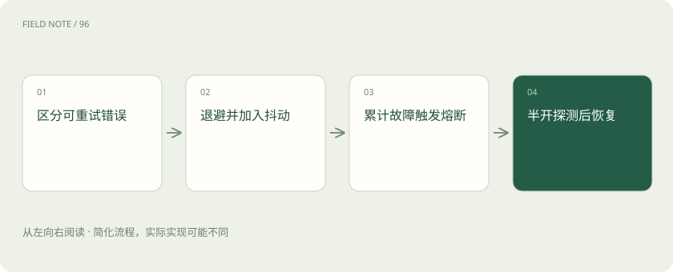

# 重试与熔断：故障时怎样避免越救越忙

> 暂时失败可以稍后再试，持续故障则先停止涌入，让服务有机会恢复。

专题：接入平台 · 整理于 2026-11-04

## 先说这篇在讲什么

餐厅突然太忙，所有人立刻重新打电话，只会更忙。模型服务故障时也一样。重试、退避、抖动和熔断，都是为了控制“再试一次”的时机与范围，而不是无限重复同一个请求。

## 先看一个具体例子

参数缺少必填字段时，退避等待并不能修复请求；应返回明确错误。临时网络中断则可在总时限内重试，两者不应共用无限尝试策略。

## 遇到陌生概念，可以先读

展开前置阅读建议

- [推理网关：为什么企业不直接调用模型？](gateway.md)

## 先用一个类比理解

像故障电梯，短暂等待可以再试，持续损坏则先封闭检修。

类比只帮助建立直觉，不等同于完整机制。

## 一图看懂

## 先看失败有没有可能暂时恢复

网络偶发中断或短时限流，有时等待后可以恢复；参数写错、没有权限，通常不会因为多发几次就变对。限流表示短时间请求太多。先区分原因，再决定是否值得重试，才能避免多花钱却重复同样错误。

## 退避和抖动：晚一点，而且别一起回来

退避是每次失败后拉长等待间隔；指数退避是一种让间隔逐步成倍增加的安排。随机抖动则把时间稍微错开。这样许多客户端不会在同一秒钟再次冲过来，形成第二波拥堵。

## 熔断：连续出问题，就先暂停

熔断可以先理解为暂时关闭某条故障路径。等待一段时间后，只放少量请求探测；稳定后再逐步恢复。某个模型端点出错，不一定表示所有服务都坏了，所以暂停范围应与实际故障对应。

## 用户已经放弃，后台别一直重试

整项任务应有总时限和费用限制。一次次重试即使各自没超时，加起来也可能超过用户能等的时间。若涉及退款或提交订单，还要先查此前是否已执行，不能把重复请求变成重复操作。

## 读完先记住这一句

重试要有次数和时限，持续故障时要停下来，再少量试探恢复。

## 常见误区

多层服务各自重试可能成倍放大流量，应给整条请求链设总时限与尝试预算。

## 想一想

为什么不能给所有失败都无限重试？

查看解释

参数错误通常不会自行恢复，重试还会放大流量并耗尽请求时限。

## 关联阅读

- [配额、预算与计量：三个不同的控制面](gateway-budgets.md)
- [工具可靠性：接口成功为何仍可能办错事](agent-tool-reliability.md)
- [智能路由与负载均衡：把请求交给谁？](routing.md)

## 原始资料

- [timeouts retries and backoff with jitter](https://aws.amazon.com/builders-library/timeouts-retries-and-backoff-with-jitter/)
- [Microsoft Azure · Circuit Breaker pattern](https://learn.microsoft.com/en-us/azure/architecture/patterns/circuit-breaker)

原创讲解；图示和类比经过简化，数字示例不代表实测。工具功能以对应版本官方资料为准。
