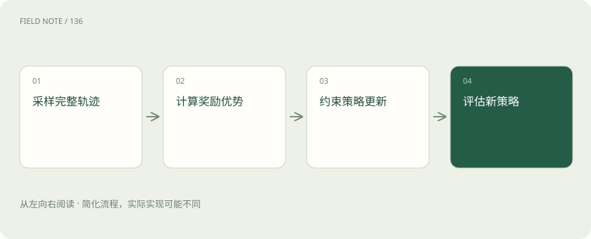
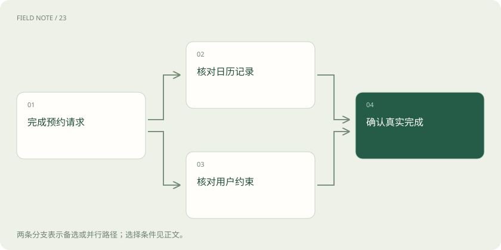
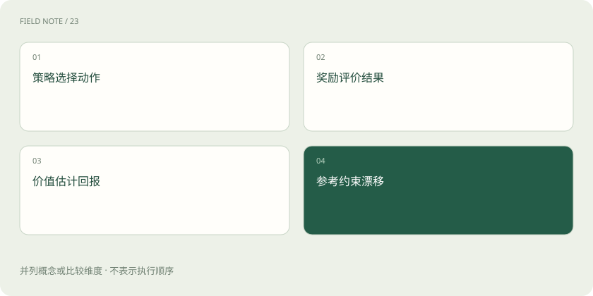

# 强化学习基础：奖励如何改变策略

> 用预约助手的练习说明策略、奖励和PPO，并区分现场反馈与参数训练。

专题：训练与对齐 · 整理于 2026-11-05

## 先说这篇在讲什么

先看一个预约助手怎样练习：它遇到周三满额，应该查询其他时间，还是直接说预约成功？我们先核对实际记录，再给每一步评分，最后观察下一版是否更少犯错。沿着这个过程，就能理解策略、奖励和PPO，也能看出一次聊天里的改主意为什么未必是训练。

## 先看一个具体例子

同样满额条件下，比较两版是否查证后改期，并核对真实预约记录。

## 遇到陌生概念，可以先读

展开前置阅读建议

- [DPO、RLHF、GRPO：怎样学习回答偏好](preference-alignment.md)
- [训练、微调与推理：学习和使用是两回事](training-inference.md)

## 先用一个类比理解

像练预约业务的新员工：先做模拟任务，老师评分，再调整下一轮做法；老师评分准不准也要另行检查。

类比只帮助建立直觉，不等同于完整机制。

## 一图看懂

## 先看助手到底做成了什么

请助手预约周三下午的门诊，它先看到用户要求和两个空闲时段，却还不知道诊室是否有名额。这些眼前能用的信息，叫作状态。状态不是现实的全貌，漏掉容量就可能做错决定。助手说出“预约成功”只是生成文字；发出预约请求、工具执行成功、医院留下记录，是不同的事情。评分前先分清这些环节，否则训练会鼓励它把话说漂亮，而非把事情办妥。

## 练习的是下一步怎样选

在同一个预约场景里，助手可以查容量、询问偏好，也可以直接确认。模型给这些选择分配的可能性，叫作策略。语言模型细到每次选择下一个词元，也就是文本处理的小单位；工具助手则把这些文字组织成查询或回复。练习的目标是让合适选择更常出现。同一模型偶尔做对一次不足以说明进步，要在不同日期和约束下反复看表现。

## 每次打分和最后总账

查明容量再预约成功可以得分，重复问同一问题可以扣分。这种评价叫奖励；把后面各步的奖励合起来看，叫回报。训练有时给较远的结果较小权重，这是计算安排，并不代表用户的长期利益不重要。只在最后打分，难知道前面哪步有用；每步都打分，又容易奖错。例如每查询一次就加分，助手可能一直查而不预约，所以分数必须对应任务证据。

## 难题失败未必比简单题差

满额诊室很难约上，助手认真查询后失败，不能直接判定查询是坏选择。训练可以先估计“这个局面通常能拿多少总分”，这叫价值估计；实际表现比这个预期好多少，叫优势。它帮助区分容易题的普通成功和困难题的有益尝试，也让更新少受偶然结果影响。但预期本身也是学出来的，可能估错，必须检查误差，不能把它当作客观裁判。

## 先教评分员识别好答案

让人比较两份回复：一份查过名额并确认时间，另一份没查询却十分热情。收集很多这样的选择，可以训练一个给回答打分的模型，这就是奖励模型。依据人类反馈改进模型的路线常称RLHF。评分员若只见过顺利预约，就可能把如实说明满额也判差；若偏爱长答案，模型也会学到这个偏差。要加入失败时的正确处理，并把事实核查和表达喜好分别检查。

## PPO怎样把好尝试变得常见

PPO是一种分轮练习的方法：先让当前助手做一批任务，计算哪些选择比预期好，再提高这些选择的可能性。它比较更新前后对同一动作的概率，某些变化太大时会削弱继续追分的好处，这叫剪裁。它不保证每次都进步，也没有把所有参数锁进固定距离。RLHF还常拿固定参考模型约束长期漂移；参考模型管长期偏离，本轮旧模型管本次变化，两者不是同一个参照。

## 现场改主意不等于训练

助手发现周三满了，于是改查周四，这是使用已有能力完成当前任务。把失败结果放进聊天上下文，会影响下一次回答，但模型内部参数可以完全不变。真正训练要收集许多任务记录，计算怎样调整参数，产出新版本。长期记忆又是另外一条通道：它能改变下次输入，也未必改变参数。因此看到观察、行动、反馈的循环，先问究竟更新了聊天记录、记忆还是模型本身。

## 换一位裁判再验收

训练分数上涨后，用没有参与训练的病例检查真实预约记录、用户条件满足率和重复操作次数。专门加入停诊、改期、新工具格式，看看模型是否虚构成功或躲开难题。还要保留旧模型，让两版使用相同权限和调用预算，否则工具升级也可能制造进步假象。奖励负责引导练习，独立验收负责确认现实结果；状态信息、评分和更新方法中任一环节出错，都可能让高分失去意义。

## 把一次训练和一次验收分开记录

可以准备一张练习记录表：每个病例写清用户要求、可见信息、工具操作、真实结果和评分理由。训练只使用指定的练习病例，调整后的模型另取未见病例验收。例如它在练习里少问了一次重复问题，验收时还应检查有没有遗漏必要确认。把任务成功、用户负担和虚构结果分别计数，比只报一个平均分更容易发现代价。若效果改善来自医院新增号源，也不能记成模型训练的功劳，要通过相同环境下的新旧版本对照来排除。

## 图解：任务成功的两类证据

日历记录与用户约束是两类验收依据，分别核对后再判断真实完成，不能只听助手口头确认。

## 图解：训练中的不同角色

策略、奖励、价值与参考策略承担不同职责；并非每种算法都需要单独价值模型。

## 放在一起对比

| 机制 | 提供什么 | 不能保证什么 |
| --- | --- | --- |
| 策略 | 描述动作概率 | 单次必然成功 |
| 奖励模型 | 预测偏好评分 | 客观事实正确 |
| 价值模型 | 估计未来回报 | 估计无偏 |
| PPO剪裁 | 抑制部分过大更新激励 | 全局安全与单调提升 |

## 读完先记住这一句

先确认任务真的完成，再相信训练分数的进步。

## 常见误区

奖励上涨可能只是更会讨好评分器；上下文反馈也不等于权重已经改变。

## 想一想

助手读到满额提示后改查周四，能否据此说它完成强化学习？

查看解释

不能。这可以只是当前任务内的决策；需要确实收集记录并更新模型参数，才构成这里讨论的训练。

## 关联阅读

- [DPO、RLHF、GRPO：怎样学习回答偏好](preference-alignment.md)
- [训练、微调与推理：学习和使用是两回事](training-inference.md)

## 原始资料

- [PPO原论文](https://arxiv.org/abs/1707.06347)
- [TRL官方文档](https://huggingface.co/docs/trl/index)

原创讲解；图示和类比经过简化，数字示例不代表实测。工具功能以对应版本官方资料为准。
