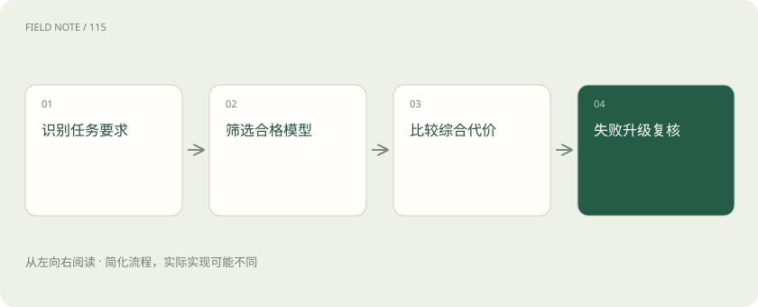

# 模型路由：质量、成本与失败代价怎么比

> 模型路由是在多个模型或服务之间选择处理请求的对象。

专题：接入平台 · 整理于 2026-11-04

## 前置阅读

- [智能路由与负载均衡：把请求交给谁？](routing.md)

## 先用一个类比理解

像总机选择接哪位专家，MoE 则更像专家脑内调用不同技能模块。

类比只帮助建立直觉，不等同于完整机制。

## 一图看懂

## 概念边界

模型路由是在多个模型或服务之间选择处理请求的对象。它与 MoE 不同：MoE 通常在模型内部按词元激活部分专家，应用路由则在调用边界选择模型，两者可以同时存在。

## 内部怎样运作

路由应先识别任务类别与最低质量要求，再比较价格、等待时间和失败后的补救成本。困难度判断也会出错，应保留升级路径。离线平均分不能掩盖少数高风险任务的大幅退化。

## 把机制放进具体场景

把订单号抽取交给较小模型、复杂合同解释交给能力更强的模型，属于应用路由。若小模型抽错导致人工返工，不能只比较每次接口单价；还应计入升级调用和补救成本，并保留难度误判的样本。

## 取舍与容易忽略的限制

路由策略自身也需要评价。若困难度分类器把长文本一律判为困难，可能增加费用却没有改善结果；若只根据历史平均延迟选择模型，又可能忽略当前排队。应保留任务类型和路由理由，并检查升级是否真正补救了首次失败，而不是让两次错误调用共同增加总成本。

## 放在一起对比

| 方式或概念 | 主要作用 | 关键边界 |
| --- | --- | --- |
| 模型路由 | 应用调用边界选择模型 | 比较质量和总成本 |
| MoE | 模型内部选择专家 | 关注词元分发与负载 |

## 真实场景

同一个合同审查请求可能包含简单字段抽取和复杂风险解释。按子任务路由比整份文档只选一个模型更灵活，但也增加结果衔接责任。

## 常见误区

便宜模型首次调用省钱，但若大量返工或升级，总成本可能增加。

## 想一想

应用层模型路由与 MoE 专家路由处于同一层吗？

查看解释

不是，前者选择模型服务，后者通常在模型内部选择参与词元计算的专家。

## 关联阅读

- [智能路由与负载均衡：把请求交给谁？](routing.md)
- [缓存感知路由：把请求送到有共同前缀的地方](cache-routing.md)
- [文本、多模态、推理模型与开源权重，怎么区分？](model-choices.md)

## 原始资料

- [RouteLLM: Learning to Route LLMs from Preference Data](https://arxiv.org/abs/2406.18665)

原创讲解；图示和类比经过简化，数字示例不代表实测。工具功能以对应版本官方资料为准。
